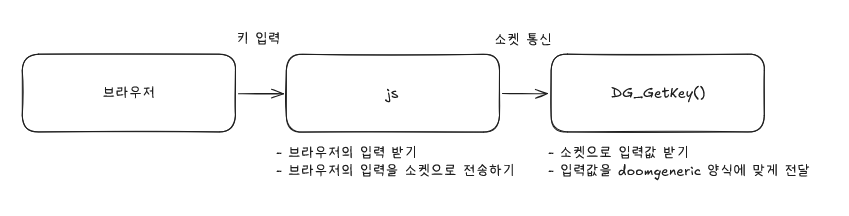
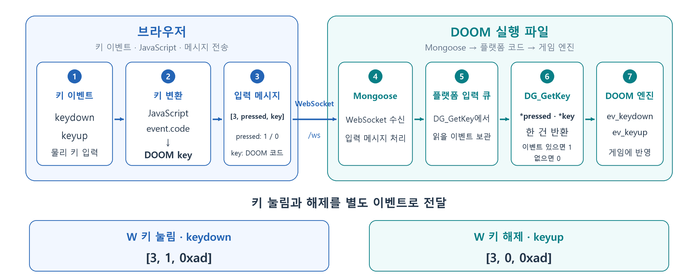

# 조작 입력 구현

화면 출력 구조를 구현한 뒤, 브라우저에서 받은 키 입력을 DOOM에 전달하는 작업을 진행했습니다. 화면 출력에 사용한 WebSocket의 양방향 통신을 활용해, 같은 연결로 게임 화면을 받고 키 입력을 보내도록 구성했습니다.

브라우저에서는 JavaScript로 키 입력을 인식하고, 장치에서는 받은 입력을 `DG_GetKey`를 통해 게임에 전달하는 방식입니다. 키를 누르는 순간과 놓는 순간을 구분하여 전달하고, 포커스가 바뀌어 키 해제 이벤트를 받지 못하는 상황도 처리하도록 구현했습니다.

## 준비

### 입력 구조

[화면 출력 구현](../화면%20출력%20구현/README.md) 단계에서는 `DG_GetKey`가 입력 없음으로 반환하도록 작성했습니다. 화면을 확인할 수는 있지만 게임을 직접 조작하려면, 이 함수가 실제 키 코드와 눌림 상태를 반환하도록 수정해야 합니다.

브라우저에서 발생한 키 입력을 JavaScript가 받아 WebSocket으로 보내고, DOOM 바이너리가 이를 게임 입력으로 처리하는 구조를 구상했습니다. 입력 구조 구상은 다음과 같습니다.



위 그림은 브라우저에서 게임으로 입력을 전달하는 방향을 간략히 표현한 것입니다. 실제 구현에서는 Mongoose의 수신 처리와 입력 큐를 거친 뒤 `DG_GetKey`가 입력을 반환하도록 역할을 나누었습니다. 큐는 처리할 데이터를 들어온 순서대로 보관하는 공간입니다.

입력 전달 흐름을 정리하면 다음과 같습니다.

1. 유저가 브라우저의 게임 화면을 클릭하여 브라우저가 키보드 입력을 받는다
2. JavaScript가 키 눌림과 해제 이벤트를 인식한다
3. 입력한 키를 JavaScript가 DOOM에서 사용하는 키 코드로 변환하고 WebSocket 메시지로 보낸다
4. 장치의 수신 처리에서 입력을 큐로 전달한다
5. `DG_GetKey`가 입력 이벤트를 하나씩 읽어 키 코드와 눌림 상태를 반환한다
6. DOOM이 전달받은 값을 doom 게임 입력겂으로 정리한다


키 눌림과 해제를 확인하는 이유는 어떤 키를 계속 누르고 있는지 doom이 확인해 이동·공격을 처리하기 때문입니다. 웹소켓으로 데이터 전송시 누른 키만 전송하게 되면 언제 해제되었는지 인식하지 못해 그 입력이 누른 채로 고정되기 때문입니다.

## 구현

### 브라우저에서 키 입력 인식

키 입력은 브라우저의 `keydown`과 `keyup` 이벤트로 처리했습니다. `keydown`은 키를 눌렀을 때, `keyup`은 키를 놓았을 때 발생하는 이벤트입니다.

게임 화면인 Canvas에 `tabindex="0"`을 지정하고, 화면을 클릭하면 `focus()`를 호출하도록 작성했습니다. 포커스는 키보드 입력을 받을 대상을 지정하는 것으로, 게임 화면을 클릭한 뒤 조작할 수 있도록 구성했습니다.

```javascript
canvas.addEventListener("pointerdown", () => canvas.focus({ preventScroll: true }));
```

키 눌림은 Canvas에서 받고, 키 해제는 `window`에서 받도록 작성했습니다. 이를 통해 키를 놓을 때에는 브라우저 창 범위에서 해제 이벤트를 처리할 수 있도록 했습니다. 게임에서 사용하는 키에는 `event.preventDefault()`를 적용하여, Space나 Tab을 눌렀을 때 화면 스크롤이나 포커스 이동 같은 브라우저의 기본 동작이 조작을 방해하지 않도록 했습니다.

### 키 코드 변환

브라우저에서 받은 키 이름을 그대로 전송하지 않고, DOOM에서 사용하는 1바이트 키 코드로 변환했습니다. `event.code`의 `KeyW`, `ArrowUp`, `Space` 같은 값을 키 매핑 표에서 찾아 대응하는 코드를 반환하도록 작성했습니다.

예를 들어 W와 위쪽 방향키는 모두 전진에 해당하는 `0xad`로 변환했습니다. 웹 페이지의 매핑은 다음과 같습니다.

```javascript
const keyMap = {
  KeyW: 0xad, KeyS: 0xaf, KeyA: 0xa0, KeyD: 0xa1,
  KeyQ: 0xac, KeyE: 0xae,
  ArrowUp: 0xad, ArrowDown: 0xaf, ArrowLeft: 0xac, ArrowRight: 0xae,
  ControlLeft: 0xa2, ControlRight: 0xa2, Space: 0xa3,
  ShiftLeft: 0xb6, ShiftRight: 0xb6,
  Enter: 13, NumpadEnter: 13, Escape: 27, Tab: 9
};
```

표에 지정한 키를 먼저 변환하고, 나머지 알파벳은 소문자 ASCII 코드로, 키보드 상단의 숫자 키는 숫자의 ASCII 코드로 변환했습니다. ASCII는 문자와 숫자에 번호를 대응시키는 문자 코드입니다. 처리할 수 없는 키는 전송하지 않도록 했습니다.

### 입력 메시지 구성

키 입력은 `Uint8Array`로 작성한 바이너리 메시지로 전송했습니다. `Uint8Array`는 각 항목을 1바이트 값으로 저장하는 배열입니다.

키 눌림과 해제 메시지는 각각 다음과 같습니다.

```javascript
socket.send(new Uint8Array([3, 1, key]));  // 키 눌림
socket.send(new Uint8Array([3, 0, key]));  // 키 해제
```

두 메시지는 모두 3바이트이며, 첫 바이트는 입력 메시지라는 뜻의 `3`, 두 번째 바이트는 눌림 상태, 마지막 바이트는 변환한 DOOM 키 코드입니다.

| 시작 위치 | 크기 | 내용 |
| --- | --- | --- |
| 0 | 1바이트 | 키 입력 메시지 종류인 `3` |
| 1 | 1바이트 | 눌림은 `1`, 해제는 `0` |
| 2 | 1바이트 | DOOM 키 코드 |

W를 눌렀을 때에는 `[3, 1, 0xad]`, 놓았을 때에는 `[3, 0, 0xad]`를 보냅니다. 여러 키의 눌림 상태를 한 번에 정리할 때에는 `[4]`라는 1바이트 메시지를 보내 전체 해제를 요청하도록 구성했습니다.

이 메시지들은 화면 처리가 끝났음을 알리는 ACK와 구분합니다. 같은 `/ws` 연결을 사용하더라도, 화면 ACK는 프레임 번호를 전달하고 키 입력 메시지는 키 코드와 눌림 상태를 전달합니다.

### 입력 큐와 DG_GetKey

장치에서는 WebSocket 수신과 게임의 입력 처리 시점을 연결하기 위해 입력 큐를 사용했습니다. `DG_GetKey`는 소켓에서 직접 데이터를 읽는 함수가 아니라, 준비된 입력 이벤트를 읽어 게임에 반환하는 함수입니다.

`DG_GetKey` 구현은 다음과 같습니다.

```c
int DG_GetKey(int *pressed, unsigned char *key) {
    struct key_event event;
    while (s_release_key < sizeof(s_delivered_keys)) {
        unsigned int previous_key = s_release_key++;
        if (s_delivered_keys[previous_key]) {
            s_delivered_keys[previous_key] = 0;
            *pressed = 0;
            *key = (unsigned char) previous_key;
            return 1;
        }
    }
    if (s_key_count == 0) return 0;
    event = s_keys[s_key_read];
    s_key_read = (s_key_read + 1u) % KEY_QUEUE_SIZE;
    --s_key_count;
    s_delivered_keys[event.key] = event.pressed;
    *pressed = event.pressed;
    *key = event.key;
    return 1;
}
```

앞부분의 반복문은 키 해제 순회가 진행 중일 때, 게임에 눌림으로 전달했던 키를 찾아 해제 이벤트로 반환합니다. `s_delivered_keys`에 기록된 상태를 지우고 `pressed`에 `0`을 넣어 한 번의 호출에서 키 하나를 해제합니다. 다음 호출에서는 증가한 `s_release_key` 위치부터 이어서 확인합니다.

반복문이 끝나면 일반 입력 큐를 읽습니다. `s_key_count`가 `0`이면 전달할 이벤트가 없으므로 `0`을 반환하고, 이벤트가 있으면 `s_keys[s_key_read]`에서 하나를 꺼냅니다. 읽기 위치는 나머지 연산인 `% KEY_QUEUE_SIZE`로 배열 끝에서 처음으로 돌아가도록 원형 큐로 구성했습니다.

이후 이벤트 개수를 줄이고, `pressed`에는 눌림 여부를, `key`에는 키 코드를 기록한 뒤 `1`을 반환합니다.

doomgeneric의 현재 공개 입력 처리 코드에서는 이 반환값을 받아 눌림이면 `ev_keydown`, 해제면 `ev_keyup` 이벤트를 만들고 `D_PostEvent`로 엔진에 전달합니다. 이 연결 방식은 [doomgeneric의 입력 처리 코드](https://github.com/ozkl/doomgeneric/blob/master/doomgeneric/i_input.c)에서 확인할 수 있습니다.

### 중복 입력 처리

키를 길게 누르면 브라우저가 `keydown`을 반복해서 발생시킵니다. 같은 키의 눌림 메시지가 계속 전송되지 않도록, `event.repeat`인 이벤트와 이미 눌린 물리 키는 처리하지 않도록 작성했습니다.

또한 서로 다른 물리 키가 같은 DOOM 키 코드에 대응할 수 있으므로, 다음 두 상태를 따로 관리했습니다.

| 상태 | 관리하는 내용 |
| --- | --- |
| `heldCodes` | 눌려 있는 물리 키의 `event.code`를 저장하는 Set |
| `heldKeys` | DOOM 키 코드마다 눌려 있는 물리 키 개수를 저장하는 Map |

Set은 같은 항목을 중복해서 저장하지 않는 구조이며, Map은 키 코드와 그에 대응하는 값을 연결해 저장하는 구조입니다. 키가 처음 눌렸을 때의 주요 처리는 다음과 같습니다.

```javascript
heldCodes.add(event.code);
const count = heldKeys.get(key) || 0;
heldKeys.set(key, count + 1);
if (count === 0) socket.send(new Uint8Array([3, 1, key]));
```

예를 들어 W와 위쪽 방향키는 모두 `0xad`에 대응합니다. W를 누른 상태에서 위쪽 방향키까지 누르면 해당 코드의 개수는 2가 되지만, 눌림 메시지는 처음 한 번만 보냅니다. 이후 W만 놓으면 개수가 1이므로 해제를 보내지 않고, 위쪽 방향키까지 놓아 0이 되었을 때 해제 메시지를 보냅니다.

이를 통해 여러 물리 키가 같은 게임 동작에 연결되어 있어도, 한쪽 키를 먼저 놓았다는 이유로 다른 쪽 키의 동작까지 해제되지 않도록 구성했습니다.

## 조작 방법 및 구현 결과

게임 페이지에 접속해 화면이 표시되면 화면을 클릭합니다. 이후 다음 키로 게임을 조작하도록 코드를 구성했습니다.

| 키 | 게임 동작 | 전송하는 DOOM 키 코드 |
| --- | --- | --- |
| W / S | 전진 / 후진 | `0xad` / `0xaf` |
| A / D | 왼쪽 / 오른쪽 이동 | `0xa0` / `0xa1` |
| Q / E | 왼쪽 / 오른쪽 회전 | `0xac` / `0xae` |
| ↑ / ↓ | 전진 / 후진 | W / S와 같은 코드 |
| ← / → | 왼쪽 / 오른쪽 회전 | Q / E와 같은 코드 |
| Enter | 선택 | `13` |
| Space | 사격 | `0xa3` |
| Ctrl | 문 열기 및 사용 | `0xa2` |
| Shift | 달리기 | `0xb6` |
| 키보드 상단의 숫자 1~7 | 무기 선택 | ASCII `49`~`55` |
| Tab | 지도 표시 | `9` |

브라우저의 키 인식과 코드 변환, WebSocket 메시지 전송, `DG_GetKey`의 이벤트 반환을 연결해 입력 구조를 구현했습니다. 키 눌림과 해제를 구분하고 중복 입력을 처리하여, 화면 출력에 이어 게임 조작을 지원하도록 구성했습니다.

실기기에서의 조작 결과와 입력 지연은 [실기기 동작 확인](../../실험%20및%20결과/실기기%20동작%20확인/README.md) 단계에서 기록합니다.
