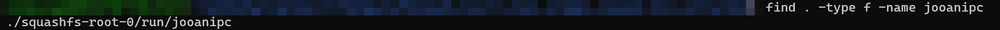
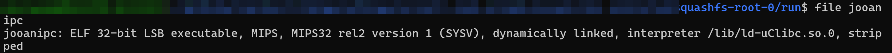
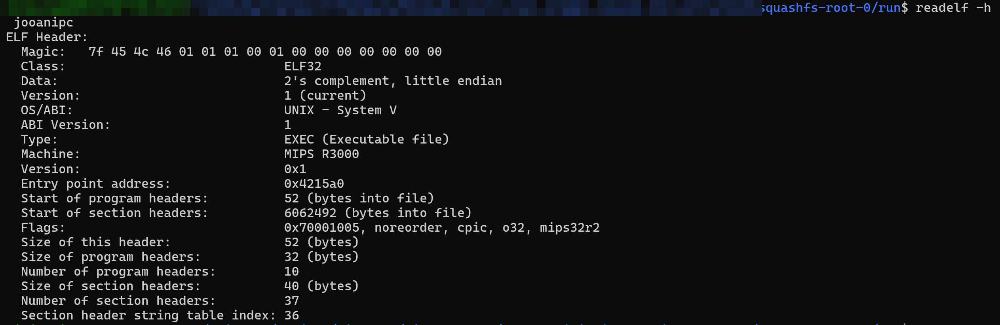
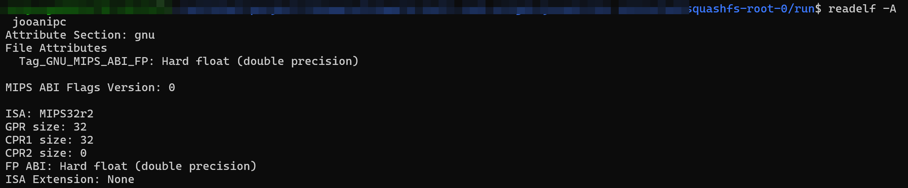
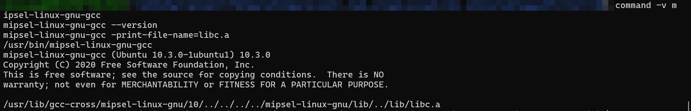

# 크로스 컴파일 환경 구성

## 구성 목적

크로스컴파일은 개발 PC에서 다른 CPU를 사용하는 장치용 실행 파일을 만드는 작업입니다. 이 절에서는 실제 추출한 카메라 펌웨어에서 실행 규격을 확인하고, 그 규격에 맞는 정적 빌드 환경을 구성합니다.

작업 순서는 대상 규격 확인 → 도구 설치 → 작은 C 프로그램 빌드 → 생성물 검사입니다. 아래 명령은 WSL Ubuntu에서 수행하며, 개인 경로 대신 각 단계에 설명한 파일이 있는 폴더에서 진행합니다. 원본 분석 출력과 새로 빌드할 프로그램의 검증 기준을 구분하여 기록합니다. `file`·`readelf`가 없다면 ‘개발 환경과 필수 도구 설치’의 도구 설치를 먼저 수행합니다.

<br>

## 대상 실행 규격

먼저 어떤 형식의 실행 파일을 만들어야 하는지 조사합니다. 실제 추출한 펌웨어에 포함되어 있고 부팅 스크립트에서 실행 명령을 확인한 `jooanipc`를 기준으로 삼습니다.

| 필요한 정보 | 확인하는 이유 |
|---|---|
| CPU 계열 | 대상 CPU가 이해하는 명령어를 만드는 컴파일러를 선택하기 위해 확인합니다. |
| 32비트·64비트 | 실행 파일과 주소·포인터 규격을 맞추기 위해 확인합니다. |
| 엔디언 | 여러 바이트로 된 값을 저장하고 읽는 순서를 맞추기 위해 확인합니다. |
| 명령어 집합(ISA) 버전 | CPU가 지원하지 않는 명령어가 생성되지 않도록 확인합니다. |
| ABI | 함수 인자·반환값 전달과 레지스터 사용 규칙을 맞추기 위해 확인합니다. |
| 부동소수점 규격 | 실수 연산 및 실수 값 전달 방식, 레지스터 규격을 맞추기 위해 확인합니다. |

<br>

### 1. 기준 실행 파일 찾기

추출한 파일시스템 폴더들이 들어 있는 폴더에서 파일을 찾습니다.

```bash
find . -type f -name jooanipc
```



*그림. 추출한 파일시스템에서 `jooanipc` 위치를 검색한 결과*

출력에는 파일까지의 경로가 표시됩니다. 찾은 `jooanipc`가 있는 폴더로 이동한 뒤 다음 분석 명령을 실행합니다.

<br>

### 2. CPU·비트 수·엔디언 확인

다음 명령어를 통해 `jooanipc`의 파일 형식, CPU 계열, 비트 수와 엔디언을 확인합니다. `file`은 파일 내부의 식별 정보를 분석하여 파일 종류와 실행 규격을 보여주는 명령어입니다.

```bash
file jooanipc
```

앞선 분석에서 확인한 출력은 다음과 같습니다.

```text
jooanipc: ELF 32-bit LSB executable, MIPS, MIPS32 rel2 version 1 (SYSV), dynamically linked, interpreter /lib/ld-uClibc.so.0, stripped
```



*그림. `jooanipc`의 파일 형식과 실행 규격을 확인한 결과*

`ELF 32-bit`는 32비트, `LSB`는 리틀 엔디언, `MIPS32 rel2`는 MIPS32 Release 2를 나타냅니다.

<br>

### 3. ABI와 부동소수점 규격 확인

ELF는 실행 파일 형식입니다. `readelf -h`는 ELF 헤더를 읽습니다.

```bash
readelf -h jooanipc
```



*그림. `jooanipc`의 ELF 헤더를 확인한 결과*

`Class: ELF32`, `Data: little endian`, `Flags`의 `o32`·`mips32r2`를 확인합니다. 여기서 `o32`가 ABI입니다. `Machine: MIPS R3000`이라는 표시만으로 실제 CPU 모델을 R3000이라고 판단하지 않습니다.

`-A`는 MIPS 전용 속성을 읽습니다.

```bash
readelf -A jooanipc
```



*그림. `jooanipc`의 MIPS ISA와 부동소수점 ABI를 확인한 결과*

앞선 분석에서 확인한 주요 출력은 다음과 같습니다.

```text
ISA: MIPS32r2
CPR1 size: 32
FP ABI: Hard float (double precision)
```

부동소수점 ABI는 hard-float이며 레지스터 규격은 FP32입니다. 이는 프로그램의 규격이고, 물리적 FPU 유무를 이 출력만으로 확정하는 것은 아닙니다.

<br>

## 툴체인 선정 및 링크 방식

이제 조사한 규격의 실행 파일을 만들 개발 도구를 선택합니다. 툴체인은 컴파일러·어셈블러·링커·대상용 라이브러리를 포함하는 도구 묶음입니다. 여기서는 Ubuntu의 `mipsel-linux-gnu-` 툴체인과 정적 링크를 사용합니다.

libc는 `puts()`의 문자열 출력, `malloc()`의 메모리 할당 같은 C 기본 기능을 구현한 라이브러리입니다. 정적 링크는 프로그램이 사용하는 라이브러리 코드를 빌드할 때 실행 파일에 포함하는 방식입니다. 개발자가 코드를 직접 복사하는 것이 아니라, `-static` 옵션을 지정하면 링커가 준비된 정적 라이브러리에서 필요한 부분을 가져옵니다. [GCC 링크 옵션](https://gcc.gnu.org/onlinedocs/gcc/Link-Options.html)

정적 빌드는 필요한 라이브러리 코드를 실행 파일에 포함하므로 대상 파일시스템의 공유 라이브러리 의존성을 줄일 수 있습니다. 다만 CPU·ABI·커널 호환성까지 자동으로 해결되는 것은 아닙니다.

<br>

## 개발 환경과 필수 도구 설치

패키지 목록을 갱신하고 크로스컴파일에 필요한 도구를 설치합니다. `apt update`는 설치 가능한 패키지 목록을 갱신하고, `apt install`은 지정한 도구를 설치하는 명령어입니다. 아래 명령은 WSL Ubuntu의 어느 작업 폴더에서 실행해도 됩니다.

```bash
sudo apt update
sudo apt install make gcc-mipsel-linux-gnu binutils-mipsel-linux-gnu libc6-dev-mipsel-cross binutils file nano
```

`gcc-mipsel-linux-gnu`는 대상 컴파일러, `libc6-dev-mipsel-cross`는 MIPS용 C 개발 라이브러리입니다. `make`는 빌드 설정을 실행하고, `binutils`와 `file`은 생성물을 검사하는 데 사용합니다.

설치 후 컴파일러 경로·버전과 정적 C 라이브러리 위치를 확인합니다.

```bash
command -v mipsel-linux-gnu-gcc
mipsel-linux-gnu-gcc --version
mipsel-linux-gnu-gcc -print-file-name=libc.a
```



*그림. MIPS 크로스컴파일러와 정적 C 라이브러리 설치를 확인한 결과*

실행 경로와 GCC 버전이 출력되어야 합니다. 마지막 명령은 정적 C 라이브러리 `libc.a`의 경로를 출력합니다. 이름만 출력되거나 명령을 찾지 못하면 설치 상태를 점검합니다.

<br>

## Makefile 구성 및 빌드 절차

지금 하는 작업은 작은 프로그램으로 컴파일러와 대상 라이브러리가 정상적으로 연결되는지 점검하는 것입니다.

<br>

### 1. 점검용 소스 작성

비어 있는 실습 폴더에서 다음 명령으로 소스를 작성합니다.

```bash
nano cross_compile_test.c
```

다음 내용을 넣고 `Ctrl+O`, Enter로 저장한 뒤 `Ctrl+X`로 종료합니다.

```c
#include <stdio.h>

int main(void) {
    puts("Cross compilation test");
    return 0;
}
```

문자열 한 줄을 출력하는 프로그램입니다. `stdio.h`는 함수의 선언을 제공하며, `puts()`의 구현은 링크 단계에서 libc로부터 연결됩니다.

<br>

### 2. Makefile 작성

Makefile은 사용할 컴파일러·옵션·입력 파일·출력 파일을 정리하는 빌드 설정 파일입니다. 소스가 있는 같은 폴더에서 작성합니다.

분석에서 확인한 대상 규격을 다음과 같이 빌드 설정에 반영합니다. 정적 링크는 원본 실행 파일의 규격이 아니라 이번 빌드에서 선택한 방식입니다.

| 확인한 대상 규격 또는 선택한 방식 | 빌드에 반영하는 설정 |
|---|---|
| MIPS·리틀 엔디언·Linux | `mipsel-linux-gnu-gcc`, `-EL` |
| 32비트·O32 ABI | `-mabi=32` |
| MIPS32r2 | `-mips32r2` |
| Hard-float·FP32 | `-mhard-float -mfp32` |
| 정적 링크 선택 | `-static` |

```bash
nano Makefile
```

아래 내용을 저장합니다. `$(CC)`로 시작하는 명령 줄은 Tab 한 번으로 시작해야 합니다.

```make
CC = mipsel-linux-gnu-gcc
CFLAGS = -Os -Wall -EL -mips32r2 -mabi=32 -mhard-float -mfp32
LDFLAGS = -static
OUTPUT = cross_compile_test_mips

$(OUTPUT): cross_compile_test.c Makefile
	$(CC) $(CFLAGS) cross_compile_test.c $(LDFLAGS) -o $(OUTPUT)
```

CPU·ABI 옵션은 원본 분석 결과에 맞춥니다. `-EL`은 리틀 엔디언, `-mips32r2`는 ISA, `-mabi=32`는 O32, `-mhard-float -mfp32`는 부동소수점 규격입니다. `-Os`는 크기 최적화, `-Wall`은 경고 표시, `-static`은 정적 링크 옵션입니다. [GCC MIPS 옵션](https://gcc.gnu.org/onlinedocs/gcc/MIPS-Options.html)

<br>

### 3. 빌드

소스와 Makefile이 있는 폴더에서 실행합니다.

```bash
make
```

오류 없이 끝나면 `cross_compile_test_mips`가 생성됩니다. `missing separator`가 나오면 Makefile의 Tab을, 컴파일러를 찾지 못하면 도구 설치 상태를 확인합니다.

<br>

## 생성된 실행 파일 검증

지금 하는 작업은 생성물이 대상 규격과 정적 링크 설정에 맞는지 확인하는 것입니다. 생성된 실행 파일이 있는 폴더에서 실행하지 않고 내부 정보를 읽습니다.

```bash
file cross_compile_test_mips
readelf -h cross_compile_test_mips
readelf -A cross_compile_test_mips
```

`file`에서 `ELF 32-bit`, `LSB`, `MIPS32 rel2`, `statically linked`가 나오는지 확인합니다. `readelf`의 헤더·속성에서는 원본과 같은 O32·MIPS32r2·hard-float·FP32인지 비교합니다.

위 항목은 빌드 후 확인할 검증 기준입니다. 실제 명령과 출력을 기록하여 결과를 판단합니다.

<br>

## 구성 결과와 이후 활용

이 단계에서 준비하는 것은 카메라용 실행 파일을 만들 컴파일러, 대상용 라이브러리, 빌드 옵션과 검사 도구입니다. 작은 C 프로그램으로 기본 환경을 점검하며, 화면 출력이나 게임 기능은 아직 구현하지 않습니다.

향후 DOOM의 화면 출력·입력 등 필요한 구조가 완성되면, 점검용 C 소스 대신 DoomGeneric 소스와 직접 작성한 플랫폼 구현 소스를 빌드 대상으로 지정합니다. 사용하는 외부 라이브러리가 있다면 해당 소스도 함께 빌드하거나, 같은 대상 규격으로 만들어진 라이브러리를 연결합니다.

Makefile에서는 이번에 정한 컴파일러·CPU·ABI 옵션과 정적 링크 방식을 유지하고, 소스 목록·헤더 위치·필요한 라이브러리·출력 파일명을 실제 프로그램에 맞게 수정합니다. `make`를 실행하면 여러 소스를 컴파일하고 연결하여 카메라용 실행 파일을 생성합니다.

생성된 파일은 이번과 동일하게 `file`과 `readelf`로 규격을 검사한 뒤 카메라로 옮겨 실행을 확인합니다. 즉, 이번에 구축하는 환경은 완성된 DOOM 코드를 카메라가 실행할 수 있는 형식으로 만드는 데 사용합니다. 빌드 성공과 실제 카메라에서의 정상 동작은 구분하여 확인합니다.
