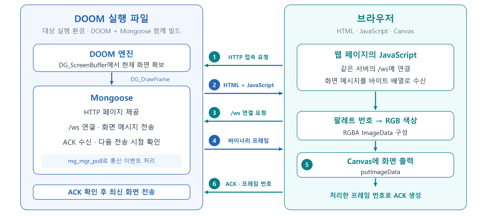
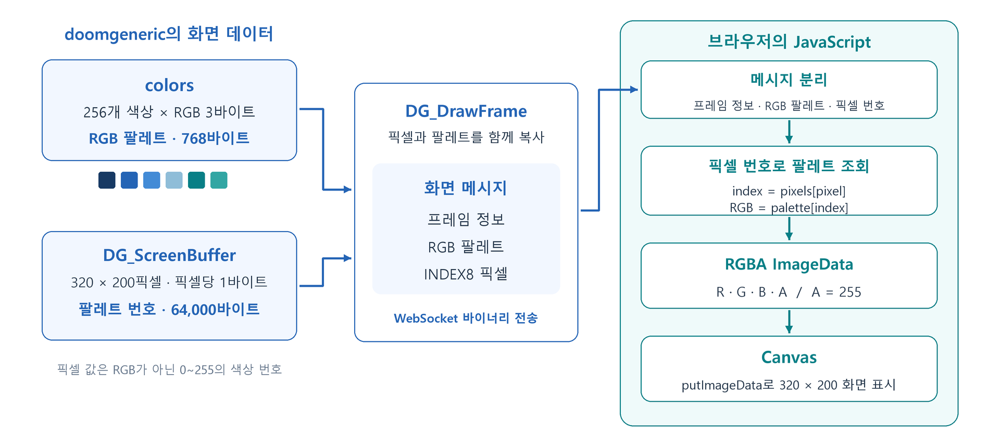
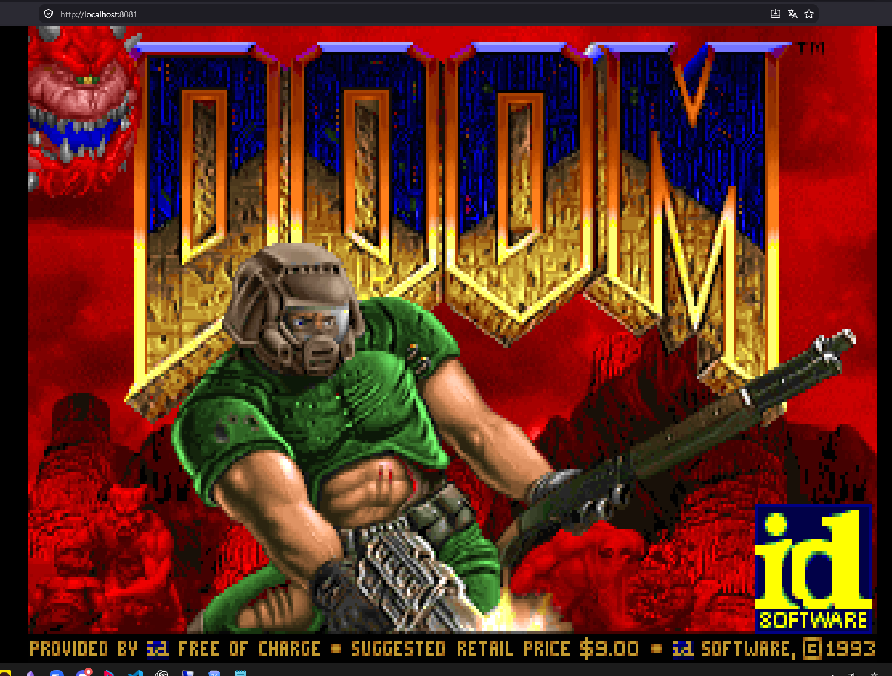

# 화면 출력 구현

장치에 맞는 DOOM 실행 파일을 작성하기 위해, DOOM porting 작업을 진행했습니다. DOOM porting이란, 실행하려는 장치의 프로세서 구조와 입출력 방식에 맞게 DOOM 소스 파일을 수정하고 컴파일하는 과정입니다.

이번 구현에서는 카메라에서 실행되는 DOOM의 화면을 브라우저로 확인할 수 있도록 구성했습니다. DOOM 실행 파일에 Mongoose 웹 서버를 포함하고, WebSocket으로 화면 데이터를 전달한 뒤 브라우저의 JavaScript로 출력하는 방식입니다. 컴파일된 바이너리의 실행 가능성을 확인하기 위해 화면 출력을 우선으로 개발을 진행했습니다.

## 준비

### doomgeneric

DOOM 포팅을 쉽게 하기 위해, 플랫폼에 맞는 입출력 부분을 분리한 [doomgeneric 프로젝트](https://github.com/ozkl/doomgeneric)를 활용했습니다.

doomgeneric은 게임의 공통 코드와 장치별 구현을 나누어 두고 있어, 다음 플랫폼 함수들을 대상 환경에 맞게 구현하는 방식으로 포팅할 수 있습니다.

| 함수              | 역할                                |
| --------------- | --------------------------------- |
| `DG_Init`       | 플랫폼에서 필요한 초기화 수행                  |
| `DG_DrawFrame`  | `DG_ScreenBuffer`에 담긴 화면을 플랫폼에 출력 |
| `DG_SleepMs`    | 지정된 밀리초만큼 대기                      |
| `DG_GetTicksMs` | 시작 후 진행된 밀리초를 반환                  |
| `DG_GetKey`     | 키 코드와 눌림 여부를 게임에 전달               |

### 출력 구조

카메라에서 생성한 게임 화면을 외부에서 확인하려면, 화면 데이터를 가져오는 부분과 이를 브라우저까지 전달하는 부분이 필요합니다. 화면을 이미지 파일로 저장하고 매번 다시 요청하는 대신, 연결을 유지하면서 새 화면 데이터를 전달하는 방식을 구상했습니다.

[Mongoose](https://github.com/cesanta/mongoose)는 C와 C++ 프로그램에서 HTTP와 WebSocket 등의 통신을 처리할 수 있는 라이브러리입니다. `mongoose.c`와 `mongoose.h`를 소스에 포함하고 함께 빌드하면, 프로그램 내부에서 웹 서버를 열고 통신 이벤트를 처리할 수 있습니다. [Mongoose 공식 문서](https://mongoose.ws/documentation/)

HTTP는 처음 접속한 브라우저에 HTML과 JavaScript를 제공하는 데 사용했습니다. 이후에는 WebSocket 연결을 통해 화면 데이터를 전송하도록 구성했습니다. WebSocket은 연결을 유지한 상태에서 양방향으로 데이터를 주고받는 방식이므로, 웹 페이지를 새로고침하지 않아도 화면을 계속 갱신할 수 있습니다.

Mongoose 웹 서버와 WebSocket을 통해 다음 흐름으로 화면 출력을 구상했습니다.



유저의 접속 요청을 시작으로 흐름을 정리하면 다음과 같습니다.

1. 유저가 DOOM 바이너리에서 연 Mongoose 웹 서버에 접근합니다.
2. 서버가 JavaScript를 포함한 HTML을 브라우저로 보냅니다.
3. 브라우저의 JavaScript가 같은 서버의 `/ws` 경로로 WebSocket 연결을 요청합니다.
4. 서버가 연결을 수립하고, DOOM에서 생성한 화면 데이터를 바이너리 메시지로 전송합니다.
5. 브라우저가 받은 데이터를 색상으로 변환해 Canvas에 출력합니다.
6. 브라우저가 해당 화면을 처리했다는 ACK 메시지를 서버로 보냅니다.

Canvas는 JavaScript로 픽셀과 그림을 출력할 수 있는 HTML 요소입니다. ACK는 여기서 특정 프레임의 화면 처리가 끝났음을 알리는 응용 프로그램 메시지로 사용했습니다.

`DG_DrawFrame`을 구현하기 위해 doomgeneric이 제공하는 화면 버퍼의 형식도 확인했습니다. 버퍼는 프로그램이 처리할 데이터를 메모리에 모아 두는 공간입니다. 화면 버퍼에는 한 화면을 구성하는 픽셀 값이 저장됩니다.

이번 빌드에서는 `CMAP256`을 설정하고 출력 해상도를 320×200으로 지정했습니다. 이 설정에서 `DG_ScreenBuffer`의 픽셀 하나는 1바이트이며, RGB 색상값 대신 0~255 사이의 팔레트 번호를 담습니다. 팔레트는 각 번호에 대응하는 RGB 색상을 모아 둔 표입니다.

예를 들어 픽셀 값이 10이라면, 그 값 자체를 색상으로 출력하는 것이 아니라 팔레트의 10번 항목에서 빨강·초록·파랑 값을 찾아 출력해야 합니다. 따라서 화면을 전달할 때 픽셀 데이터와 해당 화면에 사용한 팔레트를 함께 보냈습니다.



게임 엔진은 내부 화면 버퍼인 `I_VideoBuffer`에 화면을 그립니다. doomgeneric의 `I_FinishUpdate`는 이를 플랫폼 출력용 `DG_ScreenBuffer`에 반영한 뒤 `DG_DrawFrame`을 호출합니다. 두 버퍼의 역할을 구분하고, 플랫폼 코드에서는 `DG_ScreenBuffer`를 읽어 전송하도록 구현했습니다. 버퍼 형식과 호출 흐름은 [doomgeneric의 화면 처리 코드](https://github.com/ozkl/doomgeneric/blob/master/doomgeneric/i_video.c)에서 확인할 수 있습니다.

## 구현

구상한 계획에 맞게 플랫폼 코드인 `doomgeneric_mon.c`를 작성했습니다. 초기 화면 출력 버전에서는 게임 실행, 화면 전송, 브라우저 출력이 연결되는지 먼저 확인하고, 키 입력은 이후 [조작 입력 구현](../조작%20입력%20구현/README.md) 단계에서 추가하는 방향으로 진행했습니다.
### 웹 서버 초기화와 요청 처리

프로그램의 `main`에서 Mongoose의 연결 관리 구조체를 초기화하고 HTTP 서버를 열었습니다. 초기 출력 코드의 기본 접속 포트는 `8081`이며, `MON_LISTEN` 환경 변수로 변경할 수 있도록 작성했습니다. `DG_Init`에서는 전송할 화면 메시지의 헤더를 초기화했습니다.

다음은 서버 초기화에 사용한 호출입니다.

```c
mg_mgr_init(&s_manager);
mg_http_listen(&s_manager, listen_url, handle_event, NULL);
```

`mg_mgr_init`은 연결을 관리하는 구조체를 준비하고, `mg_http_listen`은 지정한 주소에서 요청을 받도록 설정하는 함수입니다. 요청이 들어오면 `handle_event`에서 경로와 이벤트 종류에 맞게 처리했습니다.

| 요청 또는 이벤트 | 처리 내용 |
| --- | --- |
| `/` 또는 `/index.html` 요청 | 게임 화면을 표시할 HTML 파일 제공 |
| `/ws` 요청 | WebSocket 연결로 전환 |
| WebSocket 연결 완료 | 화면을 받을 클라이언트 등록 |
| ACK 메시지 수신 | 전송한 프레임 번호와 비교해 다음 화면 전송 허용 |
| 연결 종료 | 클라이언트와 ACK 대기 상태 초기화 |

한 번에 한 클라이언트만 화면을 받도록 구성했습니다. 이미 연결된 클라이언트가 있으면 추가 `/ws` 요청에는 `503` 응답을 보냈습니다.

### 화면 데이터 구성

화면 한 장의 픽셀 데이터 크기는 `320×200×1 = 64,000바이트`입니다. 팔레트는 256개 색상에 각각 RGB 3바이트를 사용하므로 `256×3 = 768바이트`가 됩니다.

초기 화면 출력 코드에서는 메시지 식별 정보, 버전, 해상도와 프레임 번호를 담은 16바이트 헤더를 사용했습니다. 메시지 구성은 다음과 같습니다. 아래 크기는 WebSocket 자체의 헤더를 제외한 화면 메시지 본문의 크기입니다.

| 구성 요소   | 시작 위치 | 크기        | 내용                                     |
| ------- | ----- | --------- | -------------------------------------- |
| 헤더      | 0     | 16바이트     | 식별 문자열, 버전, 메시지 종류, 해상도, 픽셀 형식, 프레임 번호 |
| RGB 팔레트 | 16    | 768바이트    | 256개 색상의 RGB 값                         |
| 픽셀 데이터  | 784   | 64,000바이트 | 320×200개 픽셀의 팔레트 번호                    |
| 합계      | —     | 64,784바이트 | 초기 출력 버전의 화면 메시지                       |

헤더의 첫 4바이트에는 `DGWS`를 넣었으며, 프레임 번호는 12번 위치부터 4바이트로 기록했습니다. 여러 바이트를 사용하는 해상도와 프레임 번호는 리틀 엔디언 순서로 기록하도록 작성했습니다.

웹 페이지는 다음 구조의 화면 메시지를 처리합니다.

| 구성 요소 | 시작 위치 | 크기 |
| --- | --- | --- |
| 프레임 번호 | 0 | 4바이트 |
| RGB 팔레트 | 4 | 768바이트 |
| 픽셀 데이터 | 772 | 64,000바이트 |
| 합계 | — | 64,772바이트 |

### DG_DrawFrame 구현

`DG_DrawFrame`에서는 현재 화면의 팔레트와 픽셀을 전송 버퍼에 복사했습니다. 게임이 다음 화면을 생성하기 전에 두 데이터를 함께 복사하여, 픽셀 번호와 그 번호에 대응하는 색상이 같은 시점의 값이 되도록 했습니다.

초기 출력 코드의 주요 부분은 다음과 같습니다.

```c
for (i = 0; i < 256; ++i) {
    s_frame[HEADER_SIZE + i * 3] = (unsigned char) colors[i].r;
    s_frame[HEADER_SIZE + i * 3 + 1] = (unsigned char) colors[i].g;
    s_frame[HEADER_SIZE + i * 3 + 2] = (unsigned char) colors[i].b;
}
memcpy(s_frame + HEADER_SIZE + PALETTE_SIZE,
       DG_ScreenBuffer, PIXEL_COUNT);
put_u32(s_frame + 12, ++s_frame_sequence);
```

`colors`는 doomgeneric이 사용하는 팔레트이고, `memcpy`는 픽셀 데이터를 전송 버퍼에 복사합니다. `put_u32`는 증가시킨 프레임 번호를 4바이트로 기록합니다. 위 코드의 `HEADER_SIZE`는 초기 출력 버전의 값인 16입니다.

화면 복사 간격은 `FRAME_INTERVAL_MS = 100`으로 설정했습니다. 매번 게임 화면이 갱신될 때마다 전송용 화면을 만드는 대신, 100ms 간격으로 최신 화면을 복사하도록 구성했습니다. 다만, 웹소켓 통신 특성상 통신에 지연이나 문제가 생기면 10fps가 나오지는 않을 수 있습니다.

### WebSocket 전송과 ACK 처리

복사한 화면은 `mg_ws_send`의 `WEBSOCKET_OP_BINARY` 메시지로 전송했습니다.

```c
mg_ws_send(s_viewer, s_frame, sizeof(s_frame), WEBSOCKET_OP_BINARY);
```

전송한 뒤에는 해당 프레임의 ACK를 기다리도록 구성했습니다. 브라우저가 화면 처리를 끝내고 프레임 번호를 돌려보내면, 서버가 전송한 번호와 비교하여 다음 화면을 보낼 수 있도록 했습니다.

ACK 메시지는 8바이트로 구성했습니다.

| 시작 위치 | 크기 | 내용 |
| --- | --- | --- |
| 0 | 1바이트 | ACK 메시지 종류인 `2` |
| 1 | 1바이트 | 프로토콜 버전인 `1` |
| 2 | 2바이트 | 예약 영역인 `0` |
| 4 | 4바이트 | 처리한 프레임 번호 |

이전 ACK가 대기 중이거나 전송 버퍼에 데이터가 남아 있으면 새 화면을 보내지 않았습니다. ACK가 3초 안에 도착하지 않으면 연결을 종료하도록 작성했습니다.

### 브라우저에서 화면 출력

브라우저의 JavaScript에서는 `/ws`에 연결한 뒤 `binaryType`을 `arraybuffer`로 지정했습니다. 이를 통해 수신 메시지를 바이트 배열로 읽고, 프레임 번호·팔레트·픽셀을 나누어 처리할 수 있도록 했습니다.

배포용 웹 페이지에서는 메시지 크기가 64,772바이트인지 먼저 확인하고, 프레임 번호를 리틀 엔디언으로 읽었습니다. 각 픽셀의 팔레트 번호로 RGB 값을 찾은 뒤 `ImageData`에 기록했습니다. `ImageData`는 Canvas에 그릴 픽셀 데이터를 담는 객체이며, 픽셀 하나에 빨강·초록·파랑·투명도 값인 RGBA 4바이트를 사용합니다.

다음은 웹 페이지의 메시지 규격을 사용하는 변환 부분입니다.

```javascript
const bytes = new Uint8Array(event.data);
const sequence = new DataView(event.data).getUint32(0, true);

for (let pixel = 0, offset = 0; pixel < 64000; pixel++, offset += 4) {
  const color = 4 + bytes[772 + pixel] * 3;
  image.data[offset] = bytes[color];
  image.data[offset + 1] = bytes[color + 1];
  image.data[offset + 2] = bytes[color + 2];
  image.data[offset + 3] = 255;
}
context.putImageData(image, 0, 0);
```

`772 + pixel` 위치에서 픽셀의 팔레트 번호를 읽고, 팔레트가 시작되는 4번 위치에 번호의 3배를 더해 RGB 값을 찾습니다. 투명도는 `255`로 지정하여 모든 픽셀이 불투명하게 표시되도록 했습니다.

웹 페이지는 위 변환과 화면 출력을 `requestAnimationFrame` 안에서 수행하여 브라우저의 화면 갱신 시점에 맞추었습니다. `putImageData` 호출 후에는 처리한 프레임 번호가 포함된 ACK를 전송했습니다. 이전 화면의 갱신이 끝나기 전에 다음 화면이 도착하거나 메시지 크기가 맞지 않으면 연결을 종료하도록 구성했습니다.

### 게임 실행과 통신 이벤트 처리

Mongoose는 이벤트 루프가 실행될 때 연결과 송수신을 처리합니다. 따라서 서버를 열기만 하는 것이 아니라, 게임 실행 중에도 `mg_mgr_poll`을 반복해서 호출해야 합니다. [Mongoose 연결 관리 설명](https://mongoose.ws/documentation/#connections-and-event-manager)

초기 코드에서는 `service_web` 함수에 통신 처리를 모으고, 게임의 반복 실행과 `DG_DrawFrame`에서 호출하도록 구성했습니다. `DG_SleepMs`에서도 대기 시간을 최대 5ms씩 나누어 같은 함수를 호출했습니다.

시간 계산에는 `clock_gettime(CLOCK_MONOTONIC, ...)`으로 얻은 밀리초 값을 사용했습니다. `DG_GetTicksMs`는 이 값에서 프로그램 시작 시간을 빼 경과 시간을 반환하도록 작성했습니다.

## 빌드 구성

카메라용 바이너리를 만들기 위해 Makefile의 컴파일러를 `mipsel-linux-gnu-gcc`로 지정했습니다. 대상 규격을 확인하고 툴체인을 준비하는 과정은 [크로스컴파일 환경 구성](../크로스컴파일%20환경%20구성/README.md)에서 다룹니다. 이 단계에서는 해당 환경에 화면 출력용 소스와 옵션을 추가했습니다.

주요 변경 사항은 다음과 같습니다.

| 변경 항목 | 적용 내용 |
| --- | --- |
| 플랫폼 구현 | 기본 X11 출력 코드 대신 `doomgeneric_mon.c` 사용 |
| 웹 통신 코드 | `mongoose.c`를 함께 컴파일하고 `mongoose.h` 포함 |
| 출력 형식 | `-DCMAP256`으로 팔레트 번호를 담는 8비트 픽셀 사용 |
| 출력 해상도 | `-DDOOMGENERIC_RESX=320 -DDOOMGENERIC_RESY=200` |
| 대상 CPU와 ABI | `-EL -mips32r2 -mabi=32 -mhard-float -mfp32 -mnan=legacy` |
| 링크 방식 | `-static`으로 정적 링크 |
| 기존 그래픽 의존성 | X11 플랫폼 오브젝트와 `-lX11` 제거 |
| 생성물 관리 | 오브젝트는 `build-mon`, 실행 파일은 `doomgeneric_mon`으로 구분 |

초기 출력 버전의 Makefile에서 컴파일러와 화면 형식을 지정한 부분은 다음과 같습니다. 전체 Makefile 중 일부이며, 공통 DOOM 오브젝트 목록에는 `doomgeneric_mon.o`와 `mongoose.o`도 포함했습니다.

```make
CROSS_COMPILE ?= mipsel-linux-gnu-
CC=$(CROSS_COMPILE)gcc
CFLAGS+=-EL -mips32r2 -mabi=32 -mhard-float -mfp32 -mnan=legacy
CFLAGS+=-DCMAP256 -DDOOMGENERIC_RESX=320 -DDOOMGENERIC_RESY=200
LDFLAGS+=-static -Wl,--gc-sections -Wl,--build-id=none
LIBS+=-lm -lc
```

정적 링크로 실행에 필요한 라이브러리 코드를 바이너리에 포함했습니다.
## 실행 확인 및 구현 결과

다음 사진과 같이 `localhost:8081`의 브라우저에서 DOOM 타이틀 화면을 확인했습니다.



qemu user mode를 통해 개발 환경에서 테스트 구동을 진행하고, 실장치에서도 구동 확인을 진행했습니다.

화면 버퍼를 가져오는 `DG_DrawFrame`, WebSocket으로 전송하는 Mongoose, 팔레트 번호를 색상으로 변환하는 브라우저 코드를 연결하여 화면 출력 구조를 구현했습니다. 이후 브라우저의 키 입력을 게임으로 전달하고 ([조작 입력 구현](../조작%20입력%20구현/README.md)), 카메라에서 DOOM을 실행할 [트리거](../둠%20트리거%20구현/README.md)를 연결한 뒤 [실기기 동작 확인](../../실험%20및%20결과/실기기%20동작%20확인/README.md) 단계로 이어집니다.
