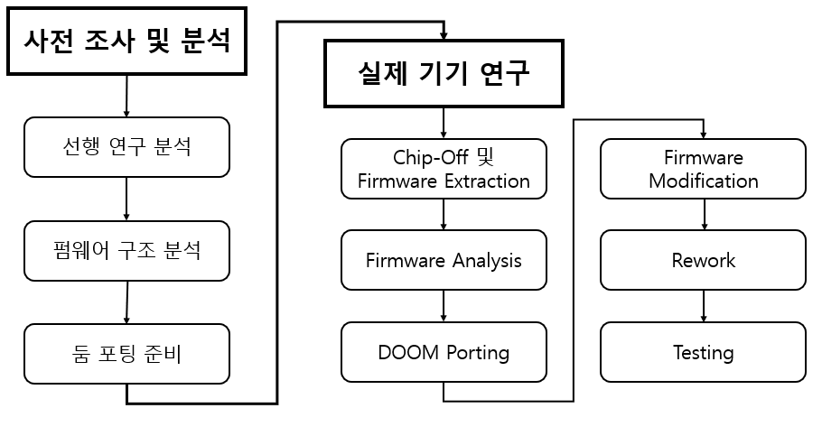
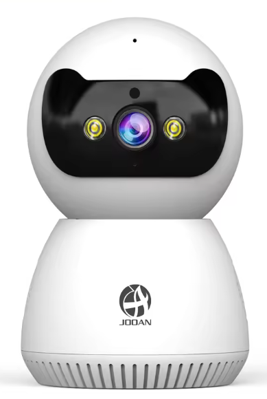

# 임베디드 기기 대상 DOOM 포팅하기


홈캠의 하드웨어와 펌웨어를 분석하고,
분석한 실행 환경에 맞게 DOOM을 포팅하여 실제 기기에서의 구동을 목표로 한다.

<br>

[**Project Files →**](../project/)

---

## Contents

* [서론](#01-서론)
  * [연구의 필요성](#1-연구의-필요성)
  * [선행 연구](#2-선행-연구)
  * [연구의 목표](#3-연구의-목표)
  * [기술적 배경](#4-기술적-배경)

* [연구 방법](#02-연구-방법)
  * [연구 설계](#연구-설계)
  * [연구 대상](#연구-대상)
  * [연구 수행 절차](#연구-수행-절차)

* [결과](#03-결과)
* [고찰](#04-고찰)

<br>

---

# 01. 서론

## 1) 연구의 필요성

임베디드 시스템의 구조와 동작 방식을 이해하기 위해서는 실제 기기를 직접 분석하는 과정이 필요하다.

임베디드 기기는 기기마다 하드웨어 구성과 펌웨어 환경이 달라, 이론만으로는 내부 구조와 프로그램 실행 과정을 정확하게 파악하기 어렵다.

이에 홈캠의 주요 부품과 펌웨어를 분석하고, 분석한 실행 환경에 맞게 DOOM을 포팅하여 외부 프로그램이 실제 장비에서 실행되는지 확인한다.

이를 통해 임베디드 기기의 **하드웨어 분석부터 펌웨어 분석과 실행 환경 검증까지의 전 과정**을 익히는 것을 목적으로 한다.

<br>

## 2) 선행 연구

본 연구에서는 `IoT 기기 취약점 분석을 위한 펌웨어 추출 및 분석 환경 구축 방법론`을 선행 연구로 선정하였다.

해당 논문의 제3장 `IoT 기기 취약점 분석 환경 구축`에서 제시한 **Chip-Off, Firmware Extraction, Firmware Modify, Rework, Testing**의 방법과 절차를 본 연구에 반영한다.

본 연구에서는 선행 연구의 수행 절차를 기반으로 **Firmware Analysis에 중점을 두며**, Firmware Extraction 이후 추출한 펌웨어와 실행 환경을 분석한 뒤 **DOOM Porting**을 수행하고 Firmware Modify 단계로 진행한다.

<br>

## 3) 연구의 목표

> **홈캠의 하드웨어와 펌웨어를 단계적으로 분석하고, 분석한 실행 환경에 맞게 DOOM을 포팅하여 실제 장비에서 구동하는 것을 목표로 한다.**

 (1) 홈캠 하드웨어 및 시스템 환경 분석
 - 홈캠이 정상적으로 작동하는지 확인한 뒤 기기를 분해한다.
 - 내부의 저장 칩과 주요 부품을 찾고, 각 부품의 역할과 연결 방식을 확인한다.

(2) 펌웨어 획득 및 파일 시스템 추출
- 홈캠의 저장 칩에서 펌웨어를 가져온다.
- 이후 분석 도구를 사용하여 펌웨어 안에 있는 파일과 폴더 구조를 확인한다.

(3) 펌웨어 구조 분석
- 추출한 펌웨어의 구성 및 구조를 분석한다.
- 각 구성 요소의 역할과 관계를 파악하여 펌웨어의 구조와 동작 방식을 이해한다.

(4) 펌웨어 및 프로그램 실행 환경 분석
- 펌웨어 안의 시작 과정과 사용할 수 있는 기능을 확인한다.
- 이를 바탕으로 홈캠에서 외부 프로그램을 실행할 수 있는 환경을 마련한다.

(5) DOOM 포팅 및 실제 장비 구동 검증
- 홈캠의 환경에 맞게 DOOM을 적용하고 실제 장비에서 실행한다.
- 이후 홈캠이 정상적으로 켜지는지와 DOOM이 제대로 작동하는지를 확인한다.

<br>

## 4) 기술적 배경
(1) 사용하는 도구
- wsl
- binwalk

  
(2) 사용하는 명령어


<br>

---

# 02. 연구 방법

## 연구 설계

본 연구는 **사전 조사 및 분석**과 **실제 기기 연구**의 두 단계로 구성한다.

<p align="center">
  
</p>

<br>

## 연구 대상

> 연구에 사용되는 임베디드 기기의 하드웨어 구성, 펌웨어 및 실행 환경을 분석 대상으로 한다.

본 연구의 대상 기기는 중국 JOOAN사의 홈캠이다. 

<p align="center">
  
</p>
<br>

## 연구 수행 절차

전체 수행 자료는 아래 프로젝트 디렉터리에서 확인할 수 있다.

> **[Project Directory](../project/)**

### 1. Preliminary Research & Analysis

실제 기기를 분석하기 전 선행 연구를 분석하고, 확보한 펌웨어를 대상으로 펌웨어 및 파일 시스템 구조와 부팅 흐름을 분석한다. 이후 실제 기기 도착 전 수행할 수 있는 DOOM 포팅 준비 작업을 진행한다.

| Step | 수행 단계 | Documentation |
| :--: | ------------------------------ | :----------------------------------------------------------------------------------------------------------------------------------------------------------------: |
| 01 | 선행 연구 분석 | [Prior Research Analysis](../project/1.%20Preliminary%20Research%20%26%20Analysis/1.%20Prior%20Research%20Analysis) |
| 02 | 펌웨어 및 파일 시스템 분석 | [Firmware & File System Analysis](../project/1.%20Preliminary%20Research%20%26%20Analysis/2.%20Firmware%20Analysis/1.%20Firmware%20%26%20File%20System%20Analysis) |
| 03 | 부팅 흐름 분석 | [Boot Flow Analysis](../project/1.%20Preliminary%20Research%20%26%20Analysis/2.%20Firmware%20Analysis/2.%20Boot%20Flow%20Analysis) |
| 04 | 펌웨어 실행 환경 분석 | [Execution Environment Analysis](../project/1.%20Preliminary%20Research%20%26%20Analysis/3.%20DOOM%20Porting%20Preparation/1.%20Execution%20Environment%20Analysis) |
| 05 | Web Server 및 SD Card 환경 분석 | [Web & SD Environment Analysis](../project/1.%20Preliminary%20Research%20%26%20Analysis/3.%20DOOM%20Porting%20Preparation/2.%20Web%20%26%20SD%20Environment%20Analysis) |
| 06 | DoomGeneric 및 웹 뷰어 구현 | [DOOM Output Implementation](../project/1.%20Preliminary%20Research%20%26%20Analysis/3.%20DOOM%20Porting%20Preparation/3.%20DOOM%20Output%20Implementation) |
| 07 | MIPS Cross-Compile 및 사전 테스트 | [Cross-Compilation & Pre-Testing](../project/1.%20Preliminary%20Research%20%26%20Analysis/3.%20DOOM%20Porting%20Preparation/4.%20Cross-Compilation%20%26%20Pre-Testing) |

> **[Preliminary Research & Analysis →](../project/1.%20Preliminary%20Research%20%26%20Analysis/)**

<br>

### 2. Physical Device Analysis

사전 분석을 기반으로 실제 기기에서 펌웨어 추출부터 분석, DOOM Porting, 펌웨어 수정 및 검증까지 수행한다.

| Step | 수행 단계 | Documentation |
| :--: | ------------------------------ | :------------------------------------------------------------------------------------------------------------------------: |
| 01 | Chip-Off 및 Firmware Extraction | [Chip-Off & Firmware Extraction](../project/2.%20Physical%20Device%20Analysis/1.%20Chip-Off%20%26%20Firmware%20Extraction) |
| 02 | Firmware Analysis | [Firmware Analysis](../project/2.%20Physical%20Device%20Analysis/2.%20Firmware%20Analysis) |
| 03 | DOOM Porting | [DOOM Porting](../project/2.%20Physical%20Device%20Analysis/3.%20DOOM%20Porting) |
| 04 | Firmware Modification | [Firmware Modification](../project/2.%20Physical%20Device%20Analysis/4.%20Firmware%20Modification) |
| 05 | Rework | [Rework](../project/2.%20Physical%20Device%20Analysis/5.%20Rework) |
| 06 | Testing | [Testing](../project/2.%20Physical%20Device%20Analysis/6.%20Testing) |

> **[Physical Device Analysis →](../project/2.%20Physical%20Device%20Analysis/)**

<br>

### 전체 수행 흐름

```text
Preliminary Research & Analysis
        │
        ├── Prior Research Analysis
        │
        ├── Firmware Analysis
        │      ├── Firmware & File System Analysis
        │      ├── Boot Flow Analysis
        │      └── QEMU Dynamic Analysis
        │
        └── DOOM Porting Preparation
               ├── Execution Environment Analysis
               ├── Web & SD Environment Analysis
               ├── DOOM Output Implementation
               └── Cross-Compilation & Pre-Testing
        │
        ▼
Physical Device Analysis
        │
        ├── Chip-Off & Firmware Extraction
        ├── Firmware Analysis
        ├── DOOM Porting
        ├── Firmware Modification
        ├── Rework
        └── Testing
```

<br>

---

# 03. 결과


<br>

---

# 04. 고찰


<br>

---

<div align="center">

</div>
