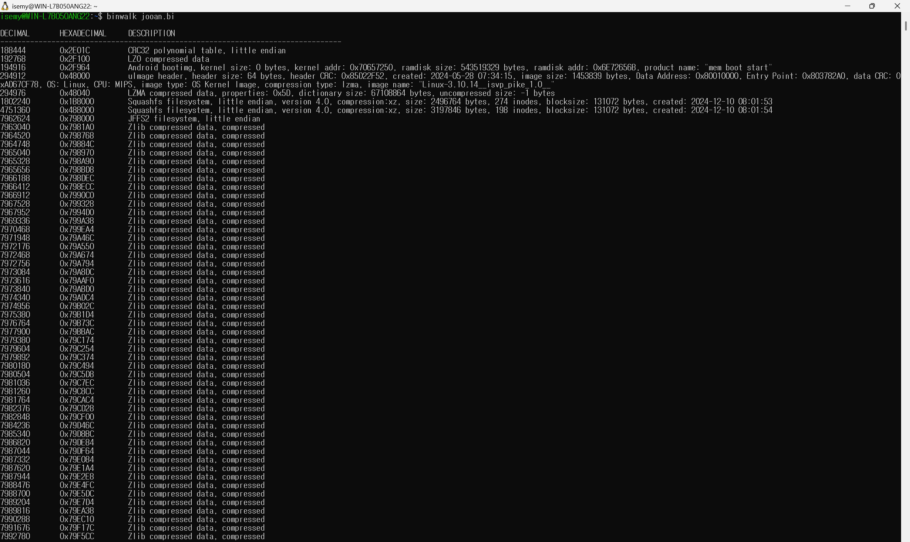
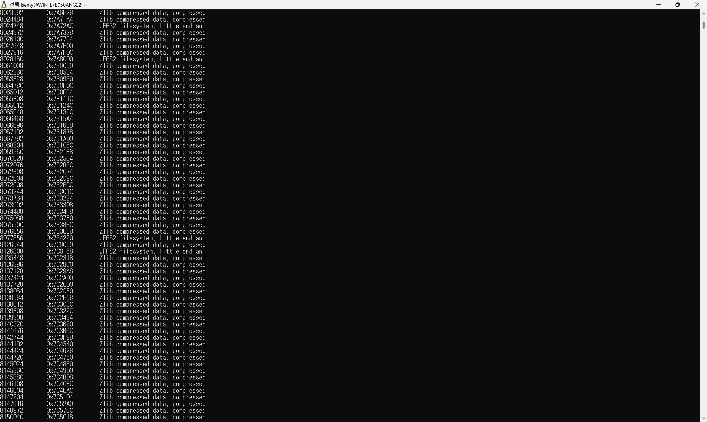
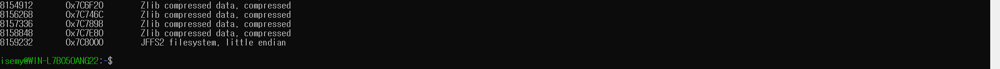
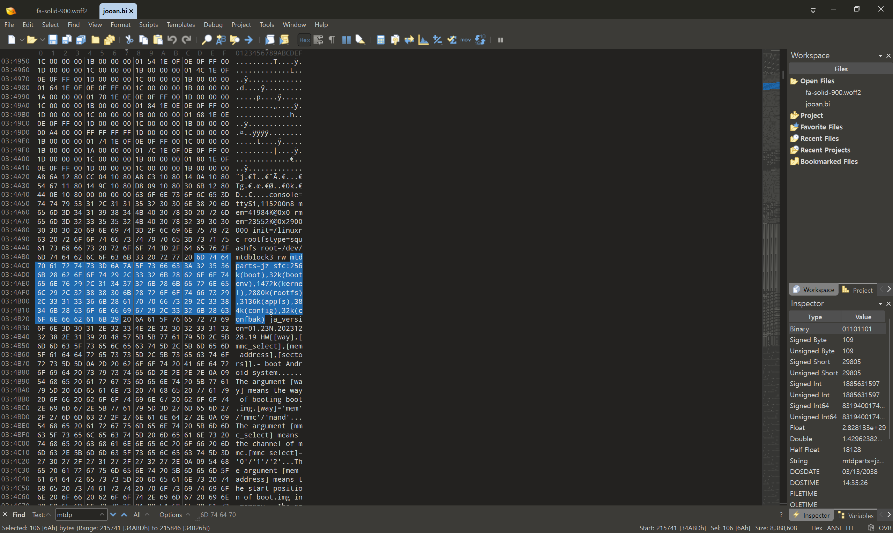

# Firmware & File System Analysis

## 목차

- [1. 펌웨어 구조 분석](#1-펌웨어-구조-분석)
  - [1.0 펌웨어 및 용어 정의](#10-펌웨어-및-용어-정의)
  - [1.1 일반적인 임베디드 Linux 펌웨어 구조](#11-일반적인-임베디드-linux-펌웨어-구조)
  - [1.2 JOOAN 펌웨어 구조 분석](#12-jooan-펌웨어-구조-분석)
- [2. 파일 시스템 추출](#2-파일-시스템-추출)
- [3. 파일 시스템 및 파일 분석](#3-파일-시스템-및-파일-분석)

---

## 1. 펌웨어 구조 분석

### 1.0 펌웨어 및 용어 정의

**Firmware**는 하드웨어 장치의 동작을 제어하기 위해 장치에 내장되는 저수준 소프트웨어를 의미한다.

**Firmware Image**는 이러한 Firmware를 저장장치에 기록하거나 배포·분석할 수 있도록 바이너리 형태로 구성한 데이터를 의미하며, 장치에 따라 Bootloader, Kernel, Root File System, 설정 데이터 등의 영역을 포함할 수 있다.

본 연구에서는 펌웨어의 바이너리 구조를 추출·분석·수정하는 작업을 중심으로 수행하므로, **이후 별도의 구분이 없는 경우 '펌웨어'또는 '펌웨어 이미지'는 분석 대상인 Firmware Image를 의미하는 것으로 정의한다.**


### 1.1 일반적인 임베디드 Linux 펌웨어 구조

일반적인 임베디드 Linux 펌웨어는 다음과 같은 구조로 구성된다.

- 펌웨어 이미지
  - Header
  - Bootloader
  - Kernel
  - Root File System
  - User Data & Config

1. Header <br>

   - 펌웨어 헤더는 펌웨어 이미지 시작 부분에 위치하며 이미지의 형식과 속성을 설명하는 정보를 포함한다. 헤더 자체가 장치의 주요 기능을 수행하는 실행 코드는 아니지만, 부트로더 또는 업데이트 프로그램이 해당 이미지를 올바르게 식별하고 검증하는 데에 사용된다. 
   - 헤더에는 일반적으로 적용 가능한 장치 및 모델 식별, 펌웨어 버전 비교 및 관리, 이미지를 적재할 메모리 주소 지정 등등의 정보가 포함되어 있다.
   - 이런 정보들을 통해 펌웨어 헤더는 하나의 이미지 안에 포함된 여러 구성요소의 위치와 크기를 식별하고 다른 모델용 펌웨어가 설치되는 것을 방지해준다. 또한, 체크섬 해시 및 전자서명을 통해 전송 과정의 비인가 변조를 탐지해주기도 한다. 
   - 펌웨어를 수정한 후 리패키징을 할 때에는 파일 내용뿐만 아니라 헤더의 이미지 크기, 오프셋, 체크섬 및 해시 값도 다시 계산해야 한다. 따라서 Secure Boot가 적용된 장치에서는 제조사의 서명 키 없이 유효한 전자서명을 생성할 수 없으므로, 파일 수정과 재압축만으로는 변조된 펌웨어가 정상적으로 실행되지 않을 수도 있다.

<br><br>

2. Bootloader

   - 부트로더는 장치에 전원이 공급되거나 


3. Kernel


4. Root File System


5. User Data & config
    

### 1.2 JOOAN 펌웨어 구조 분석
1. 펌웨어 전체 구조
```
├─ boot
│   └─ U-Boot
├─ bootenv
├─ kernel
│   ├─ uImage Header
│   └─ LZMA-compressed Linux Kernel
├─ rootfs
│   └─ SquashFS
├─ appfs
│   └─ SquashFS
├─ config
│   └─ JFFS2
└─ confbak
```
<br><br>
2. 구조 분석 방법 1 - binwalk
<p align="center">
  
</p>
<p align="center">
  생략
</p>
<p align="center">
  
</p>
<p align="center">
  생략
</p>
<p align="center">
  
</p>

**위 사진에서 알 수 있는 내용**
| 시작 오프셋 | 다음 주요 탐지 지점까지의 범위 | 탐지 결과 | 판단 |
|---|---|---|---|
| `0x000000` | `0x000000 ~ 0x047FFF` | CRC32 Table, LZO Data, Android bootimg signature 등 | 역할 미확인 영역 |
| `0x048000` | `0x048000 ~ 0x1B7FFF` | uImage Header, MIPS Linux Kernel, LZMA | Kernel Image 영역으로 판단 |
| `0x1B8000` | `0x1B8000 ~ 0x487FFF` | SquashFS #1 | SquashFS 파일 시스템 영역 |
| `0x488000` | `0x488000 ~ 0x797FFF` | SquashFS #2 | SquashFS 파일 시스템 영역 |
| `0x798000` | 이후 영역 | JFFS2 및 다수의 Zlib Data | JFFS2 파일 시스템 영역 |


<br><br>
3. 구조 분석 방법 2 - 101 editor <br>
   binwalk는 펌웨어의 전체 구조를 이해해서 판단하는 것이 아니라, 바이너리 내부의 시그니처와 바이트 패턴을 검색하여 알려진 파일 형식·압축 형식·파일시스템 등이 존재할 가능성을 탐지한다.
   따라서 binwalk의 탐지 결과만으로 실제 펌웨어 구조를 확정할 수 없기에 101 editor를 사용하여 조금 더 정확한 정보를 얻고자 하였다.
<p align="center">
  
</p>
```
---

## 2. 파일 시스템 추출

---

## 3. 파일 시스템 및 파일 분석
