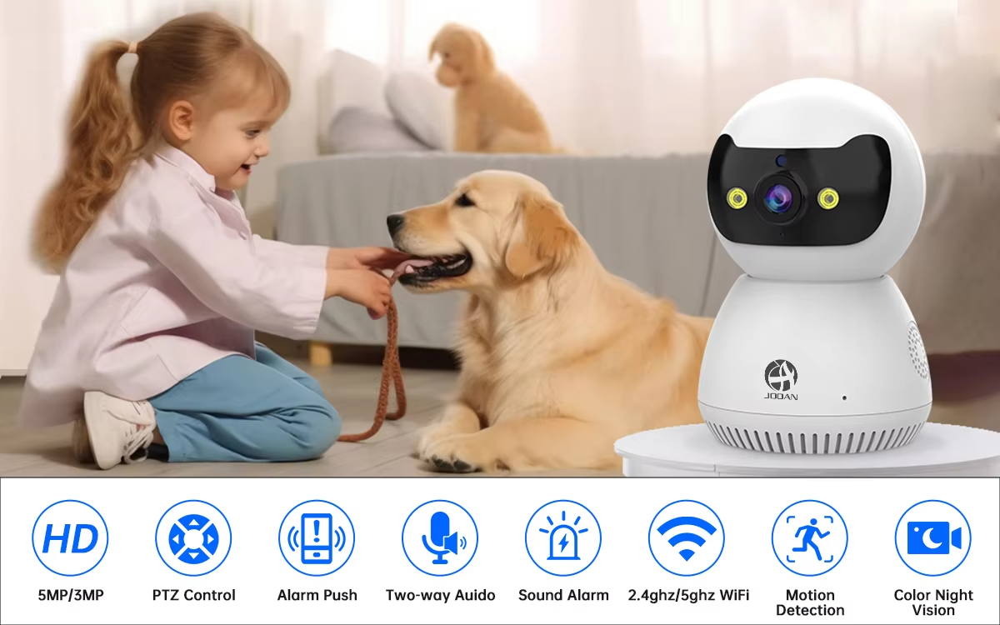
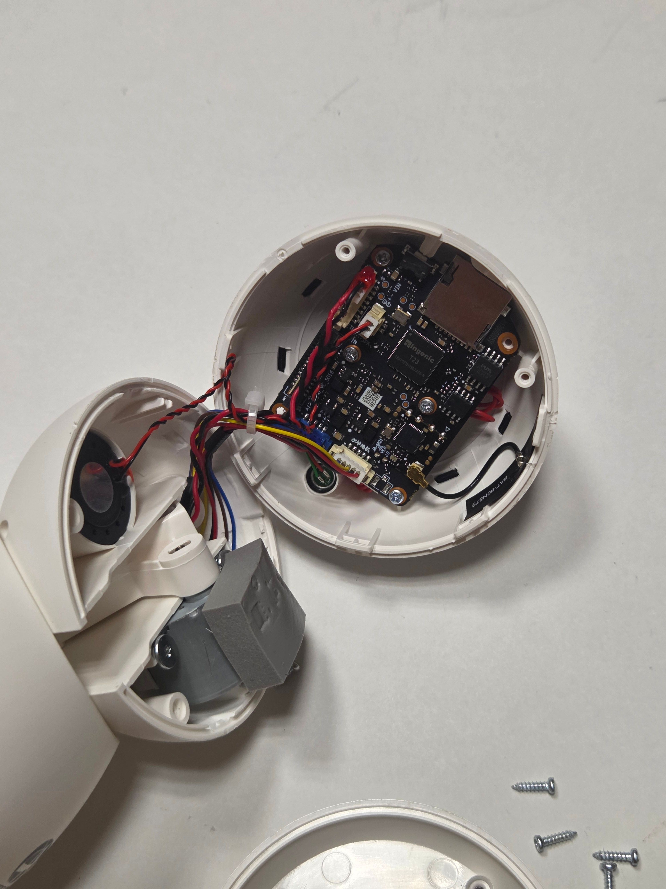
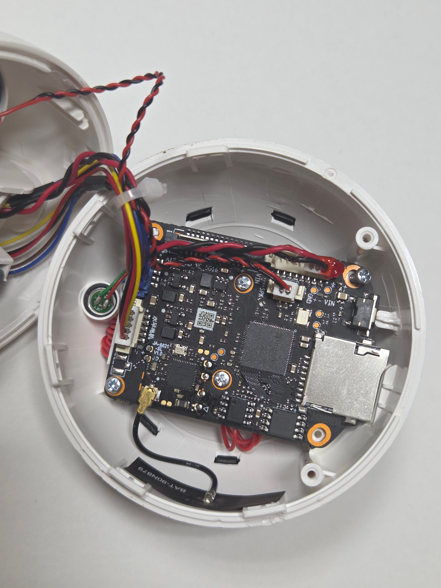
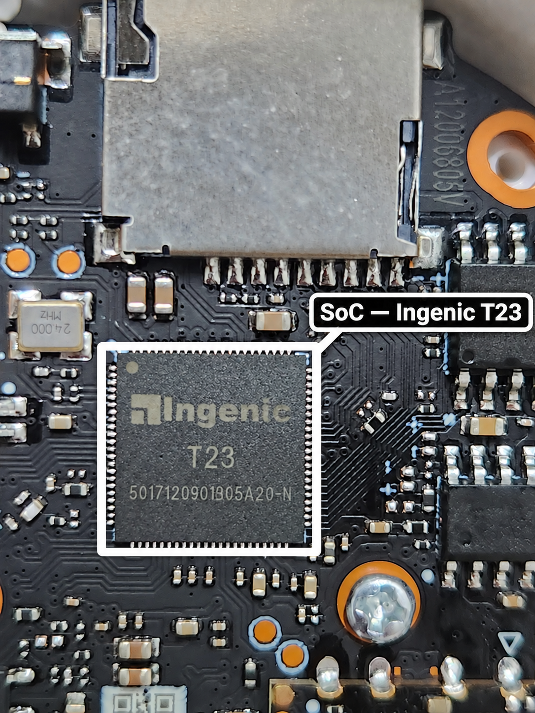
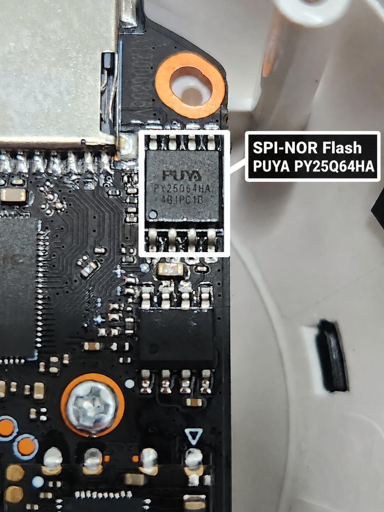
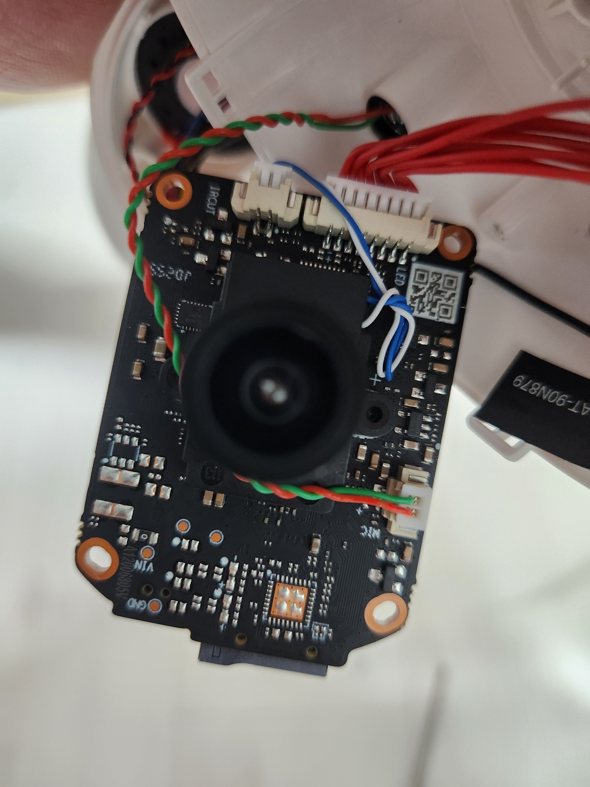
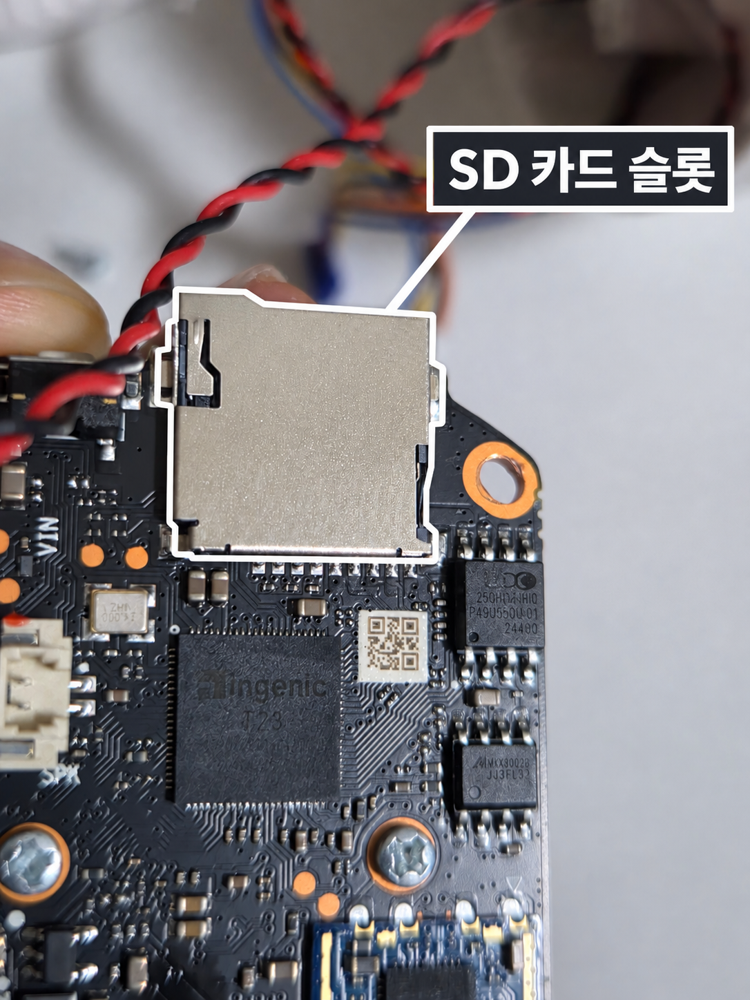
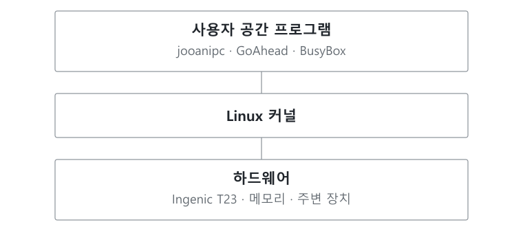

# 대상 시스템 및 분석 환경

본 절에서는 임베디드 시스템과 펌웨어의 기본 개념을 소개하고, 본 프로젝트에서 사용한 JOOAN C9TS-U 카메라의 하드웨어와 소프트웨어 구성을 설명합니다.

 

## 임베디드 시스템 기초

### 1. 임베디드 시스템

임베디드 시스템은 제품 내부에 탑재되어 특정 기능을 수행하는 컴퓨터 시스템입니다. 다양한 프로그램을 실행하는 일반 PC와 달리, 정해진 기능을 제한된 메모리와 저장 공간 안에서 처리하도록 구성합니다.

홈캠은 영상을 촬영하고, 촬영한 영상을 네트워크로 전달하며, 사용자의 요청에 따라 카메라 방향을 조절합니다. 내부의 프로세서가 프로그램을 실행하고 주변 장치를 제어하므로, 홈캠도 임베디드 시스템에 해당합니다.

### 2. 주요 하드웨어 용어

| 용어 | 설명 |
|---|---|
| CPU | 프로그램의 명령어를 실행하는 처리 장치입니다. |
| SoC(System on Chip) | CPU와 메모리·주변 장치 제어 기능 등을 하나의 칩에 통합한 구성입니다. |
| RAM | 실행 중인 프로그램과 데이터를 임시로 보관하는 메모리입니다. 일반적으로 전원이 꺼지면 내용이 사라집니다. |
| 플래시 메모리 | 전원이 꺼져도 내용을 유지하는 저장 장치입니다. 카메라에서는 펌웨어와 설정 등을 보관합니다. |
| SPI | 클럭 신호를 이용해 장치 사이에서 데이터를 주고받는 직렬 통신 방식입니다. 이 카메라에서는 플래시 메모리와의 통신에 사용합니다. |
| UART | 송신(TX)과 수신(RX) 신호를 이용하는 비동기 직렬 통신 방식입니다. 장치에 따라 부팅 로그나 디버깅 인터페이스로 사용합니다. |

### 3. 펌웨어와 기본 소프트웨어 구조

펌웨어는 장치가 동작하는 데 필요한 소프트웨어입니다. Linux 기반 카메라의 펌웨어에는 부트로더, 커널, 실행 파일과 설정을 담은 파일시스템 등이 포함됩니다.

| 구성 요소 | 역할 |
|---|---|
| 부트로더 | 부팅에 필요한 초기화를 수행하고 운영체제 커널을 메모리에 올려 실행합니다. |
| 커널 | 운영체제의 핵심으로, 메모리·프로세스·장치 드라이버·파일시스템 등을 관리합니다. |
| 루트 파일시스템(rootfs) | `/`를 기준으로 실행 파일, 라이브러리, 설정 파일 등이 배치된 기본 파일시스템입니다. |
| 응용 프로그램 | 영상 처리, 네트워크 통신, 웹 서비스 등 제품의 기능을 수행합니다. |

파일시스템은 저장 공간 안에서 파일과 폴더를 관리하는 형식입니다. rootfs는 파일시스템의 역할을 가리키며, SquashFS나 JFFS2는 파일시스템의 형식을 가리킵니다. SquashFS는 압축된 읽기 전용 파일시스템이며, JFFS2는 플래시 메모리에서 변경 가능한 데이터를 관리하는 파일시스템입니다.

마운트는 파일시스템을 특정 디렉터리에 연결하여 그 안의 파일에 접근할 수 있게 하는 작업입니다. 예를 들어 SD 카드가 `/mnt/sd_card`에 마운트되면, 해당 경로를 통해 카드에 저장된 파일에 접근합니다.

 

## 대상 제품

본 프로젝트의 대상은 **JOOAN C9TS-U 실내용 IP 카메라**입니다. IP 카메라는 네트워크를 통해 영상을 전달하는 카메라입니다. 해당 장비의 하드웨어와 펌웨어를 분석하고, 장비의 실행 환경에 맞게 DOOM을 포팅하는 것을 목표로 합니다.

출처: [JOOAN 판매 페이지](https://ko.aliexpress.com/item/33024400486.html)

 

프로젝트에서 사용하는 장비의 주요 정보는 다음과 같습니다.

| 항목 | 내용 |
|---|---|
| 대상 장비 | JOOAN C9TS-U |
| 연동 앱 | Cam720 |
| 주요 기능 | 영상 스트리밍, 앱을 통한 카메라 방향 제어 |
| 무선 연결 | 2.4GHz·5GHz Wi-Fi |
| SD 카드 | microSD(TF) 슬롯, 최대 256GB 지원 사양 |

 

## 하드웨어 구성

### 1. 내부 구조

카메라 내부는 전원 단자 보드, 방향 제어용 모터, 메인보드, 렌즈와 카메라 모듈로 구성되어 있습니다. 메인보드 주변에는 열을 전달하기 위한 써멀 패드가 배치되어 있습니다.

 

프로젝트에서 사용하는 장비의 하드웨어 정보는 다음과 같습니다.

| 구성 요소 | 내용 |
|---|---|
| 메인 SoC | Ingenic T23 |
| SPI-NOR 플래시 | PUYA PY25Q64HA, 64Mbit(8MiB) |
| 크리스탈 | 24MHz |
| 카메라 모듈 | 렌즈와 이미지 센서 |
| 방향 제어 장치 | 모터 |
| 외부 저장 인터페이스 | microSD 카드 슬롯 |
| 전원 단자 | USB-C |
| 무선 통신 | Wi-Fi |

### 2. 메인 SoC와 RAM

SoC(System on Chip)는 CPU와 주변 장치 제어 기능 등을 하나의 칩에 통합한 반도체입니다. 카메라에서는 프로그램을 실행하고, 영상 데이터를 처리하며, 저장 장치와 통신 장치를 제어하는 중심 역할을 합니다.

대상 장비의 메인 SoC는 **Ingenic T23**입니다. T23은 XBurst CPU, ISP, 영상 인코딩 기능과 SD 카드·SPI·UART 등의 인터페이스를 갖춘 카메라용 영상 처리 SoC입니다.

그림 — Ingenic T23 내부 블록 구성도. 출처: [Ingenic](https://en.ingenic.com.cn/products-detail/id-22.html)

ISP(Image Signal Processor)는 이미지 센서에서 들어온 데이터를 영상으로 처리하는 장치입니다. 영상 인코딩 기능은 영상을 압축하여 저장하거나 전송하는 데 사용합니다.

RAM은 운영체제와 카메라 프로그램이 실행되는 작업 공간입니다. 플래시가 프로그램을 보관한다면, RAM은 실행 중인 코드와 데이터를 보관합니다. 대상 장비의 사용 가능한 RAM 용량은 미확정입니다.

크리스탈은 회로의 기준 클럭을 제공하는 부품입니다. 장비에는 24MHz 크리스탈이 배치되어 있으며, 이 값은 CPU의 실제 동작 주파수와는 구분합니다.

 

### 3. SPI-NOR 플래시 메모리

플래시 메모리는 전원이 꺼져도 데이터를 유지하는 비휘발성 저장 장치입니다. SPI-NOR 플래시는 SPI 통신으로 데이터를 읽고 쓰는 NOR형 플래시로, 부트로더와 펌웨어를 저장하는 데 사용합니다.

대상 장비의 플래시는 **PUYA PY25Q64HA**이며, 용량은 64Mbit입니다. 바이트 단위로는 8,388,608바이트, 즉 8MiB입니다. 이 공간에는 부트로더, 커널, 기본 파일시스템과 설정 데이터 등이 저장됩니다.

플래시 용량 전체가 새 프로그램을 위한 여유 공간은 아닙니다. 프로그램을 추가할 때는 기존 펌웨어가 차지하는 영역과 남은 공간을 고려해야 합니다.

 

### 4. 카메라 모듈과 모터

카메라 모듈은 렌즈와 이미지 센서로 구성되어 있습니다. 렌즈는 빛을 모으고, 이미지 센서는 빛을 전기적 신호로 변환하여 SoC의 영상 처리 기능에 전달합니다.

방향 제어용 모터는 카메라의 촬영 방향을 조절합니다. 사용자가 앱에서 방향을 선택하면 카메라의 제어 프로그램이 모터를 구동합니다.

 

### 5. 네트워크와 SD 카드

Wi-Fi는 앱과 카메라 사이에서 영상과 제어 데이터를 전달하는 무선 통신 경로입니다.

SD 카드 슬롯은 외부 저장 공간을 연결하는 인터페이스입니다. 카드를 장착하고 파일시스템을 마운트하면 카메라의 프로그램에서 카드에 저장된 파일을 읽거나 데이터를 저장할 수 있습니다.

DOOM 포팅에서는 실행 파일과 게임 데이터 등을 보관하는 공간으로 SD 카드를 활용할 수 있습니다. 이를 통해 용량이 제한된 내부 플래시에 큰 파일을 추가하는 부담을 줄일 수 있습니다.

 

## 소프트웨어 구성

대상 장비에서 추출한 펌웨어의 소프트웨어 구성은 다음과 같습니다.

그림 — JOOAN C9TS-U 소프트웨어 계층도.

### 1. 운영체제와 프로그램 실행 환경

카메라의 소프트웨어는 Linux 운영체제, BusyBox, 공유 라이브러리와 카메라 응용 프로그램으로 구성되어 있습니다. BusyBox는 여러 Linux 명령의 기능을 하나의 실행 파일에 모아 제공하는 프로그램으로, 기본 명령어와 초기화 기능을 제공합니다.

카메라 응용 프로그램 `jooanipc`의 실행 규격은 다음과 같습니다.

| 항목 | 내용 |
|---|---|
| 운영체제 | Linux |
| CPU 계열 | MIPS |
| 실행 파일 형식 | ELF32, 32비트 |
| 엔디언 | Little-endian |
| 명령어 집합 | MIPS32 Release 2 |
| ABI | O32 |
| 부동소수점 ABI | Hard-float, double precision, FP32 레지스터 규격 |
| C 라이브러리 계열 | uClibc |
| 동적 링커 경로 | `/lib/ld-uClibc.so.0` |

ABI는 함수의 인자와 반환값 전달, 레지스터 사용 등에 관한 규칙입니다. 동적 링커는 실행 파일이 요구하는 공유 라이브러리를 불러오는 프로그램입니다. 이러한 실행 규격은 이후 카메라용 실행 파일을 크로스컴파일하는 기준이 됩니다.

 

### 2. 파일시스템과 저장 공간

카메라의 주요 파일시스템과 저장 공간은 다음과 같이 구성되어 있습니다.

| 영역 | 파일시스템 및 경로 | 역할 |
|---|---|---|
| rootfs | SquashFS, `/` | 기본 실행 파일, 설정과 라이브러리를 제공합니다. |
| appfs | SquashFS, `/mnt/mtd` | 카메라 애플리케이션과 관련 파일을 제공합니다. |
| config | JFFS2, `/opt` | 변경 가능한 설정 데이터를 저장합니다. |
| SD 카드 관련 경로 | `/mnt/sd_card` | 카메라 프로그램에서 참조하는 외부 저장 경로입니다. |

SquashFS 영역은 읽기 전용이므로 실행 중에 일반 파일처럼 직접 수정할 수 없습니다. 설정 데이터는 변경 가능한 JFFS2 영역에서 관리합니다. `/mnt/sd_card`는 프로그램에서 참조하는 경로이며, 실제 카드 사용에는 마운트가 필요합니다.

 

### 3. 초기화와 주요 프로그램

부팅 과정에서는 BusyBox init이 `/etc/inittab`에 따라 `/etc/init.d/rcS`를 실행합니다. `rcS`는 장치·네트워크·파일시스템을 준비하고, `startapp`과 `jzstart.sh` 등 관련 스크립트를 통해 응용 프로그램 환경과 드라이버를 초기화합니다.

| 항목 | 역할 |
|---|---|
| BusyBox | 기본 명령어와 init 등의 기능을 제공합니다. |
| `rcS` | 파일시스템 마운트, 네트워크 설정과 서비스 실행을 담당하는 초기화 스크립트입니다. |
| `startapp`·`jzstart.sh` | 응용 프로그램 환경과 드라이버를 초기화하는 스크립트입니다. |
| `goahead` | 카메라의 웹 페이지와 웹 요청을 처리하는 서버 프로그램입니다. |
| `jooanipc` | 부팅 스크립트에서 실행하는 카메라 애플리케이션입니다. |
| `syslogd` | 로그를 처리하는 프로그램입니다. |
| `my_watch_dog` | 부팅 스크립트에서 실행하는 감시용 프로그램입니다. |

웹 서버는 브라우저 요청을 받아 파일이나 처리 결과를 전달합니다. DOOM의 게임 로직을 실행하는 프로그램과 화면을 브라우저로 전달하는 웹 서버는 서로 다른 역할을 수행합니다.

 

## 참고

1. [JOOAN 판매 페이지](https://ko.aliexpress.com/item/33024400486.html)
2. [Ingenic T23](https://en.ingenic.com.cn/products-detail/id-22.html)
3. [PUYA PY25Q64HA](https://www.puyasemi.com/en/h_series653/3185.html)
