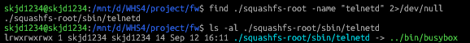

# rcS

앞에서 펌웨어 추출 과정을 통해 확보한 펌웨어를 기반으로, 본 문서에서는 실제 장비 내부에 접속할 수 있는 분석 환경을 만들기 위해 펌웨어의 `/etc/shadow`와 rcS 파일을 수정하는 방법에 대해서 다룹니다.

## telnetd 확인 및 /etc/shadow 수정

### telnetd 확인

파일 시스템 내에 telnetd 명령어가 있는 경우, IoT 기기의 부팅 스크립트에서 telnetd를 실행하면 장비가 켜질 때 telnet 서버가 자동을 시작되도록 하면서 실제 장비 내부에 접속할 수 있게 됩니다.

따라서, 우선 파일 시스템에 아래와 같이 telnetd 명령어가 존재하는지 확인할 수 있습니다.

```
find ./squashfs-root -name "telnetd" 2>/dev/null
```

```
ls -al ./squashfs-root/sbin/telnetd
```



파일 시스템에 telnetd과 관련된 파일을 찾고, 해당 파일이 `../bin/busybox`를 가리키는 심볼릭 링크임을 확인하면서, 펌웨어에 telnetd 명령어가 존재함을 알 수 있습니다.

### /etc/shadow 수정

telnet 접속 시 비밀번호 없이 root로 접속할 수 있게 하기 위해 파일 시스템에서 `/etc/shadow` 파일을 수정해줍니다.

여기서 `/etc/shadow`는 사용자 계정의 비밀번호와 관련된 정보를 저장하는 시스템 설정 파일입니다.

`/etc/shadow` 파일을 수정 시에는 시스템 설정 파일이기 때문에 `sudo`를 붙여야 내용을 수정할 수 있습니다.

```
sudo vi ./squashfs-root/etc/shadow
```

**수정 전 /etc/shadow**

```
root:$5$HvUmiKay8JugO17C$gazQrgfxANwpkKuzhKvE0.KVTWrS53cyVLsm8yiSkrC:10933:0:99999:7:::
```

**수정 후 /etc/shadow**

```
root::10933:0:99999:7:::
```

root: 다음에 나오는 두번째 필드에 해당하는 값이 비밀번호 해시값이므로 해당 값을 지워 비밀번호 없이 로그인이 가능하도록 해줍니다.

## rcS 초기화 스크립트 분석 및 수정

### rcS 초기화 스크립트

rcS는 시스템 부팅 시 실행되는 초기화 스크립트로, 장비가 정상적으로 동작하기 위해서 필요한 초기 설정과 서비스 실행을 실행하는 역할을 합니다.

우리가 사용하는 펌웨어의 경우에는 전원이 공급되면 부트로더가 실행되고 이후 리눅스 커널이 메모리에 적재되어 실행됩니다. 커널이 기본적인 하드웨어 및 시스템 환경을 준비하면 초기화 프로세스가 실행되며, 초기화 프로세스의 설정에 따라 rcS와 같은 스크립트가 실행됩니다.

따라서, rcS에 프로그램 실행 명령어를 추가하면 해당 스크립트가 부팅 과정에서 실행되기 때문에 장비가 켜질 때 해당 프로그램도 자동으로 실행되도록 설정할 수 있습니다.

### rcS 초기화 스크립트 분석

펌웨어 분석 과정에서 알게 된 rcS 파일 경로는 `./squashfs-root/etc/init.d/rcS`이며, cat 명령어를 통해 해당 초기화 스크립트를 열어보면 다음과 같습니다.

```
cat ./squashfs-root/etc/init.d/rcS
```

코드를 하나씩 살펴보면 다음과 같습니다.

```shell
# Set mdev
echo /sbin/mdev > /proc/sys/kernel/hotplug
/sbin/mdev -s && echo "mdev is ok......"
```

먼저, mdev를 사용해서 장치 관리 환경을 초기화합니다. 여기서 mdev는 BusyBox에서 제공하는 프로그램으로 시스템에 연결된 장치를 인식하고 필요한 장치 파일을 관리하는 역할을 합니다.

```shell
# Set Global Environment
export PATH=/bin:/sbin:/usr/bin:/usr/sbin
export PATH=/mnt/mtd/run:$PATH
export LD_LIBRARY_PATH=/mnt/mtd/lib
```

다음으로 프로그램 실행에 필요한 환경변수를 설정합니다.

```shell
# networking
ifconfig lo up
ifconfig eth0 172.16.1.18 netmask 255.255.255.0 up

# for hostapd udhcpd
mkdir -p /var/lib/misc
touch /var/lib/misc/udhcpd.leases
```

이 부분에서는 장비의 네트워크 인터페이스를 설정합니다.

```shell
#=======================提高ISP优先级==========================
devmem 0x1301206c 32 0x0
devmem 0x13012020 32 0x8840400B
devmem 0x13012038 32 0x88404002

#=======================提高sdio PB_8(12ma) 时钟驱动能力==========================
#echo "SDIO WIFI Enhancing clock driving capability PB(8) to MAX(12ma)"
#devmem 0x10011134 32 0x30000

#======================提高sfc优先级==========================
devmem 0x13012034 32 0x8840400F
```

이 부분에서는 devmem 명령어를 사용하여 특정 물리 메모리 주소에 값을 기록해줍니다.

```shell
# Mount app partition
mount -t squashfs /dev/mtdblock4 /mnt/mtd
mount -t jffs2 /dev/mtdblock5 /opt
```

이 부분에서는 장비의 플래시 메모리에 저장된 파일시스템을 마운트합니다.

```shell
source /etc/usbnet.sh &

goahead &
if [ $? -eq 0 ]; then
        echo "goahead running ......"
fi

system_call_daemon &
if [ $? -eq 0 ]; then
        echo "system_call_daemon running ......"
fi
```

이 부분에서는 `source /etc/usbnet.sh &`를 통해 우선 USB 네트워크와 관련된 초기화 작업을 하도록 되어있으며, `goahead &`, `system_call_daemon &` 명령어를 통해 웹 서버를 실행하고, 장비의 시스템 기능과 관련된 전용 데몬을 백그라운드에서 실행하고 있습니다.

```shell
# Run start script
if [ -f /mnt/mtd/startapp ]; then
        echo "==> startapp ok"
    /mnt/mtd/startapp &
fi
```

이 부분에서는 `/mnt/mtd/startapp` 파일을 실행하고 있습니다.

`/etc/init.d/rcS` 초기화 스크립트는 장치 관리자 초기화부터 네트워크 설정, 파일시스템 마운트, 웹 서버 및 장비 전용 프로그램 실행까지 여러 작업을 수행하고 있으며, 다만 사용하려는 telnet 서버를 실행하는 명령어는 확인할 수 없습니다.

### rcS 초기화 스크립트 수정

원격 분석 환경을 구성하기 위해서 장비가 켜질 때 telnet 서버가 자동으로 시작되도록 만들 것이기 때문에, 해당 rcS에 telnet을 실행시킬 수 있는 명령어를 추가해주면 자동으로 실행하도록 설정할 수 있습니다.

```shell
sudo nano ./squashfs-root/etc/init.d/rcS
```

```bash
# Run start script
if [ -f /mnt/mtd/startapp ]; then
        echo "==> startapp ok"
    /mnt/mtd/startapp &
fi

/sbin/telnetd &
```

위에서 `/sbin/telnetd`는 앞서 확인한 BusyBox의 Telnet 서버 기능을 호출하는 경로이며, `&`는 명령어를 백그라운드에서 실행하기 위한 기호입니다.

즉, `./etc/init.d/rcS` 파일의 마지막줄에 `/sbin/telnetd &` 추가해줌으로써, 장비가 시작될 때 rcS에서 telnet 서버도 함께 시작하도록 설정할 수 있습니다.
