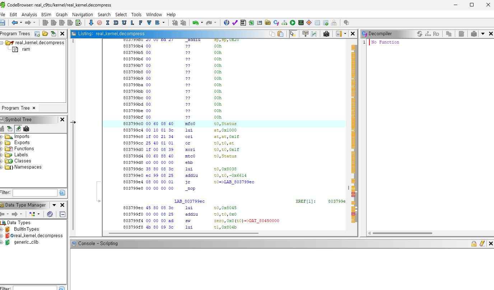
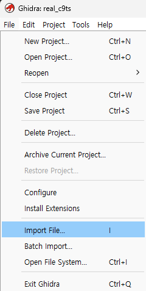
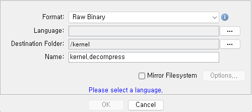
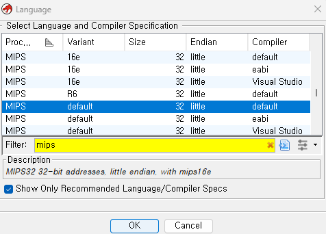
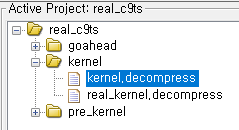
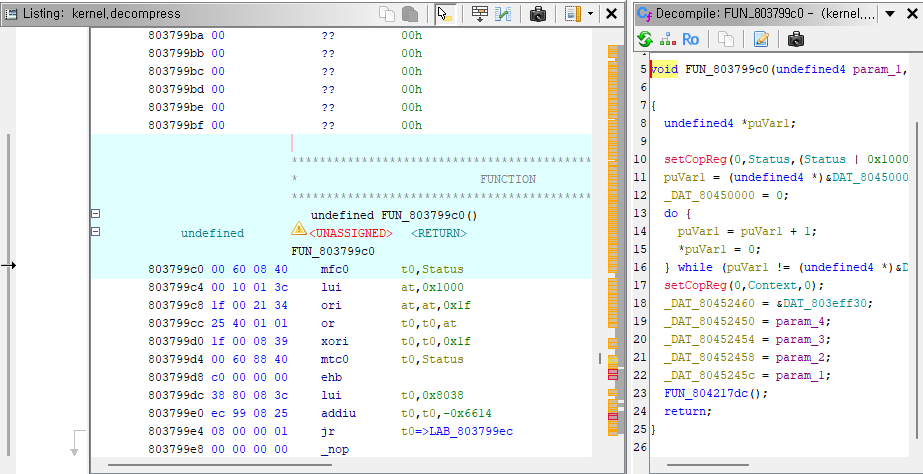
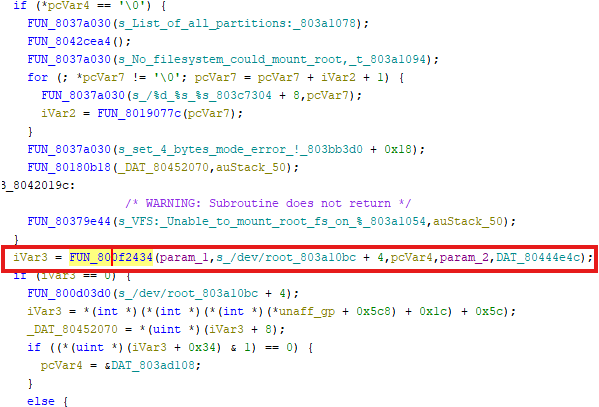

# Ghidra를 통한 정적 분석

본 장에서는 추출한 펌웨어의 커널 이미지와 사용자 공간 실행 파일을 Ghidra로 분석하는 방법을 설명합니다. 분석의 목적은 바이너리 전체를 완전히 복원하는 것이 아니라, DOOM 포팅에 필요한 부팅 구조, 실행 환경, 웹 서비스의 처리 흐름과 수정 후보 지점을 식별하는 것입니다.

펌웨어와 보드의 버전이 달라지면 함수 주소와 바이너리 구성이 달라질 수 있습니다. 따라서 아래 주소를 그대로 사용하는 대신, 이미지 헤더와 ELF 정보, 문자열, 교차 참조를 이용하여 각 펌웨어에서 분석 기준을 다시 확인해야 합니다.

## 1. 분석 대상

| 대상 | 형식 | 주요 분석 목적 |
|---|---|---|
| Linux 커널 | uImage 내부의 압축된 MIPS 커널 | 진입점, 초기화 과정, 루트 파일시스템 마운트 확인 |
| `goahead` | MIPS ELF, stripped | 웹 요청 처리, 문서 루트와 인증 초기화, 업데이트 경로 확인 |
| BusyBox 등 사용자 바이너리 | MIPS ELF | 아키텍처 및 ABI 확인, QEMU 실행 대상 선정 |

펌웨어 내부의 파티션 위치와 파일시스템 추출 과정은 [binwalk를 통한 정적 구조 분석](../binwalk를%20통한%20정적%20구조%20분석/README.md)에서 다룹니다. 본 장에서는 추출 이후의 코드 분석에 집중합니다.

### 주요 용어

| 용어 | 의미 |
|---|---|
| 바이너리(binary) | 컴파일되어 기계어 형태로 저장된 실행 파일 또는 데이터입니다. 본 문서에서는 주로 커널과 실행 파일을 가리킵니다. |
| ELF | Linux에서 널리 사용하는 실행 파일 형식입니다. CPU 아키텍처, 진입점, 코드·데이터 구역과 동적 링크 정보를 담습니다. |
| ISA | CPU가 해석할 수 있는 명령어 집합입니다. MIPS32r1, MIPS32r2 등이 이에 해당합니다. |
| ABI | 함수 인자를 전달하는 레지스터, 자료형 크기, 스택 사용법, 부동소수점 처리 등 컴파일된 프로그램 사이의 호출 규약입니다. ISA가 같아도 ABI가 맞지 않으면 정상적으로 실행되지 않을 수 있습니다. |

`/proc`과 프로세스 관련 용어는 [동적 구조 분석](../동적%20구조%20분석/README.md)에서 설명합니다. `/proc/cpuinfo`는 커널이 인식한 CPU 정보를, ELF 헤더는 해당 파일이 빌드된 조건을 보여주므로 두 정보의 목적이 다릅니다.

## 2. 분석 전 바이너리 형식 확인

Ghidra에 파일을 불러오기 전에 `file`과 `readelf`로 형식을 확인합니다.

```bash
file squashfs-root/mnt/mtd/run/jooanipc
readelf -h squashfs-root/mnt/mtd/run/jooanipc
readelf -A squashfs-root/mnt/mtd/run/jooanipc
```

분석에 사용한 `jooanipc`에서는 다음 특성을 확인했습니다.

```text
ELF 32-bit LSB executable, MIPS, MIPS32 rel2
dynamically linked
interpreter /lib/ld-uClibc.so.0
O32 ABI
hard-float, double precision
stripped
```

이 정보는 Ghidra 언어 선택뿐 아니라 이후 크로스 컴파일러와 QEMU 종류를 결정하는 근거가 됩니다. 실기기의 `/proc/cpuinfo`에 표시되는 ISA와 ELF의 ABI 플래그가 다를 수 있으므로, 어느 한 정보만으로 호환성을 단정하지 않고 실제 실행으로 검증합니다.

## 3. 커널 이미지 분석

### 3.1 uImage 헤더 확인

uImage는 64바이트 헤더 뒤에 실제 데이터가 이어지는 형식입니다. 헤더에는 아키텍처, 압축 방식, 데이터 크기, 로드 주소와 진입점 주소가 포함됩니다.


분석한 한 펌웨어에서는 다음 값을 확인했습니다.

| 항목 | 값 |
|---|---|
| Load address | `0x80010000` |
| Entry point | `0x803782A0` |
| Compression | LZMA |

실기기에서 별도로 추출한 다른 펌웨어의 진입점은 `0x803799C0`이었습니다. 이처럼 같은 제품군이라도 펌웨어 버전에 따라 주소가 달라질 수 있으므로, 다른 펌웨어에서 확인한 주소를 그대로 적용해서는 안 됩니다.

### 3.2 압축 데이터와 실행 코드 구분

초기 분석에서는 uImage에서 잘라낸 압축 커널을 그대로 Ghidra에 불러왔습니다. 이 경우 유효한 명령어가 거의 생성되지 않았고 진입점도 파일 범위와 맞지 않는 것처럼 보였습니다.

문제의 원인은 Ghidra 설정이 아니라 **압축된 데이터를 실행 코드로 해석한 것**이었습니다. 다음 순서로 다시 준비해야 합니다.

1. uImage 헤더에서 데이터 크기와 압축 방식을 확인합니다.
2. 64바이트 헤더를 제외한 데이터 영역만 정확히 카빙합니다.
3. 헤더에 표시된 방식으로 압축을 해제합니다.
4. 압축 해제한 커널을 Ghidra에 RAW 바이너리로 불러옵니다.
5. uImage의 load address를 이미지 베이스로 지정하고 entry point로 이동합니다.

카빙에는 `dd`를 사용할 수 있습니다. 다음 예시는 `0x48000`에서 시작하는 uImage의 64바이트 헤더를 건너뛴 뒤, 헤더의 Data Size만큼을 별도 파일로 저장합니다.

```bash
dd if=jooan.bin of=jooan_kernel.lzma bs=1 \
  skip=$((0x48000+64)) count=$((0x162f0f))
```

| 인자 | 의미 |
|---|---|
| `if` | 입력 펌웨어 파일 |
| `of` | 잘라낸 데이터를 저장할 출력 파일 |
| `bs=1` | 오프셋과 크기를 바이트 단위로 계산 |
| `skip` | 입력 파일에서 건너뛸 바이트 수 |
| `count` | 출력할 바이트 수 |

오프셋과 Data Size는 펌웨어마다 다르므로 예시 값을 그대로 사용하지 않고 해당 uImage 헤더에서 다시 확인합니다. 파티션 카빙과 압축 해제 과정의 상세 내용은 [binwalk를 통한 정적 구조 분석](../binwalk를%20통한%20정적%20구조%20분석/README.md)에서 다룹니다.

압축 해제한 커널을 올바른 주소로 불러오면 MIPS 명령어와 함수 흐름이 정상적으로 나타납니다.



### 3.3 Ghidra Import 설정

RAW 커널은 형식 정보가 없으므로 다음 항목을 직접 지정합니다.

| 설정 | 값 또는 확인 방법 |
|---|---|
| Language | MIPS 32-bit little-endian |
| Variant | default를 우선 적용한 뒤 명령어 해석 결과 확인 |
| Image base | uImage의 load address |
| Entry point | uImage의 entry point |

Ghidra 화면에서는 다음 순서로 불러옵니다. 버전에 따라 버튼 위치나 명칭이 조금 달라질 수 있으나 설정해야 하는 값은 같습니다.

1. Ghidra Project 창에서 File → New Project를 선택하고 개인 분석용이면 Non-Shared Project를 만듭니다.

2.File → Import File...을 선택하고 압축 해제한 커널 파일을 지정합니다.

3. Import 창의 Format을 Raw Binary로 지정합니다.

4. Language 옆의 선택 버튼을 누르고 필터에 `MIPS`를 입력합니다.

5. 목록에서 32비트 little-endian에 해당하는 `MIPS:LE:32:default` 계열을 선택합니다. 결과가 정상적으로 해석되지 않으면 Variant를 다시 확인합니다.

6. Options...에서 Base Address를 uImage의 Load Address인 `0x80010000`으로 지정합니다.

7. Import 요약에서 파일 형식, Language와 Base Address를 다시 확인하고 OK를 선택합니다.
8. 프로젝트 목록에서 가져온 파일을 더블클릭하여 CodeBrowser로 엽니다.

9. Auto Analysis 창이 나타나면 기본 reference·data·function 분석 항목을 유지하고 Analyze를 실행합니다. 창을 닫았다면 Analysis → Auto Analyze...에서 다시 실행할 수 있습니다.

10. 분석 후 `G` 키를 눌러 uImage의 Entry Point(앞서 말했듯이 고정값이 아니라 보드 및 펌웨어마다 다르기 때문에 찾아낸 주소값을 사용합니다)으로 이동합니다. 

해당 위치가 코드로 정의되지 않았다면 Listing에서 `D`로 디스어셈블하고, 함수 시작점이면 `F`로 함수를 생성합니다.


ELF는 헤더 정보를 이용해 형식과 Language가 자동 감지되는 경우가 많으므로 Import 요약을 확인한 뒤 진행합니다. RAW 커널은 이 정보가 없기 때문에 Format, Language와 Base Address를 반드시 직접 확인해야 합니다. 자세한 기본 사용법은 [Ghidra 공식 입문 가이드](https://ghidra.re/ghidra_docs/GhidraClass/Beginner/Introduction_to_Ghidra_Student_Guide.html)를 참고할 수 있습니다.

베이스 주소는 파일의 첫 바이트가 실행 시 메모리의 어느 주소에 놓이는지를 Ghidra에 알려주는 값입니다. RAW 파일에는 이 정보가 없으므로 분석자가 직접 지정해야 합니다.

MIPS 코드에서는 문자열과 전역 변수의 주소를 `lui`와 `addiu` 등의 명령어 조합으로 만들거나, 전역 포인터인 `gp`를 기준으로 계산합니다. 코드에 기록된 주소는 실제 메모리 배치를 전제로 하므로 Ghidra의 이미지 베이스가 틀리면 다음 문제가 발생합니다.

예를 들어 다음 명령은 상위 16비트와 하위 16비트를 조합하여 주소 `0x804217DC`를 만듭니다.

```asm
lui   t0, 0x8042        # t0 = 0x80420000
addiu t0, t0, 0x17dc    # t0 = 0x804217dc
```

`lui t0, 0x8000`과 `addiu t0, t0, 0x0021`을 조합하면 결과는 `0x8021`이 아니라 `0x80000021`입니다. `lui`가 즉시값을 상위 16비트로 이동시키기 때문입니다. 또한 `addiu`의 16비트 즉시값은 부호 확장되므로 하위 값이 `0x8000` 이상이면 컴파일러가 상위 값을 보정하는 경우도 고려해야 합니다.

- 명령어 자체는 정상적으로 보여도 문자열 주소가 문자열 데이터와 연결되지 않습니다.
- 전역 변수 접근이 실제 데이터가 아닌 잘못된 위치를 가리킵니다.
- 함수 호출 대상이나 점프 대상이 올바른 함수로 인식되지 않을 수 있습니다.
- XRef가 생성되지 않아 문자열에서 사용 함수로 이동하기 어려워집니다.
- 디컴파일러가 잘못된 포인터와 호출 관계를 바탕으로 부정확한 의사 코드를 생성합니다.

반대로 파일 내부의 상대적인 분기와 단순한 명령어 해석은 베이스 주소가 틀려도 일부 정상처럼 보일 수 있습니다. 따라서 “명령어가 보인다”는 사실만으로 설정이 올바르다고 판단해서는 안 됩니다. uImage 헤더의 load address를 적용한 뒤 entry point, 문자열 XRef와 함수 호출 대상이 함께 자연스럽게 연결되는지 확인해야 합니다.

### 3.4 커널 진입점 추적

진입점부터 코드를 따라가며 다음 초기화 과정을 확인했습니다.

1. CP0 상태 및 context 레지스터를 초기화합니다.
2. BSS 영역을 초기화합니다.
3. 부트로더가 전달한 `a0`~`a3` 인자를 보존합니다.
4. 스택 포인터와 전역 포인터(`gp`)를 설정합니다.
5. CPU와 초기 메모리 관리 환경을 준비한 뒤 C 코드로 이동합니다.


이후 Linux 버전 문자열과 초기화 메시지를 참조하는 코드가 나타났으며, `/dev/root` 문자열의 XRef를 따라가 루트 파일시스템 마운트를 시도하는 함수도 확인했습니다.



이 결과는 [binwalk를 통한 정적 구조 분석](../binwalk를%20통한%20정적%20구조%20분석/README.md)에서 확인한 `root=/dev/mtdblock3`, `rootfstype=squashfs` 부팅 인자 및 실기기의 `/proc/mounts` 결과와 일치합니다.

## 4. 사용자 공간 ELF 분석

### 4.1 ELF 불러오기

ELF 파일은 헤더에 아키텍처, 섹션과 진입점 정보가 있으므로 Ghidra가 대부분의 설정을 자동으로 인식합니다.

제품에 포함되는 실행 파일은 저장공간을 줄이고 내부 구현 정보를 노출하지 않기 위해 `strip` 처리를 하는 경우가 많습니다. stripped ELF는 실행에 불필요한 심볼 테이블과 디버깅 정보를 제거한 파일입니다. 프로그램 실행에 필요한 코드와 데이터는 남아 있으므로 정상적으로 실행되지만, Ghidra에서는 원래 함수명·변수명·소스 파일명·행 번호가 대부분 보이지 않고 `FUN_00401234`와 같은 임시 이름으로 표시됩니다. 동적 링크에 필요한 일부 외부 심볼은 남을 수 있으나 제조사가 작성한 내부 함수의 의미까지 제공하지는 않습니다.

따라서 stripped 바이너리는 손상된 파일이 아니며, 다음 단서를 조합하여 기능을 다시 식별해야 합니다.

- 오류 메시지와 로그 문자열
- URL, 파일 경로와 설정 파일 이름
- import된 libc 함수
- 문자열과 함수의 XRef
- 인접 함수의 호출 관계
- QEMU에서 관찰한 syscall과 오류 발생 시점

분석 중 의미가 확인된 함수는 Ghidra에서 이름을 변경하고, 인자와 동작을 주석으로 기록했습니다. 이름 변경은 분석 편의를 위한 추정이며 원본 심볼이 복구된 것은 아닙니다. 함수명에는 `suspected_`와 같은 접두사를 사용하거나 근거를 주석으로 남기면 확인된 사실과 추정을 구분할 수 있습니다.

### 4.2 문자열과 XRef를 이용한 함수 식별

예를 들어 펌웨어 업데이트 기능은 웹 페이지와 바이너리에서 다음 문자열을 검색하여 시작점을 찾았습니다.

```text
CgiIronManUpgrade
QAUpgradeDecV1
/tmp/upgrade
upgrade.sh
```

XRef(cross-reference)는 특정 주소를 참조하는 코드나 데이터의 위치를 보여줍니다. 함수명이 사라진 바이너리에서도 오류 메시지, URL, 파일 경로는 기능의 목적을 드러내는 경우가 많습니다. 따라서 문자열의 XRef는 의미를 아는 데이터에서 이름을 모르는 함수로 진입하는 핵심 단서가 됩니다.

Ghidra에서는 다음 순서로 확인합니다.

1. **Search → For Strings**에서 기능과 관련된 문자열을 찾습니다.
2. Listing 또는 Defined Strings 창에서 문자열을 선택합니다.
3. 우클릭 후 **References → Show References To**를 선택하거나 `X` 단축키를 사용합니다.
4. 참조 위치로 이동하여 문자열이 함수 인자, 비교 대상 또는 로그 출력 중 어디에 사용되는지 확인합니다.
5. 해당 함수의 호출자 XRef를 다시 따라가 상위 요청 처리 함수까지 범위를 넓힙니다.
6. 여러 문자열과 외부 함수 호출이 같은 기능을 가리키는지 확인한 뒤 함수명을 변경하고 근거를 주석으로 남깁니다.

문자열이 존재해도 직접 주소가 아니라 포인터 테이블이나 런타임 계산을 통해 사용되면 XRef가 자동 생성되지 않을 수 있습니다. 이 경우 문자열 주소를 구성하는 `lui`·`addiu` 조합, 인접한 문자열, 포인터 테이블과 동적 실행 로그를 함께 확인합니다.

이 방식으로 펌웨어 업데이트 문자열의 XRef를 따라 요청 처리 함수와 파일 검사 흐름을 식별했습니다. 구체적인 헤더·푸터 형식과 업데이트 적용 과정은 [업데이트 로직 분석](../업데이트%20로직%20분석/README.md)에서 다룹니다.

## 5. 펌웨어 버전 간 `goahead` 비교

같은 제품군의 구형·신형 `goahead`를 QEMU에서 실행한 결과, 한쪽에서는 다음 assertion이 발생했습니다.

```text
Assertion 0 <= sd && sd < symMax, failed at runtime.c 1978
```

QEMU `-strace` 결과를 비교하자 정상 버전은 `/etc/webs`를 문서 루트로 사용하지만, 오류가 발생한 버전은 일부 경로가 설정되지 않은 상태로 파일에 접근하는 차이가 있었습니다. 이 동적 관찰을 바탕으로 Ghidra에서 `symMax`, `dir && *dir` 등의 문자열을 검색하고 XRef를 추적했습니다.

그 결과 두 버전의 `websOpen` 초기화 흐름에 다음 차이가 있음을 확인했습니다.

| 함수 | 역할 | 관찰된 차이 |
|---|---|---|
| `websSetDocuments` | 웹 문서 루트 설정 | 오류 버전의 초기화 흐름에서 호출되지 않음 |
| `websOpenAuth` | 사용자·역할 해시 테이블 초기화 | 오류 버전의 초기화 흐름에서 호출되지 않음 |
| `hashCreate` | 내부 심볼 테이블 생성 | 인증 초기화 누락 시 유효하지 않은 핸들 사용 가능 |

처음에는 바이너리 패치를 검토했으나, 최종적으로는 `route.txt`의 기본 경로에 `dir=/etc/webs`를 명시하는 설정 변경만으로 웹 루트 문제를 해결할 수 있었습니다. 이 사례는 정적 분석 결과가 곧바로 바이너리 수정 필요성을 의미하지 않으며, 설정으로 해결할 수 있는지를 먼저 검토해야 함을 보여줍니다.

## 6. 후속 구현과의 범위 구분

문자열과 XRef로 식별한 함수는 이후 수정 대상을 선정하는 근거로 활용할 수 있습니다. 다만 본 장은 바이너리의 구조와 호출 흐름을 확인하는 정적 분석까지만 다룹니다.

실제 바이너리 수정과 리패키징은 [파일 변조 및 리패키징 사전 실습](../../파일%20변조%20및%20리패키징%20사전%20실습/)에서, 실행 트리거를 비롯한 포팅 구현은 [DOOM 포팅 구현](../../DOOM%20포팅%20구현/)에서 별도로 다룹니다.

## 7. 정적·동적 분석의 교차검증

| 정적 분석에서 세운 가설 | 동적 분석 방법 | 확인 결과 |
|---|---|---|
| 대상은 MIPS little-endian ELF임 | QEMU `qemu-mipsel-static` 실행 | 실행 가능함을 확인함 |
| `/mnt/mtd/lib`가 라이브러리 경로임 | `/proc/<PID>/environ`, `maps` 확인 | 실제 프로세스 환경에서 사용됨 |
| `/bin/goahead` 또는 appfs 복사본이 실행될 수 있음 | `/proc/<PID>/exe`, MD5 확인 | 관찰한 기기에서는 `/bin/goahead`가 실행됨 |
| 문서 루트 초기화가 누락됨 | 버전별 `-strace` 비교 | null 경로 접근 차이를 확인함 |

정적 분석과 동적 분석의 수행 순서가 항상 고정되는 것은 아닙니다. 파일 형식과 문자열을 먼저 확인한 뒤 실행할 수도 있고, 실행 중 발생한 오류 문자열에서 정적 분석을 시작할 수도 있습니다. 본 프로젝트에서는 다음 두 방향을 모두 사용했습니다.

```text
정적 분석에서 후보 함수·경로 발견 → QEMU와 실기기에서 실제 사용 여부 확인
동적 분석에서 오류·파일 접근 발견 → Ghidra에서 관련 문자열과 호출 관계 추적
```

정적 분석은 가능한 코드 경로와 후보 함수를 찾는 데 유리하고, 동적 분석은 특정 실행 조건에서 실제로 선택된 경로를 판별하는 데 유리합니다. 두 결과가 다르면 펌웨어 버전, 설정 파일, 실행 인자와 프로세스 경로를 확인한 뒤 양쪽 분석을 반복합니다.

## 8. 재현 절차

다른 펌웨어를 분석할 때는 다음 순서로 진행합니다.

1. `binwalk`, `file`, `readelf`로 컨테이너·압축·실행 파일 형식을 구분합니다.
2. 압축된 커널은 헤더와 데이터 크기를 확인한 뒤 압축 해제합니다.
3. RAW 이미지는 헤더의 load address와 entry point를 Ghidra에 반영합니다.
4. ELF는 자동 인식 결과와 `readelf` 결과가 일치하는지 확인합니다.
5. 기능과 관련된 문자열을 검색하고 문자열을 참조하는 코드 XRef로 이동합니다.
6. 참조 함수를 호출하는 상위 함수의 XRef를 따라가 기능의 진입점을 좁힙니다.
7. 함수 이름과 데이터 타입을 정리하되 추정 근거를 주석으로 남깁니다.
8. 확인이 필요한 가설과 관찰 지점을 동적 분석 단계로 전달합니다.
9. QEMU의 syscall·GDB 결과와 실기기의 실행 상태를 바탕으로 정적 분석 결과를 수정합니다.

## 9. 분석 결과

- 압축된 MIPS 커널을 분리하고 uImage 헤더의 로드 주소와 진입점을 적용하여 초기화 코드를 확인했습니다.
- 커널 진입부에서 레지스터, BSS, 스택과 전역 포인터 초기화 이후 C 코드로 이동하는 흐름을 확인했습니다.
- `/dev/root` 문자열의 XRef를 통해 루트 파일시스템 마운트 관련 코드를 식별했습니다.
- stripped ELF에서는 문자열과 외부 함수, XRef를 조합하여 `goahead`의 웹 루트·인증·업데이트 처리 경로를 좁혔습니다.
- `goahead` 버전 간 초기화 호출 차이를 확인하고, QEMU 로그와 결합하여 설정으로 해결할 수 있는 문제를 바이너리 수정 대상과 구분했습니다.
- 정적 분석 결과를 QEMU 및 실기기 관찰과 교차검증하는 절차를 정리했습니다.

## 10. 한계

- 커널 전체와 모든 드라이버를 완전히 복원하지는 않았습니다.
- stripped 바이너리에 부여한 함수명과 타입 중 일부는 문자열 및 호출 관계를 바탕으로 한 추정입니다.
- 펌웨어 버전에 따라 주소와 호출 흐름이 달라지므로 본 문서의 주소는 분석 예시로만 사용해야 합니다.
- 정적 분석만으로는 실제 실행 시 선택되는 설정과 코드 경로를 확정하기 어려우므로, 확인이 필요한 항목은 [동적 구조 분석](../동적%20구조%20분석/README.md)에서 검증했습니다.
