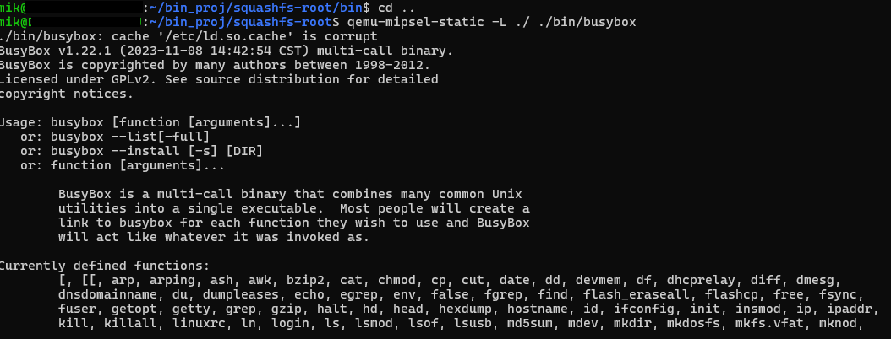
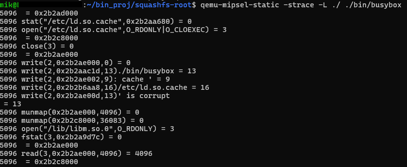
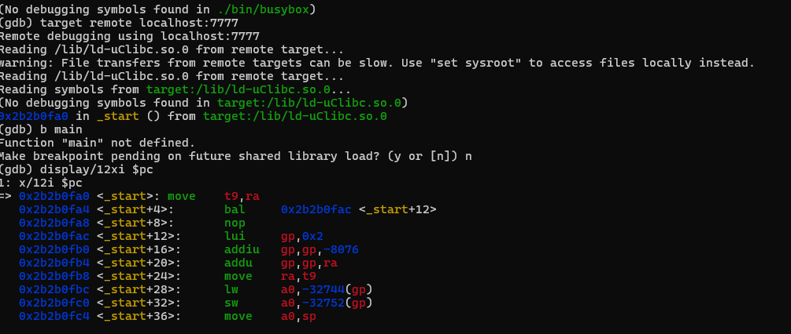
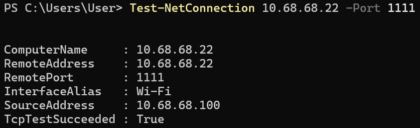
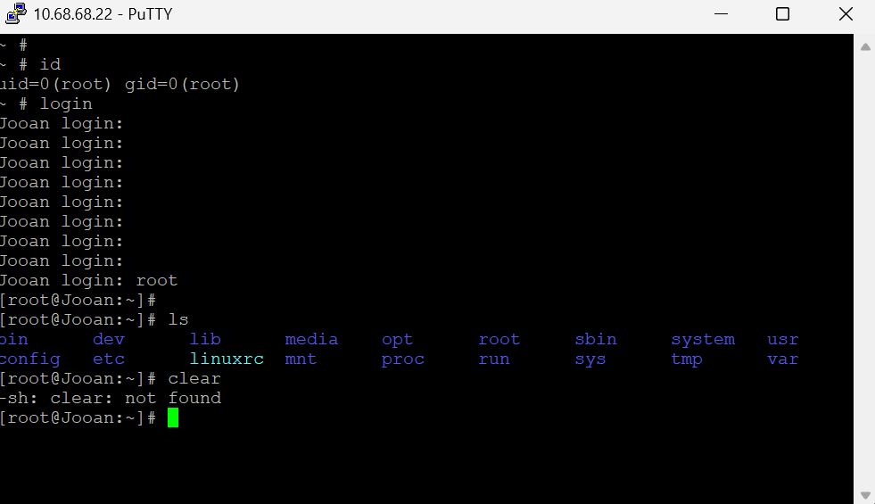
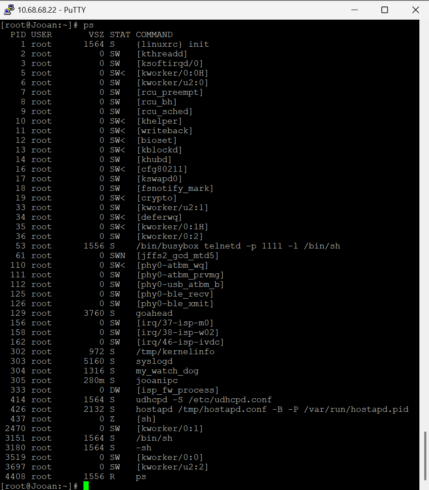
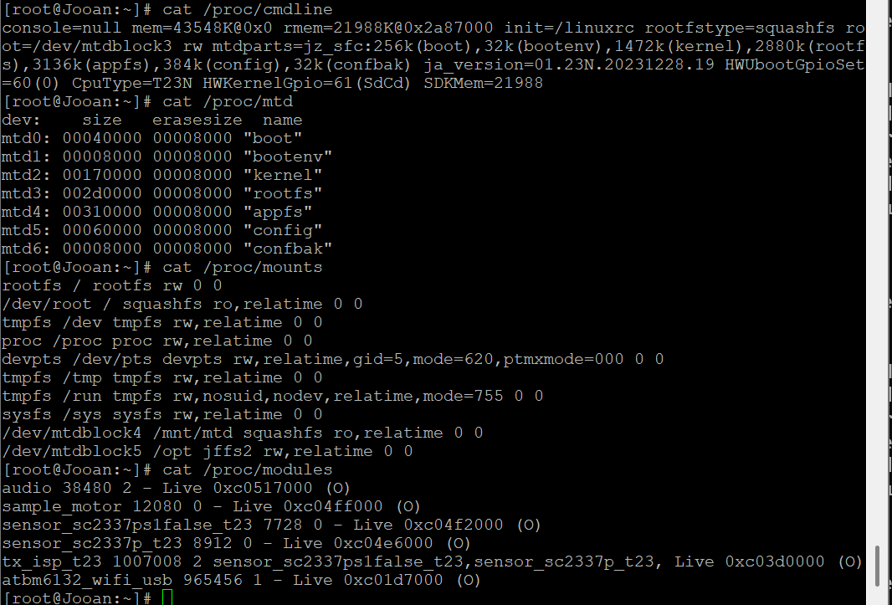
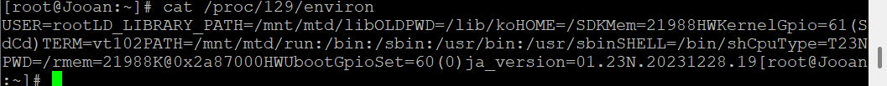
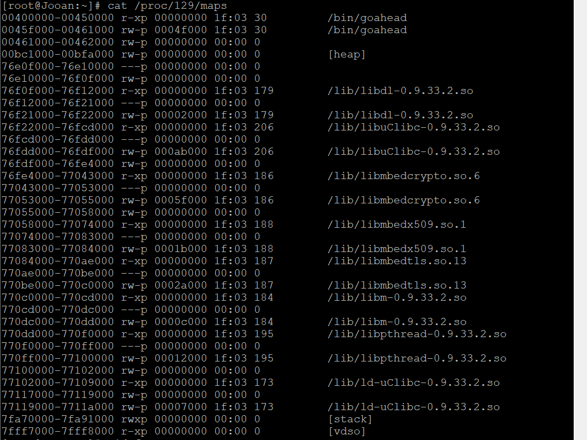

# 동적 구조 분석

본 장에서는 추출한 펌웨어의 MIPS 바이너리를 QEMU에서 실행하고, 실제 카메라의 런타임 정보를 조사하여 정적 분석 결과를 검증한 과정을 설명합니다. 펌웨어나 보드 버전이 달라지는 경우에도 DOOM 포팅에 필요한 실행 조건을 확인할 수 있도록 분석 방법과 프로젝트의 관찰 결과를 함께 제시합니다.

동적 분석은 다음 방식으로 진행했습니다. 실행 결과가 정적 분석의 예상과 다르거나 설정을 변경한 경우에는 필요한 단계로 돌아가 다시 검증합니다.

```text
바이너리 형식과 의존성 확인
          ↓
QEMU에서 최소 실행 환경 구성
          ↓
입력을 전달하고 syscall·오류 관찰
          ↓
Ghidra에서 관련 함수와 설정 재검토
          ↓
QEMU 재검증 후 실기기에서 확인
```

## 1. 분석 대상을 먼저 식별하기

같은 상품이라도 펌웨어 버전과 보드 리비전에 따라 CPU 정보, 실행 파일, 경로와 설정이 달라질 수 있습니다. 분석 전에 다음 정보를 다시 수집합니다.

### 주요 용어와 경로

| 용어 | 의미 |
|---|---|
| PID | 실행 중인 프로세스마다 커널이 부여하는 번호입니다. 재부팅하거나 프로세스를 다시 시작하면 달라질 수 있습니다. |
| syscall | 사용자 프로그램이 파일, 메모리, 네트워크와 프로세스 관리 등의 커널 기능을 요청하는 공식 진입점입니다. 일반 함수 호출과 달리 사용자 공간에서 커널 공간으로 제어가 넘어갑니다. |
| `/proc` | 실행 중인 커널과 프로세스 정보를 파일 형태로 제공하는 가상 파일시스템입니다. 실제 플래시에 저장된 일반 파일은 아닙니다. |

바이너리, ELF, ISA와 ABI처럼 파일 자체의 형식을 설명하는 용어는 [Ghidra를 통한 정적 분석](../Ghidra를%20통한%20정적%20분석/README.md)에서 다룹니다. 이 장에서는 실행 중에만 확인할 수 있는 PID, syscall과 `/proc` 정보를 중심으로 설명합니다.

`/proc/<PID>` 아래에서 주로 확인하는 항목은 다음과 같습니다.

| 경로 | 확인할 수 있는 정보 |
|---|---|
| `exe` | 실행 파일을 가리키는 심볼릭 링크 |
| `cmdline` | 프로세스를 시작할 때 전달된 실행 파일명과 인자 |
| `environ` | 프로세스에 전달된 환경 변수 |
| `maps` | 실행 파일과 공유 라이브러리가 매핑된 메모리 주소 |

임베디드 Linux는 저장공간을 줄이기 위해 BusyBox의 제한된 명령만 제공하는 경우가 많습니다. PC Linux에서 사용하는 `readlink`, `tr`, `find` 등의 명령이 없거나 일부 옵션만 지원될 수 있습니다. 아래 명령은 가능한 예시이며, 지원되지 않으면 `ls -l /proc/<PID>/exe`, `cat`, BusyBox applet 또는 분석 PC로 복사한 파일을 이용합니다.

```sh
file <binary>
readelf -h <binary>
readelf -A <binary>

ps
ls -l /proc/<PID>/exe
tr '\0' ' ' < /proc/<PID>/cmdline
tr '\0' '\n' < /proc/<PID>/environ
cat /proc/<PID>/maps

cat /proc/cpuinfo
cat /proc/version
cat /proc/cmdline
cat /proc/mtd
cat /proc/mounts
df -h
```

PID, IP 주소와 파일 경로는 고정값이 아닙니다. 먼저 `ps`로 PID를 찾고 `/proc/<PID>/exe`가 가리키는 실제 실행 파일을 확인해야 합니다. 같은 이름의 실행 파일이 rootfs와 appfs처럼 여러 파티션에 존재할 수 있으므로, 실행 중인 파일과 각 후보의 `md5sum`을 비교하면 어느 복사본이 실행되었는지 판단할 수 있습니다. MD5는 여기서 파일 내용의 동일성만 비교하기 위한 값이며 보안상 무결성이나 진위를 보증하는 용도로 사용하지 않습니다.

## 2. QEMU 기반 분석 환경

### 2.1 BusyBox로 실행 환경 검증

대상 펌웨어는 MIPS little-endian 바이너리를 사용하므로 x86-64 PC에서 직접 실행할 수 없습니다. 먼저 추출한 rootfs에서 BusyBox를 실행하여 QEMU와 라이브러리 구성이 맞는지 확인했습니다.

```bash
cd squashfs-root
qemu-mipsel-static -L ./ ./bin/busybox
```

`-L ./`은 현재 디렉터리를 분석 대상 바이너리의 라이브러리 루트로 사용하도록 지정합니다.



이 단계는 QEMU 환경의 정상 여부를 확인하기 위한 기초 시험입니다. BusyBox가 실행되었다고 해서 `goahead`, `jooanipc` 또는 카메라 장치 의존 기능까지 동작한다고 판단할 수는 없습니다.

### 2.2 syscall 추적

QEMU의 `-strace` 옵션으로 분석 대상 바이너리가 호출하는 syscall과 반환값을 확인했습니다.

```bash
qemu-mipsel-static -strace -L ./ ./bin/busybox
```



`strace`가 보여주는 syscall은 프로그램 내부 함수보다 큰 단위의 동작을 파악하는 데 유용합니다. 예를 들어 다음과 같은 흐름을 확인할 수 있습니다.

- `open`·`stat`: 어떤 설정 파일과 웹 문서, 라이브러리를 찾는지 확인합니다.
- `mmap`: 실행 파일과 라이브러리가 메모리에 적재되는 과정을 확인합니다.
- `read`·`write`: 파일 또는 소켓을 통한 입출력과 오류 메시지를 확인합니다.
- `socket`·`bind`·`listen`·`accept`: 네트워크 서비스의 생성과 요청 수신 흐름을 확인합니다.
- 반환값: 파일 부재, 권한 문제, 잘못된 인자 등 실패 원인을 확인합니다.

분석 대상이 stripped 바이너리여도 syscall의 이름, 인자와 반환값은 심볼 제거 여부와 관계없이 관찰할 수 있습니다. 따라서 특정 요청 직후 어떤 파일을 열다가 실패했는지, 어느 포트에서 대기하는지와 같은 외부 동작을 먼저 찾고 이를 정적 분석의 단서로 사용할 수 있습니다. stripped ELF의 의미와 분석 방법은 [Ghidra를 통한 정적 분석](../Ghidra를%20통한%20정적%20분석/README.md)에서 설명합니다. 다만 `-strace`만으로 syscall 사이의 내부 함수 호출 관계까지 알 수 있는 것은 아닙니다.

QEMU의 `-strace`는 함수 호출 스택이 아니라 **시스템 콜 추적 결과**입니다.

### 2.3 GDB 원격 디버깅

`gdb-multiarch`는 x86, ARM, MIPS 등 여러 ISA의 레지스터와 명령어를 해석할 수 있도록 구성된 GDB입니다. 분석 PC는 x86-64이지만 대상 바이너리는 MIPS이므로, 호스트용 기본 GDB 대신 MIPS 실행 상태를 해석할 수 있는 `gdb-multiarch`를 사용했습니다. QEMU를 원격 디버깅 대기 상태로 실행한 뒤 이에 연결했습니다.

```bash
# 터미널 1
qemu-mipsel-static -g 7777 -L ./ ./bin/busybox

# 터미널 2
gdb-multiarch ./bin/busybox
(gdb) target remote localhost:7777
(gdb) display/12i $pc
```



BusyBox의 `_start`와 초기 명령어를 확인했습니다. 이후 대상 함수에 중단점을 설정하려면 Ghidra에서 확인한 주소와 QEMU의 실제 메모리 매핑을 함께 확인해야 합니다.

## 3. 실제 서비스 바이너리 실행

### 3.1 rootfs와 설정 영역 준비

실기기에서 `/`와 `/mnt/mtd`는 읽기 전용 SquashFS이지만 `/opt`는 읽기·쓰기가 가능한 JFFS2 config 파티션입니다. 제조사는 이 영역에 장치별 설정처럼 재부팅 후에도 유지되어야 하고 펌웨어 이미지와 별도로 변경되어야 하는 데이터를 저장합니다. 관찰한 펌웨어의 `goahead`는 `/opt/conf/config.json`을 참조하므로 rootfs만 추출한 환경에서는 필요한 설정이 없어 실행이 실패할 수 있습니다. `/etc/webs`, `route.txt`, `auth.txt` 등의 웹 문서와 라우팅·인증 설정도 함께 필요합니다.

프로젝트에서는 rootfs 내부에 QEMU static 바이너리를 배치하고, 별도로 추출한 JFFS2 설정 영역을 rootfs 아래의 `/opt` 위치에 bind mount하여 실제 절대경로를 재현했습니다. bind mount는 원본 디렉터리를 복사하지 않고 다른 경로에서도 같은 내용이 보이게 하는 Linux 기능입니다.

```bash
sudo cp "$(which qemu-mipsel-static)" squashfs-root/usr/bin/
sudo mount --bind jffs2-root squashfs-root/opt
sudo chroot squashfs-root /usr/bin/qemu-mipsel-static \
  /bin/goahead /etc/webs 0.0.0.0:18080
```

분석을 마치면 bind mount를 해제합니다.

```bash
sudo umount squashfs-root/opt
```

위 명령은 QEMU를 명시적으로 호출하는 방식입니다. 호스트에 MIPS용 binfmt가 등록된 환경에서는 `chroot` 안에서 `/bin/goahead`를 직접 실행할 수도 있습니다. 실행 인자는 대상 펌웨어에서 다시 확인합니다.

```sh
/bin/goahead /etc/webs 0.0.0.0:18080
```

포트는 기존 서비스와 충돌하지 않도록 분석 환경에 맞게 변경할 수 있습니다.

### 3.2 chroot 사용 시 안전 주의사항

`chroot`는 프로세스가 `/`로 인식하는 파일시스템 시작점만 변경합니다. 별도의 커널, 프로세스·네트워크·마운트 namespace 또는 가상 하드웨어를 만드는 기능이 아니며 보안 격리 수단으로 설계된 것도 아닙니다. 기본적으로 실행 사용자의 권한도 그대로 유지됩니다.

QEMU user-mode 역시 보드 전체를 가상화하지 않습니다. MIPS 명령어를 호스트 CPU에서 실행할 수 있도록 변환하고, 대상 프로그램의 syscall을 호스트의 대응 syscall로 변환하여 호스트 커널에 요청합니다. 따라서 `chroot`와 QEMU user-mode를 함께 사용해도 파일 경로 일부가 달라질 뿐, 프로그램은 여전히 호스트 커널과 자원을 사용합니다.

특히 `/proc`, `/sys`, `/dev` 또는 설정 디렉터리를 chroot 내부에 bind mount하면 해당 경로를 통해 호스트 상태와 장치가 노출될 수 있습니다. 같은 mount·network namespace에서 root 권한으로 실행한 명령은 호스트의 마운트나 네트워크 설정에 영향을 줄 수 있습니다. 펌웨어의 `rcS`, `startapp` 같은 초기화 스크립트를 통째로 실행할 때 다음 명령을 주의해야 합니다.

- `reboot`, `poweroff`, `killall`
- `mount`, `umount`
- `ifconfig`, `route` 등의 네트워크 변경
- `devmem` 및 장치 노드 접근

안전한 분석을 위해 다음 원칙을 적용합니다.

1. `rcS`, `startapp`과 이들이 호출하는 하위 스크립트를 텍스트로 먼저 검토합니다.
2. 전체 부팅 스크립트를 실행하지 않고 필요한 환경 변수, 파일과 디렉터리만 준비한 뒤 **대상 바이너리를 개별 실행**합니다.
3. `/proc`, `/sys`, `/dev`는 필요성을 확인하기 전까지 bind mount하지 않습니다. 필요한 경우에도 가능한 범위에서 읽기 전용으로 제한합니다.
4. root 권한은 chroot 구성과 mount에 필요한 구간으로 제한하고, 대상 프로그램은 가능하면 권한을 낮춰 실행합니다.
5. 네트워크와 장치 접근이 필요한 실험은 스냅샷으로 복구할 수 있는 별도의 가상 머신이나 격리된 실행 환경에서 수행합니다.
6. 무한 대기와 반복 실행에 대비해 `timeout`을 사용하고, 종료 후 bind mount가 해제되었는지 확인합니다.

관련 동작은 [QEMU User space emulator 공식 문서](https://www.qemu.org/docs/master/user/main.html)와 [GNU Coreutils의 chroot 설명](https://www.gnu.org/software/coreutils/manual/html_node/chroot-invocation.html)에서 확인할 수 있습니다.

## 4. 버전별 실행 로그 비교

### 4.1 syscall 차이 확인

정상적으로 실행되는 구형 `goahead`와 오류가 발생하는 신형 `goahead`를 같은 조건에서 실행하고 로그를 분리하여 비교했습니다.

```bash
qemu-mipsel-static -strace -L ./ ./bin/goahead \
  /etc/webs 0.0.0.0:18080 > goahead.log 2>&1
```

오류 버전에서는 다음 assertion이 나타났습니다.

```text
Assertion 0 <= sd && sd < symMax, failed at runtime.c 1978
```

로그 비교 결과 오류 버전은 정상 버전이 `/etc/webs`를 사용하는 위치에서 null 경로로 `stat64`와 `open`을 시도했습니다. 이 차이를 단서로 [Ghidra를 통한 정적 분석](../Ghidra를%20통한%20정적%20분석/README.md)에서 `websSetDocuments`, `websOpenAuth`, `hashCreate` 호출 관계를 확인했습니다.

이 결과는 실행 오류를 정적 분석에서 다시 조사하기 위한 근거로 사용했습니다. 웹 서버 설정 변경과 이후 활용 과정은 본 장의 범위에 포함하지 않습니다.

## 5. 실기기 접근과 런타임 조사

### 5.1 접근 경로 선택

UART 접근을 검토했으나 USB 직렬 변환기 측 신호가 5V이고 대상 보드는 3.3V로 판단되어, 레벨 시프터 없이 직접 연결하지 않았습니다. 대신 허가된 실습 기기의 Wi-Fi AP에 연결하고 TCP 1111의 Telnet 셸을 이용했습니다.

커널 로그에는 UART1이 `ttyS1`으로 등록되어 있었지만, 부팅 인자에는 `console=null`이 지정되어 있고 초기 콘솔을 열지 못했다는 메시지도 기록되어 있었습니다. 따라서 UART 장치의 존재만으로 부팅 콘솔을 사용할 수 있다고 판단할 수 없습니다.

```powershell
Test-NetConnection 10.68.68.22 -Port 1111
```





실험 당시 `id` 결과는 `uid=0(root) gid=0(root)`였습니다. IP 주소와 포트는 펌웨어 설정에 따라 달라질 수 있으므로 고정값으로 가정하지 않습니다.

### 5.2 프로세스와 부팅 상태



관찰한 주요 프로세스는 다음과 같습니다.

| 프로세스 | 확인한 역할 |
|---|---|
| `{linuxrc} init` | PID 1, BusyBox 기반 초기화 |
| `telnetd -p 1111 -l /bin/sh` | 분석용 셸 제공 |
| `goahead` | 웹 서비스 |
| `my_watch_dog` | 주요 서비스 감시 |
| `jooanipc` | 카메라 핵심 애플리케이션 |
| `udhcpd`, `hostapd` | Wi-Fi AP와 DHCP 제공 |

프로세스 번호는 부팅할 때마다 달라질 수 있으므로 이름으로 PID를 찾은 뒤 `/proc`를 조회합니다.

```sh
cat /proc/cmdline
cat /proc/mtd
cat /proc/mounts
cat /proc/modules
```



| 위치 | 형식 | 상태 | 포팅 관점의 의미 |
|---|---|---|---|
| `/` | SquashFS | 읽기 전용 | 변경하려면 리패키징 필요 |
| `/mnt/mtd` | SquashFS | 읽기 전용 | appfs 실행 파일·라이브러리 위치 |
| `/opt` | JFFS2 | 읽기·쓰기, 여유 약 244~268KB | 소규모 설정 저장에 적합 |
| `/tmp` | tmpfs | 읽기·쓰기, 여유 약 18.5MB | 임시 파일용이며 재부팅 시 소멸 |
| `/tmp/sd` | VFAT SD 카드의 수동 마운트 지점 | 읽기·쓰기, 여유 약 557MB | 분석 과정에서 쓰기 가능 여부를 확인하기 위해 사용 |
| `/mnt/sd_card` | 제조사 애플리케이션이 사용하는 SD 경로 | 마운트된 경우 읽기·쓰기 | 실제 운용 경로로 사용 |

### 5.3 커널 로그와 장치 초기화

`dmesg`와 `/proc/devices`, `/proc/interrupts`, `/proc/iomem`을 함께 확인하여 커널이 인식한 하드웨어와 실제 활동 상태를 조사했습니다.

```sh
dmesg
cat /proc/devices
cat /proc/interrupts
cat /proc/iomem
```

| 확인 항목 | 관찰 결과 |
|---|---|
| CPU 및 클럭 | Ingenic XBurst, CPU 클럭 1,400MHz |
| 메모리 | 커널 인자에서 43,548KB 지정, 초기화 후 약 38,136KB 사용 가능 |
| 플래시 | XM25QH64C SPI NOR와 7개 MTD 파티션 등록 |
| SD 인터페이스 | MMC block major 179 및 `jzmmc_v1.2` 드라이버 등록 |
| 영상 장치 | IPU, ISP, IVDC와 Helix 관련 영역 및 인터럽트 확인 |
| 네트워크 | USB Wi-Fi 드라이버 초기화, 유선 GMAC probe 실패 |
| 카메라 센서 | 주 센서 `sc2337p` 탐지 및 스트림 활성화 |
| 입력·기타 장치 | `gpio-keys`, watchdog, 오디오와 모터 드라이버 등록 |

`/proc/interrupts`에서 IPU, ISP, I2C와 USB 등의 카운트가 증가한 것은 해당 장치가 등록만 된 것이 아니라 관찰 시점에 일부 동작하고 있었음을 보여줍니다. 반면 후보 보조 센서의 I2C 탐색 실패처럼 초기화 중 예상 가능한 오류도 있으므로, `dmesg`의 오류 문자열만으로 장치 고장을 단정하지 않습니다.

이 장치들은 호스트 커널을 사용하는 QEMU user-mode에서 재현되지 않습니다. 따라서 사용자 공간 바이너리의 실행과 파일 접근은 QEMU에서 조사하고, 장치 드라이버와 하드웨어 동작은 실기기 로그로 확인했습니다.

### 5.4 CPU와 메모리

| 항목 | 실기기 관찰값 |
|---|---|
| SoC 계열 | Pike / Ingenic XBurst |
| CPU | 단일 코어, BogoMIPS 1386.49 |
| `/proc/cpuinfo` ISA | `mips32r1` |
| 커널 | Linux 3.10.14 `isvp_pike` |
| 빌드 컴파일러 | Ingenic gcc 5.4.0 |
| 전체 RAM | 38,324KB |
| 측정 당시 여유 RAM | 13,064KB |
| Swap | 없음 |

`/proc/cpuinfo`는 `mips32r1`을 보고했지만 분석한 ELF에는 MIPS32r2 플래그가 존재했습니다. CPU 정보는 하드웨어 관찰값, ELF 플래그는 해당 프로그램의 빌드 조건이므로 각각 기록하고 QEMU와 실기기에서 실제 호환성을 검증했습니다.

### 5.5 실행 중인 `goahead` 확인

```sh
ls -l /proc/129/exe
cat /proc/129/cmdline
cat /proc/129/environ
cat /proc/129/maps
md5sum /proc/129/exe
```





대상 장비에는 `readlink` 명령이 없어 `ls -l /proc/129/exe`로 심볼릭 링크의 대상을 확인했습니다. `cmdline`과 `environ`의 항목은 NUL 문자로 구분되므로 단순 `cat` 출력은 서로 붙어 보일 수 있습니다. `tr`이 제공되는 펌웨어라면 `tr '\0' '\n'`으로 읽기 쉽게 변환할 수 있습니다.

관찰한 세션에서는 다음 결과를 얻었습니다.

```text
/proc/129/exe -> /bin/goahead
/proc/129/cmdline -> goahead
LD_LIBRARY_PATH=/mnt/mtd/lib
PATH=/mnt/mtd/run:/bin:/sbin:/usr/bin:/usr/sbin
MD5(/proc/129/exe) = 8ff6ebd74eafbb0f9db3dc6cec1209d9
```

정적 분석만으로는 appfs의 복사본이 실행될 가능성도 있었지만, `/proc/<PID>/exe` 심볼릭 링크를 확인하여 해당 세션에서 실제 실행된 파일은 `/bin/goahead`임을 확정했습니다. 다른 펌웨어에서는 경로가 달라질 수 있으므로 같은 절차를 반복해야 합니다.

### 5.6 SD 카드 쓰기 검증

```sh
mkdir -p /tmp/sd
mount -t vfat /dev/mmcblk0p1 /tmp/sd
echo DEVICE_SD_WRITE_OK > /tmp/sd/device_test.txt
sync
cat /tmp/sd/device_test.txt
```

`DEVICE_SD_WRITE_OK`가 다시 출력되어 실제 쓰기 가능함을 확인했습니다. `/opt`는 공간이 매우 작고 `/tmp`는 휘발성이므로, 크기가 큰 파일을 지속적으로 저장하려면 SD 카드와 같은 외부 저장공간이 필요합니다.

위 실험의 `/tmp/sd`는 쓰기 가능 여부를 확인하기 위해 임의로 만든 마운트 지점입니다. 제조사 애플리케이션 분석 기록에서는 `/dev/mmcblk0p1` 또는 `/dev/mmcblk0`을 `/mnt/sd_card`에 마운트하는 흐름이 확인되었습니다. 따라서 후속 기능에서 SD 카드를 사용할 때는 수동 검증 경로와 제품의 실제 운용 경로를 구분해야 합니다.

## 6. 정적 분석과의 교차검증

| 정적 분석 결과 | 동적 확인 | 결과 |
|---|---|---|
| PID 1은 `/linuxrc` 기반 init임 | `ps`에서 `{linuxrc} init` 확인 | 일치 |
| rootfs는 mtdblock3 SquashFS임 | `/proc/cmdline`, `/proc/mounts` 확인 | 일치 |
| appfs는 `/mnt/mtd`에 마운트됨 | mtdblock4의 read-only 마운트 확인 | 일치 |
| config는 `/opt`의 JFFS2임 | mtdblock5의 read-write 마운트 확인 | 일치 |
| `/mnt/mtd/lib`가 라이브러리 경로임 | `goahead`의 environ과 maps 확인 | 일치 |
| `goahead` 실행본은 appfs일 수 있음 | `/proc/<PID>/exe` 확인 | 해당 장비에서는 `/bin/goahead`로 확인됨 |
| 웹 루트 초기화가 필요함 | 버전별 syscall 비교 | null 경로 접근을 확인하고 설정으로 보완 |

## 7. 동적 분석의 의의

정적 분석만으로는 여러 파티션에 있는 실행 파일 중 어느 복사본이 사용되는지, 어떤 환경 변수와 라이브러리가 적용되는지, 특정 설정과 입력에서 어느 코드 경로가 선택되는지를 확정하기 어렵습니다. 동적 분석은 QEMU의 실행 로그와 실기기의 `/proc`, `dmesg` 정보를 이용해 이러한 가설을 실제 실행 상태와 비교하는 역할을 합니다.

또한 에뮬레이션으로 확인할 수 있는 사용자 공간 동작과 실기기에서만 확인할 수 있는 드라이버·하드웨어 동작을 구분할 수 있습니다. 이를 통해 이후 단계에서 사용할 실행 파일, 라이브러리 경로, 저장 위치와 검증 환경을 근거에 따라 결정할 수 있습니다.

## 8. 분석 결과

- QEMU에서 MIPS BusyBox의 실행, syscall 추적과 GDB 원격 연결을 확인했습니다.
- rootfs와 config 영역을 구성하여 `goahead`를 실행하고 펌웨어 버전별 syscall 차이를 비교했습니다.
- 실기기에서 부팅 인자, 프로세스, 마운트, 메모리, 실행 파일 경로와 라이브러리 매핑을 확인했습니다.
- 커널 로그와 `/proc` 정보를 통해 MMC, ISP, IPU, Wi-Fi와 센서 드라이버의 초기화 상태를 확인했습니다.
- 관찰한 장비는 약 38MB의 RAM을 제공했으며, `/opt`는 설정 저장용으로는 사용할 수 있지만 대용량 파일을 저장하기에는 공간이 부족함을 확인했습니다.
- QEMU는 사용자 공간의 초기 실행과 오류 분석에 사용하고, 장치 드라이버와 하드웨어 의존 동작은 실기기에서 검증해야 함을 확인했습니다.

## 9. 재현 체크리스트

- [ ] `file`, `readelf`로 아키텍처, ABI와 동적 로더를 확인했습니다.
- [ ] 실제 rootfs의 라이브러리와 설정 영역을 준비했습니다.
- [ ] 초기화 스크립트를 실행하기 전에 위험한 명령을 검토했습니다.
- [ ] BusyBox로 QEMU 환경을 먼저 검증했습니다.
- [ ] 대상 프로그램에 재현용 요청이나 실행 인자를 전달하고 syscall 로그를 저장했습니다.
- [ ] 정상·비정상 버전의 로그를 같은 조건에서 비교했습니다.
- [ ] Ghidra의 문자열·XRef 결과와 동적 오류를 연결했습니다.
- [ ] `/proc/<PID>/exe`, `cmdline`, `environ`, `maps`로 실기기 상태를 확인했습니다.
- [ ] 저장공간과 메모리의 실행 전후 값을 비교했습니다.
- [ ] QEMU 결과를 실기기에서 최종 검증했습니다.

## 10. 한계

- QEMU user-mode는 사용자 공간 프로그램 분석 환경이며 카메라 보드 전체를 에뮬레이션하지 않습니다.
- 센서, ISP, Wi-Fi와 전용 커널 모듈의 동작은 실기기에서만 확인할 수 있습니다.
- 일부 측정값은 특정 펌웨어와 한 시점의 프로세스 상태에 해당합니다.
- GDB는 기본 연결과 명령어 확인까지 수행했으며 모든 대상 함수의 인자와 내부 상태를 추적하지는 않았습니다.
