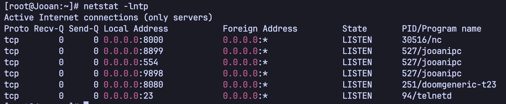

# 업데이트 로직 분석

홈캠에 수정한 펌웨어를 적용하기 위해서는 기기가 업데이트 파일을 어떻게 받아들이고 검사하는지 알아야 합니다.

이 문서에서는 **웹 업데이트 경로를 찾고, 업데이트 파일의 구조를 분석한 뒤, 수정한 펌웨어를 실제 장비에 적용한 과정**을 설명합니다. 관리자 페이지가 열리지 않는 상황에서도 웹 페이지의 코드와 웹 서버 프로그램을 살펴보면 업데이트 기능이 어떻게 연결되는지 확인할 수 있습니다.

## 1. 분석 목표와 준비 사항

### 분석 목표

이번 분석에서는 다음 내용을 확인합니다.

1. 카메라에 웹 업데이트 기능이 있는지 확인합니다.
2. 업로드 요청을 처리하는 함수를 찾습니다.
3. 업데이트 파일을 검사하는 조건을 파악합니다.
4. 수정한 펌웨어를 업데이트 형식으로 변환합니다.
5. 실제 장비에 적용한 뒤 변경 사항을 확인합니다.

### 준비 사항

카메라의 명령을 입력할 수 있는 환경과 펌웨어를 분석할 PC가 필요합니다. 카메라 셸에 접속하고 펌웨어를 추출하는 과정은 먼저 [펌웨어 추출](../펌웨어%20추출/README.md) 단계에서 준비합니다.

| 준비물                                | 용도                                            |
| ------------------------------------- | ----------------------------------------------- |
| 셸에 접속할 수 있는 JA-A12 카메라     | 실행 중인 프로그램과 기기 내부 파일 확인        |
| 카메라와 같은 네트워크에 연결된 PC    | 웹 요청 전송                                    |
| 카메라에서 확보한 `goahead` 실행 파일 | 업데이트 요청을 처리하는 코드 분석              |
| Ghidra                                | 실행 파일을 열어 함수의 동작 확인               |
| `curl`, `strings`                     | 웹 요청 전송, 실행 파일에 들어 있는 문자열 확인 |
| 8 MiB 전체 펌웨어 덤프                | 수정할 펌웨어의 원본                            |
| 공식 업데이트 파일                    | 업데이트 형식과 도구를 참고할 기준 파일         |
| Python 3.10 이상                      | 초안에 포함된 변환 스크립트 실행                |
| Linux 환경과 `mksquashfs`             | 수정한 파일들을 다시 펌웨어에 넣기              |

**명령을 실행하는 위치는 카메라와 PC로 구분합니다.** 카메라 내부 경로를 확인하는 명령은 카메라 셸에서, `curl` 요청과 파일 변환은 PC에서 실행합니다. 파일을 다시 묶는 명령은 실험에 사용한 Linux 환경을 기준으로 합니다.

실험 당시 카메라의 IP 주소는 `192.168.0.214`였습니다. 아래 요청을 따라 할 때는 이 주소를 자신의 카메라 주소로 바꿉니다.

> 업데이트 요청은 실제로 카메라 서비스를 종료하거나 장비를 재부팅할 수 있습니다. 빈 파일을 보내는 실험도 재부팅을 일으켰습니다. 파일을 살펴보는 단계와 실제 업데이트 요청을 보내는 단계를 구분하고, 업데이트 실험 전에는 원본 덤프와 장비 복구 방법을 준비합니다.

### 자주 나오는 용어

| 용어        | 이 문서에서의 의미                                                       |
| ----------- | ------------------------------------------------------------------------ |
| 펌웨어      | 카메라의 운영체제와 기능을 구성하는 프로그램 및 파일                     |
| 덤프        | 카메라의 저장장치 내용을 파일로 복사한 것                                |
| 포트        | 네트워크 요청을 받는 번호                                                |
| 프로세스    | 현재 실행 중인 프로그램                                                  |
| 헤더 / 푸터 | 파일이나 데이터의 앞 / 뒤에 붙는 설명 정보                               |
| MD5         | 데이터로 계산하는 값. 파일에 적힌 값과 비교하여 내용이 맞는지 검사합니다 |
| 파티션      | 저장장치를 용도별로 나눈 구역                                            |
| rootfs      | 운영체제의 기본 파일이 들어 있는 영역                                    |
| SquashFS    | 여러 파일을 압축하여 하나로 저장하는 파일시스템 형식                     |

---

## 2. 웹 업데이트 경로 확인

### 2.1. 카메라에서 열려 있는 포트 확인

관리자 페이지에 펌웨어 업데이트 기능이 있는지 확인하기 위해 카메라 셸에서 다음 명령을 실행했습니다.

```bash
netstat -ltnp
```

`-l`은 요청을 기다리는 항목, `-t`는 TCP 연결, `-n`은 주소와 포트를 숫자로 표시하는 옵션입니다. `-p`는 해당 포트를 사용하는 프로세스를 함께 보여줍니다.



출력에서 `doomgeneric`의 `8080` 포트와 `netcat`의 `8000` 포트는 기존 DOOM 포팅 실험에 사용하던 항목입니다. 이를 제외하면 `jooanipc`가 `8899`, `554`, `9898` 포트에서 요청을 기다리고 있었습니다.


세 포트에서는 분석에 사용할 만한 웹 응답을 얻지 못했습니다. 이어 일반적인 웹 포트인 `80`과 `443`도 확인하였고, `80` 포트에서 HTML 응답을 받았습니다.

확인하는 명령은 다음과 같다.

```bash
curl -i http://192.168.0.214/
```

`-i`는 응답 본문과 함께 HTTP 상태 등 응답 정보를 보여줍니다.


### 2.2. 업데이트 페이지 파일 확인

카메라에서 웹 페이지 파일이 저장된 `/etc/webs`를 살펴보았습니다. 그중 `/etc/webs/apcam/adm`에서 `upload_firmware.asp`를 발견했습니다.

카메라 셸에서 파일을 확인합니다.

```bash
ls /etc/webs/apcam/adm
cat /etc/webs/apcam/adm/upload_firmware.asp
```


해당 페이지 주소로 접속하였지만 `Access Error: Not Found`가 표시되었습니다.

```bash
curl -i http://192.168.0.214/apcam/adm/upload_firmware.asp
```


카메라 내부에 남아 있는 페이지 파일을 읽어 업데이트 요청을 어디로 보내는지 확인했습니다.

### 2.3. 파일을 보내는 주소와 요청 형식 확인

`upload_firmware.asp`에는 다음과 같은 입력 양식이 있었습니다. 이해에 필요한 부분만 발췌했습니다.

```html
<form method="post" action="/cgi-bin/upload_app.cgi" enctype="multipart/form-data">
  <input name="filename" type="file" />
  <input name="UploadFirmwareSubmit" type="submit" value="Apply" />
</form>
```


이 코드에서 확인할 내용은 다음과 같다.

- 요청을 보내는 주소는 `/cgi-bin/upload_app.cgi`입니다.
- 요청 방식은 `POST`입니다.
- `multipart/form-data`는 파일과 입력값을 함께 보내는 형식입니다.
- `filename`에는 PC에서 선택한 파일의 내용이 들어갑니다.
- `UploadFirmwareSubmit`에는 `Apply`가 전달됩니다.

따라서 주소에 접속하는 것과 파일을 업로드하는 것은 서로 다른 요청입니다.

### 2.4. 요청을 처리하는 실행 파일 찾기

카메라 내부에서 `upload_app.cgi`라는 파일을 검색했습니다.

```bash
find / -name 'upload_app.cgi' 2>/dev/null
```

`2>/dev/null`은 검색 중 발생하는 접근 오류 등의 메시지를 숨깁니다. 검색 결과에는 해당 이름의 파일이 없었습니다.


이에 웹 서버 프로그램인 `goahead` 내부에서 이 주소를 직접 처리할 가능성을 생각했습니다.

카메라에서 확보한 `goahead` 파일이 있는 PC 디렉터리에서 다음 명령을 실행합니다.

```bash
strings -t x goahead | grep 'upload_app'
```

`strings`는 실행 파일 안에서 읽을 수 있는 문자열을 찾아줍니다. `-t x`는 문자열의 파일 내 위치를 16진수로 함께 표시하고, `grep`은 그중 `upload_app`이 들어 있는 줄만 보여줍니다.


`upload_app.cgi` 문자열을 발견했습니다. 다음 단계에서는 이 문자열을 사용하는 함수를 찾아 요청 처리 흐름을 확인합니다.

---

## 3. 업데이트 요청을 처리하는 함수 분석

### 3.1. Ghidra에서 문자열을 사용하는 함수 찾기

Ghidra에서 확보한 `goahead` 실행 파일을 가져오고 자동 분석을 진행합니다.

1. CodeBrowser에서 `Search → for Strings`를 열어 `upload_app.cgi`를 찾습니다.
2. 검색된 문자열의 위치로 이동합니다.
3. 문자열을 참조하는 위치를 확인합니다. 참조는 프로그램 코드가 해당 문자열을 사용하는 곳을 뜻합니다.
4. 참조 위치로 이동하여 Decompiler 창에서 함수 내용을 읽습니다.

분석에서는 `cgiHandler` 함수가 해당 문자열을 사용하고 있었습니다.


핵심 흐름은 다음과 같다. 아래 코드는 디컴파일 결과의 일부이며, 생략한 부분이 있습니다.

```c
pcVar2 = strstr(pcVar2, "upload_app.cgi");
if (pcVar2 != NULL) {
    /* 중간 처리 생략 */
    CgiIronManUpgrade(local_40, uVar4);
}
```

`strstr`는 문자열 안에 지정한 문자열이 들어 있는지 찾습니다. 찾지 못하면 `NULL`을 반환합니다. 이 분기는 `upload_app.cgi`가 포함된 경우 `CgiIronManUpgrade`를 호출하는 흐름을 보여줍니다.

`pcVar2`, `local_40` 등은 Ghidra가 붙인 이름입니다. 이름만으로 의미를 판단하기보다, 어떤 값을 받고 어디에 전달하는지 살펴봅니다.

### 3.2. 업로드된 파일을 메모리로 읽는 과정

Decompiler에서 `CgiIronManUpgrade`를 열어 호출 흐름을 확인했습니다.


분석한 코드의 흐름은 다음과 같다.

1. 업로드된 파일의 정보를 확인합니다.
2. `fopen`으로 파일을 엽니다.
3. 파일 크기를 구합니다.
4. 파일을 담을 메모리 공간을 확보합니다.
5. 파일 내용을 읽습니다.
6. 읽은 내용, 크기, 파일 경로를 `ipc_fwUpgradeFromMem`에 전달합니다.

여기에서 메모리에 읽은 파일 내용을 담는 공간을 버퍼라고 부릅니다. 다음 절에서는 `ipc_fwUpgradeFromMem`이 이 내용을 어떻게 검사하는지 살펴봅니다.

### 3.3. 실패한 요청에서도 재부팅되는 이유

분석한 함수에는 다음과 같은 마무리 코드가 있었습니다.

```c
LAB_0040ecd0:
  printf("</script>");
  puts("</body></html>");
  system("(sleep 3; reboot) &");
  return 0;
```

`sleep 3`은 3초를 기다리고, `reboot`는 장비를 재부팅합니다. `&`는 이 명령을 별도로 실행하도록 합니다.

파일 읽기에 성공한 경우와 실패한 경우 모두 이 코드로 이어져 재부팅됩니다. **설치 결과는 응답 본문과 재부팅 후 변경 사항을 함께 확인합니다.**

### 3.4. 단순 접속과 파일 업로드 요청 비교

PC에서 `/cgi-bin/upload_app.cgi`에 직접 접속했을 때는 `Internal Server Error`가 발생했습니다.


브라우저에서 주소를 열거나 `curl`에 주소만 입력하면 일반적으로 `GET` 요청이 전송됩니다. 앞서 확인한 입력 양식은 파일이 포함된 `POST` 요청이므로 요청 형식이 다릅니다.

오류 출력을 보기 위해 실험 당시에는 백그라운드에서 실행 중이던 `goahead`를 종료하고 터미널에서 다시 실행했습니다. 백그라운드는 화면에 붙어 있지 않은 실행 상태이고, 포그라운드는 터미널에서 출력을 바로 보는 실행 상태를 뜻합니다.


화면에는 프로그램 내부 검사 오류와 `upgradeFW` 인증 오류, 서비스 종료 시도가 함께 나타납니다. 각 메시지와 요청의 관계는 추가 확인이 필요합니다. 프로세스 번호는 실행할 때마다 달라질 수 있으므로, 재실행 전 현재 번호를 확인합니다.

### 3.5. 빈 파일을 보내 처리 흐름 확인

다음은 실제로 수행한 빈 파일 업로드 실험입니다. PC에서 별도의 실험 디렉터리에 `test.bin`을 만든 뒤 요청을 보냈습니다.

```bash
touch test.bin
curl -i \
  -F 'filename=@./test.bin' \
  -F 'UploadFirmwareSubmit=Apply' \
  http://192.168.0.214/cgi-bin/upload_app.cgi
```

`test.bin`이 없는 상태에서 `touch`를 실행하면 빈 파일이 만들어집니다.

`-F`는 파일이나 입력값을 전송하는 옵션입니다. `@./test.bin`의 `@`를 붙이면 해당 파일의 내용을 업로드합니다. 이 형식을 사용하면 `curl`이 파일 업로드용 `POST` 요청을 만듭니다.

응답에서 확인한 핵심 내용은 다음과 같다.

```text
HTTP/1.1 200 OK
Error: FwUpgradeFromMem!
failed...rebooting
```

카메라 쪽 로그에는 다음 내용이 나타났습니다. 반복되는 줄은 생략했습니다.

```text
will kill jooanipc
will kill pppd
will kill syslogd
will kill kernelinfo
go in upGradeDo... 1, stat size=0
go in upGradeDo... 2, fseek flen=0
IronManPkgCheck failed
upgrade file  CRC error!   write failed!!! ,reboot
Connection closed by foreign host.
```

로그와 실험 결과에서 확인한 내용은 다음과 같다.

1. 업데이트 처리가 시작되면서 카메라 서비스 종료가 진행되었습니다.
2. 업로드된 파일의 크기가 `0`바이트로 기록되었습니다.
3. 업데이트 파일 형식 검사에 실패했습니다.
4. 카메라는 재부팅되었습니다.

웹 서버는 `HTTP/1.1 200 OK`로 응답했고, 본문에는 업데이트 실패와 재부팅 예정 메시지를 표시했습니다. 업로드한 빈 파일은 헤더 검사에 필요한 데이터를 갖추지 못한 상태였습니다. 로그에서는 파일 형식 검사에 실패한 사실을 확인했습니다.

---

## 4. 업데이트 파일 형식과 검사 조건

### 4.1. 공식 업데이트 파일 확보

[초안에서 참고한 IP 카메라 분석 글](https://rahulr.in/reversing-a-cheap-ip-camera-to-root/)을 바탕으로 공식 업데이트 파일을 확보했습니다.

분석에 사용한 파일은 `A12_IronMan_05.02.31.114.img`이며, 당시 확보 경로는 다음과 같다.

```text
https://use1upgrade1.jooaniot.com/img/rev/JA-A12/A12_IronMan_05.02.31.114.img
```

이 파일은 이후 변환 과정에서 업데이트 도구를 가져올 기준 파일로 사용했습니다. 위 주소의 현재 다운로드 가능 여부는 이 문서 작성 과정에서 다시 확인하지 않았습니다.

Hex Editor는 파일의 내용을 바이트 단위로 보여주는 도구입니다. 공식 파일을 열어 시작 부분의 정보를 확인했습니다.


### 4.2. 파일 앞부분의 96바이트 헤더

`ipc_fwUpgradeFromMem`을 분석한 결과, 업데이트 파일 앞에 `96`바이트의 헤더가 있었습니다.

| 헤더 내 위치 | 크기     | 내용                                 |
| ------------ | -------- | ------------------------------------ |
| 0~7바이트    | 8바이트  | `jooan` 식별 문자열이 들어 있는 영역 |
| 8~15바이트   | 8바이트  | 헤더를 제외한 본문 크기              |
| 16~63바이트  | 48바이트 | 버전과 모델 정보                     |
| 64~95바이트  | 32바이트 | 본문 전체의 MD5를 나타내는 문자열    |

첫 번째 바이트의 위치를 `0`으로 셉니다. `0x60`은 16진수 표기이며, 10진수로는 `96`입니다.

#### 식별 문자열 검사

```c
memcpy(acStack_100, param_1, 0x60);
pvVar2 = memmem(acStack_100, 8, "jooan", 5);
```

`memcpy`는 지정한 크기만큼 데이터를 복사합니다. 여기에서는 파일 앞의 `96`바이트를 복사합니다. `memmem`은 복사한 데이터의 첫 `8`바이트 안에서 `jooan`이라는 `5`바이트 문자열을 찾습니다.

이 값은 프로그램이 자신의 업데이트 형식인지 판단하는 첫 번째 단서입니다.

#### 파일 크기 검사

헤더의 본문 크기에는 다음 조건이 적용되었습니다.

- 본문 크기가 `20 MiB` 이하이어야 합니다.
- 본문 크기에 헤더 `96`바이트를 더한 값이 실제 파일 크기와 같아야 합니다.

```text
실제 파일 크기 = 96바이트 + 헤더에 적힌 본문 크기
```

디컴파일 결과에서는 `int *`로 표시된 변수에 `0x18`을 더하는 표현이 나타났습니다. `0x18`은 10진수로 `24`이며, 4바이트 단위의 포인터 계산에서는 `24 × 4 = 96`바이트가 됩니다. 이 표현을 단순히 `24`바이트를 더하는 것으로 읽으면 안 됩니다.

#### 버전과 모델 정보 검사

정보 영역에는 `ver` 문자열이 있는지 확인하는 코드가 있었습니다.


이후 `;`와 `=`를 기준으로 정보를 나누고, `/opt/conf/config.json`의 `SystemInfo`에 있는 `ProductName`과 모델 정보를 비교했습니다.

실험 장비의 `ProductName`은 `JA-A12`였습니다.


업데이트 파일에는 `model=A12`와 같은 정보가 들어 있습니다. 코드는 장비의 `JA-A12` 문자열을 나누어 모델 정보를 비교합니다.

#### 본문 MD5 검사

```c
QAMD5Sum(
    (int)param_1 + 0x60, /* 헤더 다음부터 계산 */
    piVar4,             /* 헤더에 적힌 본문 크기 */
    local_6c,
    0x24
);
iVar10 = memcmp(pcVar7, local_6c, 0x20);
```

코드는 헤더를 제외한 본문으로 MD5 값을 계산한 뒤, 헤더에 적힌 `32`바이트 문자열과 비교합니다.

본문 내용을 수정하면 계산 결과도 달라지므로 헤더에 적힌 MD5도 다시 계산해야 합니다. 값이 일치하면 파일 내용 검사를 통과하고 다음 단계로 진행합니다.

### 4.3. 파일 끝부분의 푸터와 업데이트 도구 검사

파일 끝의 `96`바이트는 마지막 데이터의 푸터입니다. 여기에는 해당 데이터의 이름, 크기, 설명, MD5가 들어 있습니다.

프로그램은 이 부분을 복사한 뒤 `QAUpgradeDecV1`을 호출했습니다.

```c
/* 파일 끝의 96바이트를 복사한 뒤 변환 */
iVar11 = QAUpgradeDecV1(acStack_100, 0x60);
```


분석한 코드는 바이트의 위치를 바꾸고 비트 연산을 적용하여 푸터를 읽을 수 있는 형태로 변환했습니다. 이 문서에서는 이를 푸터 변환이라고 부릅니다.

변환 후에는 다음 내용을 검사했습니다.

1. 첫 `8`바이트에 `toolv` 문자열이 있는지 확인합니다.
2. 마지막 데이터의 크기가 `2 MiB` 이하인지 확인합니다.
3. 푸터에 적힌 크기로 마지막 데이터의 시작 위치를 구합니다.
4. 해당 데이터의 MD5를 계산하여 푸터에 적힌 값과 비교합니다.

```text
마지막 데이터 시작 위치 = 전체 파일 크기 - 96바이트 - 마지막 데이터 크기
```

마지막 데이터는 업데이트 도구가 들어 있는 SquashFS 이미지입니다. 검사 이후 이 도구를 이용하여 `/tmp/upgrade/mnt/upgrade.sh`를 실행하는 흐름으로 이어졌습니다.

새 파일을 만들 때는 식별 문자열, 크기, MD5와 푸터의 변환 규칙을 함께 반영해야 합니다.

### 4.4. 변환 스크립트에서 사용하는 전체 구조

초안에 포함된 변환 스크립트는 각 데이터를 다음 순서로 묶습니다. 여기에서 각각의 데이터 묶음을 세그먼트라고 부릅니다.

```text
업데이트 파일
├─ 전체 헤더: 96바이트
├─ rootfs 데이터: mtd3
├─ rootfs 푸터: 96바이트
├─ 커널 데이터: mtd2
├─ 커널 푸터: 96바이트
├─ 카메라 프로그램 데이터: mtd4
├─ 카메라 프로그램 푸터: 96바이트
├─ 업데이트 도구 데이터: toolv1
│  └─ upgrade.sh 등이 들어 있는 SquashFS 이미지
└─ 업데이트 도구 푸터: 96바이트, 변환된 형식
```

전체 헤더의 본문 크기와 MD5는 **헤더 이후의 데이터와 푸터를 모두 포함하여** 계산합니다. 각 푸터의 크기와 MD5는 바로 앞에 있는 데이터에 대한 정보입니다.

분석에 사용한 공식 `.114` 파일은 `mtd2`, `mtd4`, `toolv1` 구성이며, 변환 스크립트는 여기에 덤프에서 가져온 `mtd3`도 포함합니다. 따라서 공식 파일과 변환된 파일의 구성과 크기는 다를 수 있습니다.

---

## 5. 수정한 펌웨어를 업데이트 형식으로 변환

### 5.1. 전체 덤프와 업데이트 파일의 차이

카메라 저장장치 전체를 복사한 `8 MiB` 덤프와 웹 업데이트에 사용하는 `.img` 파일은 서로 다른 형식입니다.

전체 덤프에는 부팅 관련 정보와 설정 영역 등이 함께 들어 있습니다. 웹 업데이트 파일에는 앞에서 분석한 헤더와 푸터, 업데이트할 데이터, 업데이트 도구가 들어 있어야 합니다.

이에 분석 결과를 바탕으로 `repack_firmware.py`를 작성했습니다. 스크립트는 덤프에서 필요한 구역을 가져오고 공식 파일의 업데이트 도구를 결합합니다.

이 스크립트가 사용하는 위치와 크기는 다음과 같다. 값은 실험 장비의 저장장치 구성을 기준으로 고정되어 있습니다.

| 영역   | 덤프에서의 시작 위치 | 크기                        | 용도            |
| ------ | -------------------- | --------------------------- | --------------- |
| `mtd2` | `0x48000`            | `0x170000`, 1,507,328바이트 | 커널            |
| `mtd3` | `0x1B8000`           | `0x2D0000`, 2,949,120바이트 | rootfs          |
| `mtd4` | `0x488000`           | `0x310000`, 3,211,264바이트 | 카메라 프로그램 |

이 스크립트의 적용 대상은 위 표와 같은 저장장치 구성을 가진 JA-A12입니다.

### 5.2. 스크립트 준비와 실행 방법

문서 아래의 **부록: 변환 스크립트**를 펼쳐 코드를 `repack_firmware.py`로 저장합니다. PC에서 다음 파일을 같은 작업 디렉터리에 준비합니다.

```text
작업 디렉터리/
├─ repack_firmware.py
├─ modified_firmware.bin               # 8 MiB 전체 덤프
├─ A12_IronMan_05.02.31.114.img         # 공식 업데이트 파일
└─ modified_firmware_unpacked/         # 미리 추출한 파일
   └─ rootfs/
      └─ etc/hostname
```

Python 가상환경을 만들고 필요한 패키지를 설치합니다.

```bash
python3 -m venv .venv
source .venv/bin/activate
python -m pip install typer 'pydantic>=2,<3' rich
```

실험에서는 장비의 기존 버전 `05.02.31.135`보다 마지막 숫자가 `1` 큰 `05.02.31.136`을 지정했습니다.

```bash
python repack_firmware.py \
  modified_firmware.bin \
  A12_IronMan_05.02.31.114.img \
  output.img \
  --version 05.02.31.136
```

첫 번째 경로는 전체 덤프, 두 번째는 공식 파일, 세 번째는 새로 만들 파일입니다. `--version`은 업데이트 파일에 적을 버전 정보를 지정합니다. 덤프 내부의 버전 문자열은 기존 값을 유지합니다.

초안의 실행 화면은 `uv run`을 사용했습니다.


실행이 완료되면 다음 파일이 생성됩니다.

- `output.img`: 웹 업데이트에 사용할 파일
- `output.img.json`: 데이터별 위치, 크기, 검사값 등이 기록된 파일

같은 이름의 출력 파일이나 JSON 파일이 이미 있으면 스크립트는 덮어쓰지 않고 중단합니다. 다시 변환할 때는 `hostname-update.img`처럼 새 이름을 지정합니다.

스크립트는 파일 크기, MD5, 커널의 CRC, SquashFS의 기본 정보를 검사하고 덤프에서 가져온 데이터가 그대로 들어갔는지 비교합니다. CRC도 데이터가 검사값과 일치하는지 확인하는 계산값입니다.

`Structural/payload checks passed`는 파일 구조와 데이터 비교를 통과했다는 메시지입니다. 이어지는 `Device installation has NOT been tested`는 실제 장비 적용이 다음 확인 단계로 남아 있음을 알려줍니다.

다음 화면은 변환 전 장비 설정에서 기존 버전 `05.02.31.135`를 확인한 기록입니다. 파일에 지정한 버전과 실제 장비의 버전을 구분하여 확인합니다.


공식 업데이트 파일과 변환된 업데이트 파일을 Hex Editor에서 비교했습니다.


### 5.3. 적용 여부를 확인하기 위한 장치 이름 수정

실제 적용 여부를 확인하기 위해 rootfs의 `/etc/hostname`을 수정했습니다. hostname은 장치를 구분하는 이름이며, 재부팅 후 로그인 화면이나 셸에서 확인할 수 있습니다.

덤프에서 추출해 둔 `rootfs` 디렉터리의 `etc/hostname` 파일을 텍스트 편집기로 열고 다음 이름으로 바꿉니다.

```text
Jooan-Modified
```


**PC에 추출한 `rootfs/etc/hostname`을 수정한 뒤**, 이를 다시 묶어 업데이트 파일에 넣습니다.

### 5.4. 수정한 rootfs를 전체 덤프에 넣기

다음 단계는 추출한 `rootfs` 디렉터리와 원래의 `modified_firmware.bin`이 준비된 Linux 환경을 기준으로 합니다. 먼저 `rootfs`를 다시 SquashFS 이미지로 묶습니다.

위 작업 디렉터리에서 `modified_firmware_unpacked`로 이동한 뒤 실행합니다. 이 단계에는 `mksquashfs`, `stat`, `dd`를 사용할 수 있는 Linux 환경이 필요합니다.

```bash
cd modified_firmware_unpacked
mkdir -p ../repacked
mksquashfs rootfs ../repacked/rootfs.squashfs \
  -noappend -comp xz -b 131072 -all-root -no-xattrs
```

이 명령은 수정한 파일들로 새 SquashFS 이미지를 만듭니다. 실험에서는 XZ 압축과 `131,072`바이트 블록 크기를 사용하고, 소유자를 root로 지정하였으며 확장 속성을 제외했습니다.


생성된 크기를 확인합니다.

```bash
stat -c '%s bytes' ../repacked/rootfs.squashfs
```

실험에서는 `2,916,352`바이트였습니다. rootfs 영역의 전체 크기는 `2,949,120`바이트이므로 차이인 `32,768`바이트를 `0xff`로 채웠습니다. 이 빈 공간을 채우는 작업을 패딩이라고 부릅니다.

**파일 크기가 rootfs 영역보다 크면 덤프에 넣는 작업을 진행하지 않습니다.** 아래 명령의 패딩 크기 `32768`은 이 실험에서 측정한 값이므로, 다시 압축한 파일의 크기가 다르면 `2949120 - 측정한 파일 크기`로 다시 계산합니다.

```bash
cp ../repacked/rootfs.squashfs ../repacked/rootfs.padded.bin
head -c 32768 /dev/zero | tr '\000' '\377' >> ../repacked/rootfs.padded.bin
stat -c '%s bytes' ../repacked/rootfs.padded.bin
```

마지막 출력이 `2949120 bytes`인지 확인합니다. 패딩 파일은 새 파일명으로 준비합니다. 같은 파일에 패딩 명령을 반복하면 크기가 달라집니다.

그다음 전체 덤프를 복사하고, 복사본의 rootfs 영역만 새 데이터로 교체합니다.

```bash
cp ../modified_firmware.bin ../repacked_firmware.bin
dd if=../repacked/rootfs.padded.bin \
  of=../repacked_firmware.bin \
  bs=32K seek=55 conv=notrunc status=progress
stat -c '%s bytes' ../repacked_firmware.bin
```

`bs=32K seek=55`는 파일 시작에서 `32,768 × 55 = 1,802,240`바이트, 즉 `0x1B8000` 위치부터 쓰는 설정입니다. `conv=notrunc`는 덤프의 뒤쪽 내용을 잘라내지 않도록 합니다.

완성된 전체 덤프는 `8,388,608`바이트, 즉 `8 MiB`여야 합니다.


작업 디렉터리로 돌아와 새 덤프를 업데이트 형식으로 변환합니다. 앞에서 만든 파일과 겹치지 않도록 새 이름을 지정합니다.

```bash
cd ..
python repack_firmware.py \
  repacked_firmware.bin \
  A12_IronMan_05.02.31.114.img \
  hostname-update.img \
  --version 05.02.31.136
```


---

## 6. 실제 장비 업데이트와 결과 확인

### 6.1. 수정한 파일 업로드

변환한 파일을 PC에서 카메라로 업로드합니다.

```bash
curl -i \
  -F 'filename=@./hostname-update.img' \
  -F 'UploadFirmwareSubmit=Apply' \
  http://192.168.0.214/cgi-bin/upload_app.cgi
```

초안에서는 결과 파일명을 `output.img`로 사용했습니다. 위에서는 첫 변환 결과와 구분하기 위해 `hostname-update.img`로 지정했습니다.


이 요청 화면에는 `HTTP/1.1 200 OK` 이후 `curl: (8) Header without colon` 오류가 나타납니다. curl이 응답 헤더를 읽다가 오류를 만나, 장비 로그와 재부팅 후 변경 사항을 확인하여 업데이트 결과를 살펴보았습니다.

### 6.2. 첫 실험에서 발생한 오류

업로드하고 수십 초 뒤 Cam720 앱에서 카메라가 오프라인으로 표시되었고, 자동으로 복구되는 변화는 관찰되지 않았습니다.

당시 연결이 유지된 Telnet 세션에서 커널 로그를 확인했습니다. 카메라 셸에서 커널 메시지는 다음 명령으로 볼 수 있습니다.

```bash
dmesg
```

반복해서 나타난 오류는 다음과 같다.

```text
SQUASHFS error: Unable to read page, block 15b4f4, size 8c74
SQUASHFS error: Unable to read fragment cache entry [15b4f4]
```

이 메시지는 SquashFS 데이터 일부를 읽지 못했다는 뜻입니다.

당시에는 사용 중인 rootfs를 새 내용으로 덮어쓴 뒤, 커널이 기존 파일의 위치 정보를 기준으로 읽으면서 문제가 발생했을 가능성을 검토했습니다. 이는 로그를 바탕으로 세운 가설이며, 정확한 원인은 추가 분석이 필요합니다.

실험에서는 강제 재부팅 후 다시 접속할 수 있었고, 로그인 화면과 셸의 장치 이름이 `Jooan-Modified`로 바뀐 것을 확인했습니다.


재부팅 후 바뀐 장치 이름을 통해 수정한 hostname이 적용되었음을 확인했습니다.

### 6.3. 같은 파일을 다시 업로드한 결과

같은 업데이트 파일을 다시 업로드했을 때는 응답 본문에서 다음 문구를 확인했습니다.

```text
Done...rebooting
```

이후 카메라가 자동으로 재부팅되었고 다시 접속할 수 있었습니다.


같은 파일을 사용했는데도 응답을 받지 못하는 현상이 간헐적으로 관찰되었습니다. 어떤 조건이 차이를 만들었는지는 이 분석에서 확정하지 못했습니다.

따라서 결과를 확인할 때는 웹 응답뿐 아니라 재부팅 후 접속 가능 여부와 실제 변경 사항도 함께 확인합니다.

---

## 7. 분석 결과와 한계

이번 분석에서는 다음 내용을 확인했습니다.

- `upload_firmware.asp`가 `/cgi-bin/upload_app.cgi`로 파일을 보내는 구조를 확인했습니다.
- `goahead` 내부의 `cgiHandler`에서 `CgiIronManUpgrade`로 이어지는 흐름을 찾았습니다.
- 업로드 파일을 읽어 `ipc_fwUpgradeFromMem`에 전달하는 과정을 확인했습니다.
- 헤더와 마지막 푸터의 식별 문자열, 크기, 모델 정보, MD5 검사 조건을 파악했습니다.
- 전체 덤프를 업데이트 형식으로 변환하고 실제 장비에서 변경한 hostname을 확인했습니다.

남은 사항은 다음과 같다.

- 최초 포트 목록에 `80` 포트가 표시되지 않은 이유는 확인하지 못했습니다.
- 사용 중인 rootfs를 교체할 때 발생한 읽기 오류의 정확한 원인은 확정하지 못했습니다.
- 같은 파일에서도 간헐적으로 응답이 오지 않은 원인은 확인하지 못했습니다.
- 변환 스크립트의 위치와 크기는 실험한 JA-A12의 `8 MiB` 덤프를 기준으로 합니다.

이 결과를 바탕으로, 수정한 펌웨어를 웹 업데이트 형식으로 구성하여 장비에 전달할 수 있음을 확인했습니다. 이후 포팅한 프로그램을 포함할 때에도 파일 형식 검사와 실제 장비 동작 확인을 각각 수행해야 합니다.

---

## 부록: 변환 스크립트

초안에 포함된 `repack_firmware.py` 전체 코드입니다. 코드의 동작은 유지하고 문서 본문에서 실행 방법을 설명했습니다.

기본 `--version` 값은 `05.02.31.135`이며, 본문 실험은 `--version 05.02.31.136`을 명시하여 실행합니다. Wi-Fi 식별값의 기본값은 실험 장비 기준 `3607:6621`입니다.

스크립트는 덤프의 `boot`, `bootenv`, `config`, `confbak` 영역을 제외하고 업데이트 파일을 구성합니다. 실제 적용 중에는 공식 파일에서 가져온 `upgrade.sh`가 설정을 변경할 수 있으므로, 업데이트 전 설정도 함께 백업합니다.

<details>
<summary>repack_firmware.py 전체 코드 보기</summary>

```python
from __future__ import annotations

import hashlib
import re
import zlib
from dataclasses import dataclass
from pathlib import Path
from typing import Annotated, ClassVar, Final

import typer
from pydantic import BaseModel, ConfigDict
from rich.console import Console

HEADER_SIZE: Final = 96
MAX_BODY: Final = 0x1400000
MAX_TOOL: Final = 0x200000

class FormatError(Exception):
    """A binary package violates the supported format."""

    detail: str

    def __init__(self, detail: str) -> None:
        """Retain the failed binary contract for the CLI error boundary."""
        self.detail = detail
        super().__init__(detail)

@dataclass(frozen=True, slots=True)
class Segment:
    """A payload and its exact footer metadata, in forward file order."""

    name: str
    description: str
    payload: bytes

@dataclass(frozen=True, slots=True)
class Package:
    """Parsed header metadata and independently verified payloads."""

    description: str
    segments: tuple[Segment, ...]

def md5_hex(data: bytes) -> str:
    """Use MD5 only to match the vendor's legacy wire format."""
    return hashlib.md5(data, usedforsecurity=False).hexdigest()

def decode_footer(raw: bytes) -> bytes:
    """Apply QAUpgradeDecV1, preserving its original last-byte selector."""
    if len(raw) != HEADER_SIZE:
        raise FormatError("tool footer must be 96 bytes")
    buffer = bytearray(raw)
    last = buffer[-1]
    step = ((last >> 2) & 15) + 1
    for position in range((93 // step) * step, step - 1, -step):
        buffer[position], buffer[position + 1] = buffer[position + 1], buffer[position]
    return bytes(
        (value >> 2) | (((buffer[index - 1] if index else last) << 6) & 255)
        for index, value in enumerate(buffer)
    )

def encode_footer(raw: bytes) -> bytes:
    """Reverse the bit rotation, then undo swaps in the opposite order."""
    if len(raw) != HEADER_SIZE:
        raise FormatError("tool footer must be 96 bytes")
    buffer = bytearray(
        ((value << 2) & 255) | (raw[(index + 1) % HEADER_SIZE] >> 6)
        for index, value in enumerate(raw)
    )
    step = ((buffer[-1] >> 2) & 15) + 1
    for position in range(step, (93 // step) * step + 1, step):
        buffer[position], buffer[position + 1] = buffer[position + 1], buffer[position]
    return bytes(buffer)

def parse_record(raw: bytes) -> tuple[str, int, str, str]:
    """Parse the fixed-width 8/8/48/32 byte record."""
    if len(raw) != HEADER_SIZE:
        raise FormatError("record must be 96 bytes")
    try:
        name = raw[:8].decode("ascii").strip()
        size_text = raw[8:16].decode("ascii").strip()
        description = raw[16:64].decode("ascii").strip()
        digest = raw[64:].decode("ascii")
    except UnicodeDecodeError as error:
        raise FormatError("record is not ASCII") from error
    if re.fullmatch(r"[a-z0-9_]+", name) is None or not size_text.isdecimal():
        raise FormatError("invalid record name or length")
    size = int(size_text)
    if size <= 0 or size > MAX_BODY:
        raise FormatError("record length outside supported range")
    if re.fullmatch(r"[0-9a-f]{32}", digest) is None:
        raise FormatError("invalid MD5 field")
    return name, size, description, digest

def record(segment: Segment) -> bytes:
    """Serialize fixed-width ASCII fields without silently truncating values."""
    fields = (segment.name, str(len(segment.payload)), segment.description)
    widths = (8, 8, 48)
    try:
        encoded = tuple(field.encode("ascii") for field in fields)
    except UnicodeEncodeError as error:
        raise FormatError("record fields must be ASCII") from error
    if any(len(field) > width for field, width in zip(encoded, widths, strict=True)):
        raise FormatError("record field exceeds its fixed width")
    return b"".join(
        field.rjust(width, b" ") for field, width in zip(encoded, widths, strict=True)
    ) + md5_hex(segment.payload).encode("ascii")

def parse_package(raw: bytes) -> Package:
    """Check outer MD5, every footer, and every payload MD5 before returning."""
    if len(raw) < HEADER_SIZE * 2:
        raise FormatError("package length is too short")
    name, size, description, digest = parse_record(raw[:HEADER_SIZE])
    if name != "jooan" or size != len(raw) - HEADER_SIZE:
        raise FormatError("outer package length or magic mismatch")
    if md5_hex(raw[HEADER_SIZE:]) != digest:
        raise FormatError("outer body MD5 mismatch")
    segments: list[Segment] = []
    end = len(raw)
    while end > HEADER_SIZE:
        footer = raw[end - HEADER_SIZE : end]
        if not segments:
            footer = decode_footer(footer)
        name, size, desc, digest = parse_record(footer)
        start = end - HEADER_SIZE - size
        if start < HEADER_SIZE:
            raise FormatError("segment length overlaps the outer header")
        payload = raw[start : end - HEADER_SIZE]
        if md5_hex(payload) != digest:
            raise FormatError(f"segment {name} MD5 mismatch")
        if not segments and (name != "toolv1" or size > MAX_TOOL):
            raise FormatError("final segment is not a supported toolv1 payload")
        segments.append(Segment(name, desc, payload))
        end = start
    if len({segment.name for segment in segments}) != len(segments):
        raise FormatError("duplicate segment names")
    return Package(description, tuple(reversed(segments)))

def build_package(package: Package) -> bytes:
    """Create a vendor-format package with an encoded final tool footer."""
    if not package.segments or package.segments[-1].name != "toolv1":
        raise FormatError("package must end in toolv1")
    blocks: list[bytes] = []
    for index, segment in enumerate(package.segments):
        footer = record(segment)
        if index == len(package.segments) - 1:
            footer = encode_footer(footer)
        blocks.extend((segment.payload, footer))
    body = b"".join(blocks)
    result = record(Segment("jooan", package.description, body)) + body
    parse_package(result)
    return result

FLASH_SIZE: Final = 0x800000
UIMAGE_HEADER: Final = 64
SQUASHFS_HEADER: Final = 96

@dataclass(frozen=True, slots=True)
class Partition:
    """A byte range derived from this device's /proc/mtd layout."""

    name: str
    offset: int
    size: int

ROOTFS: Final = Partition("mtd3", 0x1B8000, 0x2D0000)
KERNEL: Final = Partition("mtd2", 0x48000, 0x170000)
APPFS: Final = Partition("mtd4", 0x488000, 0x310000)
PARTITIONS: Final = (ROOTFS, KERNEL, APPFS)

@dataclass(frozen=True, slots=True)
class Conversion:
    """Explicit metadata; firmware-internal versions are not rewritten."""

    version: str
    wifi: str

def check_squashfs(payload: bytes) -> int:
    """Check superblock bounds without decompressing or executing the filesystem."""
    if len(payload) < SQUASHFS_HEADER or payload[:4] != b"hsqs":
        raise FormatError("partition does not start with a SquashFS superblock")
    major = int.from_bytes(payload[28:30], "little")
    used = int.from_bytes(payload[40:48], "little")
    if major != 4 or not SQUASHFS_HEADER <= used <= len(payload):
        raise FormatError("SquashFS version or bytes_used exceeds partition bounds")
    return used

def check_kernel(payload: bytes) -> int:
    """Check uImage header/data CRCs and the declared payload boundary."""
    if len(payload) < UIMAGE_HEADER or payload[:4] != b"\x27\x05\x19\x56":
        raise FormatError("kernel partition does not start with a uImage header")
    size = int.from_bytes(payload[12:16], "big")
    if size <= 0 or UIMAGE_HEADER + size > len(payload):
        raise FormatError("uImage length exceeds kernel partition")
    header = bytearray(payload[:UIMAGE_HEADER])
    header[4:8] = b"\0" * 4
    if zlib.crc32(header) != int.from_bytes(payload[4:8], "big"):
        raise FormatError("uImage header CRC mismatch")
    if zlib.crc32(payload[UIMAGE_HEADER : UIMAGE_HEADER + size]) != int.from_bytes(
        payload[24:28], "big"
    ):
        raise FormatError("uImage data CRC mismatch")
    return int.from_bytes(payload[8:12], "big")

def convert_dump(dump: bytes, template: bytes, options: Conversion) -> bytes:
    """Copy complete partitions, preserving padding and the official tool segment."""
    if len(dump) != FLASH_SIZE:
        raise FormatError("input must be this device's complete 8 MiB flash dump")
    if re.fullmatch(r"[0-9]{2}\.[0-9]{2}\.[0-9]{2}\.[0-9]{1,3}", options.version) is None:
        raise FormatError("version must use the A12 xx.xx.xx.xxx format")
    if re.fullmatch(r"[0-9a-f]{4}:[0-9a-f]{4}", options.wifi) is None:
        raise FormatError("Wi-Fi USB ID must use lowercase vvvv:pppp format")
    official = parse_package(template)
    if re.fullmatch(r"ver=[0-9.]+;model=A12", official.description) is None:
        raise FormatError("template must identify model A12")
    if [segment.name for segment in official.segments] != ["mtd2", "mtd4", "toolv1"]:
        raise FormatError("template must have the supplied .114 kernel/appfs/tool layout")
    tool = official.segments[-1]
    check_squashfs(tool.payload)
    rootfs = dump[ROOTFS.offset : ROOTFS.offset + ROOTFS.size]
    kernel = dump[KERNEL.offset : KERNEL.offset + KERNEL.size]
    appfs = dump[APPFS.offset : APPFS.offset + APPFS.size]
    check_squashfs(rootfs)
    check_squashfs(appfs)
    timestamp = check_kernel(kernel)
    segments = (
        Segment(ROOTFS.name, f"type=rootfs;wifi={options.wifi}", rootfs),
        Segment(KERNEL.name, f"type=kernel;ver={timestamp}", kernel),
        Segment(APPFS.name, f"type=userapp;ver={options.version};productname=A12", appfs),
        tool,
    )
    # upgrade.sh walks backwards: rootfs must be last to apply due to rebootim.
    return build_package(Package(f"ver={options.version};model=A12", segments))

console = Console()

class SegmentReport(BaseModel):
    """Machine-readable payload identity and file placement."""

    model_config: ClassVar[ConfigDict] = ConfigDict(frozen=True)
    name: str
    description: str
    start: int
    size: int
    md5: str
    sha256: str

class Report(BaseModel):
    """Structural verification evidence, explicitly separate from installation."""

    model_config: ClassVar[ConfigDict] = ConfigDict(frozen=True)
    package_description: str
    size: int
    sha256: str
    structural_checks: str = "passed"
    installation: str = "not tested; not certified safe for flashing"
    segments: tuple[SegmentReport, ...]
    excluded_partitions: tuple[str, ...] = ("boot", "bootenv", "config", "confbak")
    warnings: tuple[str, ...] = (
        "Package metadata does not rewrite versions inside the dump.",
        "Official .114 upgrade.sh and CPUType are preserved, not compatibility-certified.",
        "The official script can change device config/confbak and reboot.",
        "The fixed flash layout is only for the verified 8 MiB A12 device.",
    )

def report_for(raw: bytes, parsed: Package) -> Report:
    """Describe validated on-disk offsets without claiming device compatibility."""
    position = 96
    reports: list[SegmentReport] = []
    for segment in parsed.segments:
        reports.append(
            SegmentReport(
                name=segment.name,
                description=segment.description,
                start=position,
                size=len(segment.payload),
                md5=md5_hex(segment.payload),
                sha256=hashlib.sha256(segment.payload).hexdigest(),
            )
        )
        position += len(segment.payload) + 96
    return Report(
        package_description=parsed.description,
        size=len(raw),
        sha256=hashlib.sha256(raw).hexdigest(),
        segments=tuple(reports),
    )

def build(
    paths: Annotated[list[Path], typer.Argument(help="DUMP TEMPLATE OUTPUT: three local paths.")],
    wifi: Annotated[
        str, typer.Option(help="Target Wi-Fi USB ID; default is for the verified A12.")
    ] = "3607:6621",
    version: Annotated[
        str, typer.Option(help="Package label; does not rewrite internal versions.")
    ] = "05.02.31.135",
) -> None:
    """Preserve kernel/rootfs/appfs and vendor tools; never overwrite existing files."""
    if len(paths) != 3:
        console.print("ERROR: supply exactly three paths: DUMP TEMPLATE OUTPUT")
        raise typer.Exit(1)
    dump, template, output = paths
    manifest = Path(str(output) + ".json")
    try:
        if output.exists() or manifest.exists():
            raise FormatError("output or manifest already exists; choose a new output path")
        if not dump.is_file() or not template.is_file():
            raise FormatError("dump and template must be regular local files")
        if dump.stat().st_size != 0x800000:
            raise FormatError("input must be this device's complete 8 MiB flash dump")
        raw_dump = dump.read_bytes()
        raw = convert_dump(raw_dump, template.read_bytes(), Conversion(version, wifi))
        parsed = parse_package(raw)
        for partition, segment in zip(PARTITIONS, parsed.segments[:3], strict=True):
            expected = raw_dump[partition.offset : partition.offset + partition.size]
            if segment.payload != expected:
                raise FormatError(f"payload preservation failed for {partition.name}")
        manifest_text = report_for(raw, parsed).model_dump_json(indent=2) + "\n"
        with output.open("xb") as handle:
            handle.write(raw)
        with manifest.open("x", encoding="utf-8") as handle:
            handle.write(manifest_text)
    except (FormatError, OSError) as error:
        console.print(f"[red]ERROR:[/red] {error}")
        raise typer.Exit(1) from error
    console.print(f"Metadata: Wi-Fi {wifi}; package version {version}")
    console.print(f"Created {output} ({len(raw):,} bytes)")
    console.print(f"Manifest: {manifest}")
    console.print("Structural/payload checks passed. Device installation has NOT been tested.")

if __name__ == "__main__":
    typer.run(build)
```

</details>
