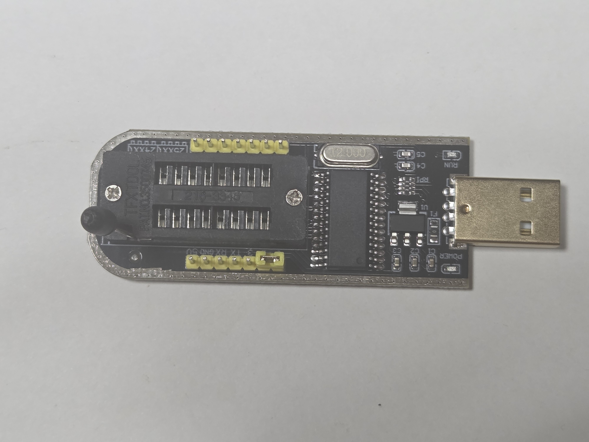
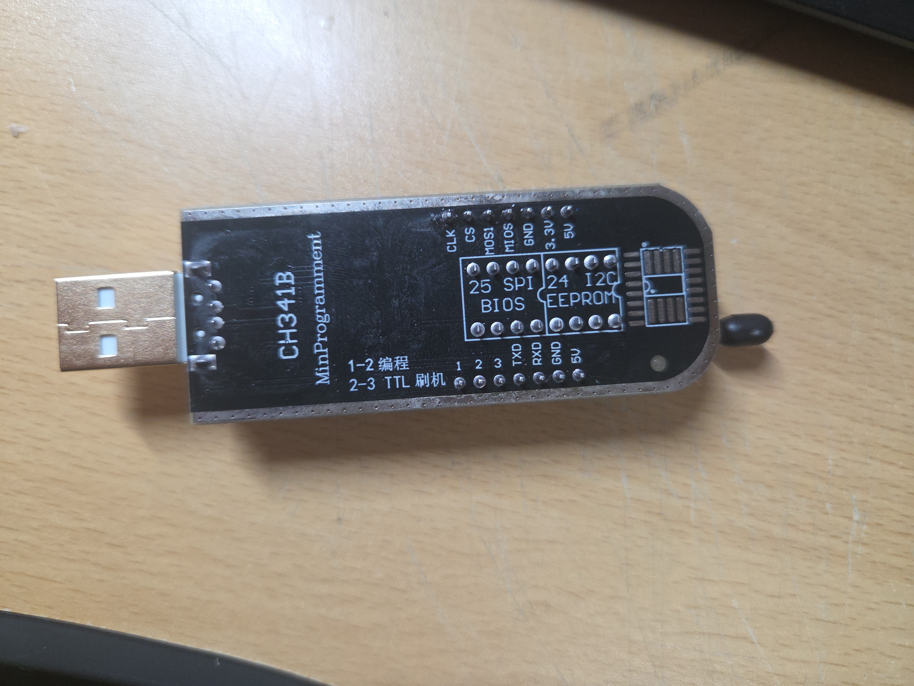
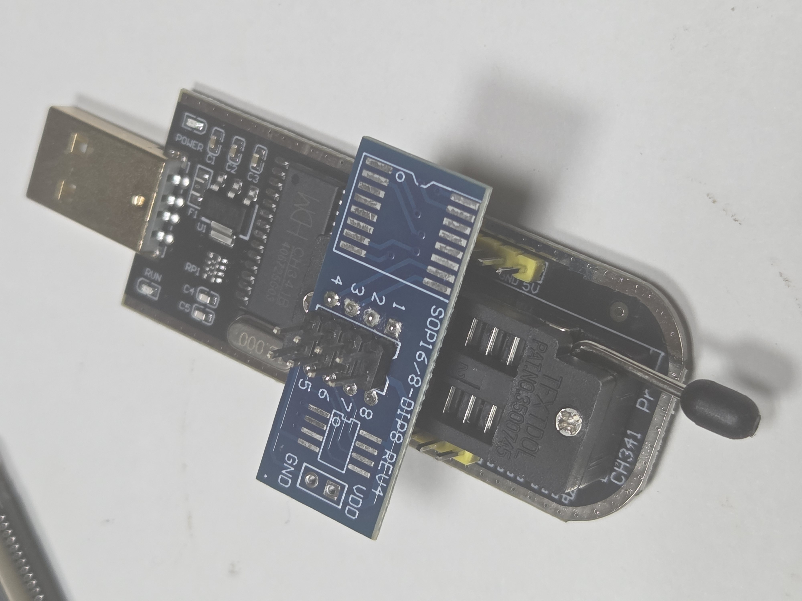
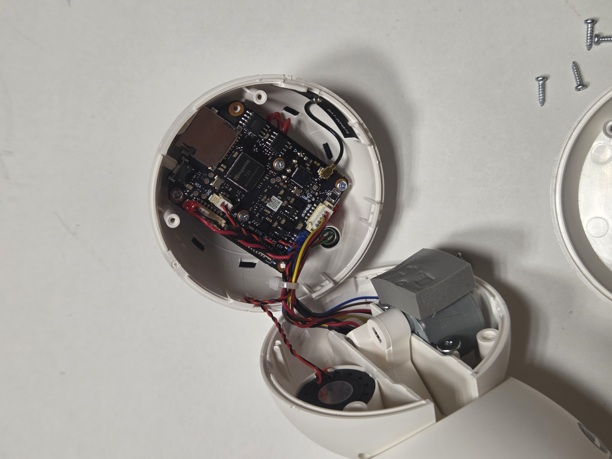
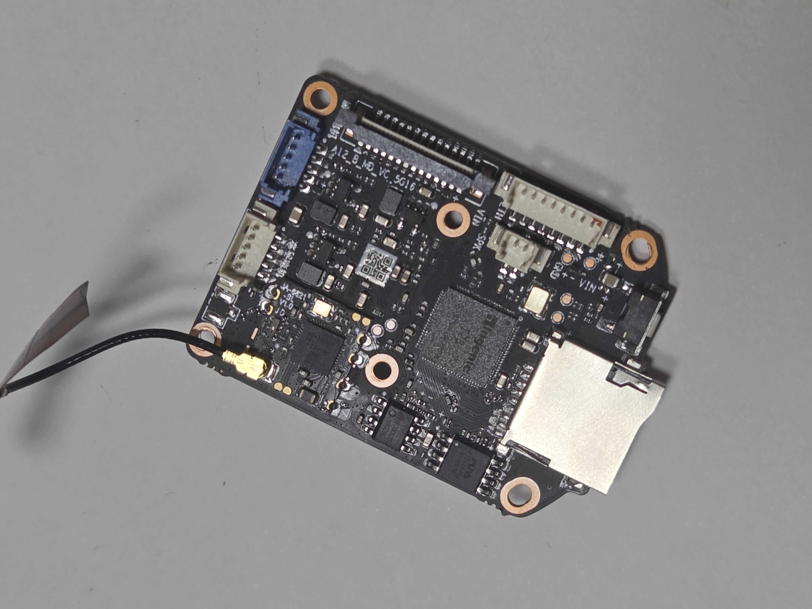
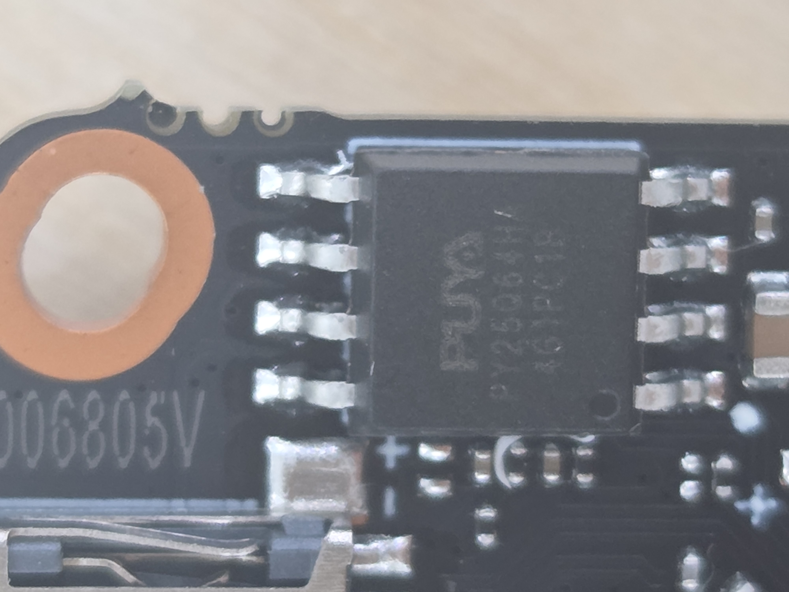
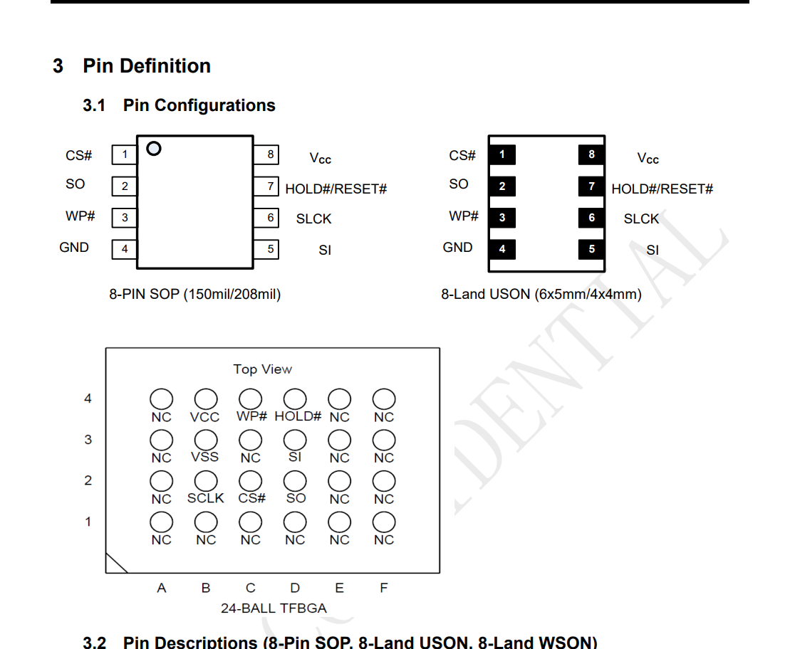
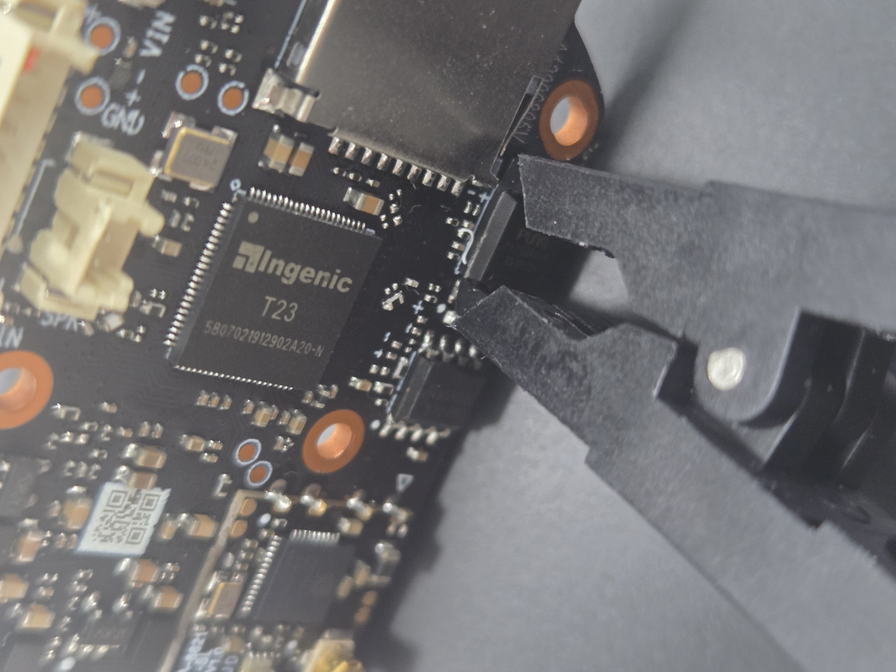

# 펌웨어 추출
프로젝트를 시작하기 위해서 Jooan 홈 카메라에서 2가지 도구를 사용하는 방식으로 펌웨어 추출을 하였습니다. 
1장에서는 사용한 기기 및 도구 설명을, 2장에서는 펌웨어를 추출하는 과정을 정리하였습니다.  
3장에서는 이 자료를 보며 실험하실 분들을 위하여 2가지 방식으로 실험한 후 미리 알았으면 좋았을 것 같은 내용과 권고 사항에 대하여 정리했습니다.

## 1. 사용한 기기 및 도구들 설명

전체 사진 
&nbsp;&nbsp;&nbsp;&nbsp;&nbsp;&nbsp;&nbsp;&nbsp;&nbsp;&nbsp;&nbsp;&nbsp;&nbsp;&nbsp;&nbsp;&nbsp;&nbsp;&nbsp;&nbsp;&nbsp;&nbsp;[홈캠](#jooan) 
[ 칩 클램퍼, ](#5)[ 테스트 니들, ](#3)[ USB 로직 애널라이저 ](#4)
 

  

프로젝트 대상인 Jooan 홈캠  
[홈캠 설명으로 이동](../../대상%20시스템%20및%20분석%20환경/대상%20시스템%20및%20분석%20환경/README.md)
 

  

- 상단 케이블
    - 듀퐁 점퍼 케이블
    - 기판, 센서, 개발보드, 측정 장비 등의 핀 사이를 임시로 연결할 때 사용
- 하단 노란 상자
    - 테스트 니들 / 니들 프로브 세트
    - 일반 커넥터나 케이블을 연결하기 어려운 작은 패드, 핀, 테스트 포인트의 신호나 전압을 측정하거나 외부 장비와 연결할 때 사용
 

  

- 좌측 검은색 장치
    - USB 로직 애널라이저
    - 여러 신호선의 전압 상태 변화를 시간에 따라 측정하여 디지털 통신이나 회로 동작을 분석할 때 사용
- 가운데 검은 케이블
    - USB 케이블
    - 장치에 전원을 공급하거나 장치와 컴퓨터 사이에서 데이터를 전달할 때 사용
- 우측 케이블
    - 듀퐁 점퍼 케이블
    - 위와 동일
  
  
  

- 상단 집게
    - 칩 클램퍼
    - 호환되는 패키지의 IC를 기판에서 분리하지 않고 외부 장비와 연결할 때 사용
- 좌측 USB 기판
    - CH341B USB 프로그래머
    - 지원되는 SPI/I2C 계열 메모리 등의 데이터를 읽거나 기록할 때 사용
- 가운데 상단 금속 핀들
    - 핀 헤더
    - 기판과 다른 기판, 케이블 또는 측정 장비를 전기적으로 연결할 때 사용
- 가운데 하단 초록 기판
    - SOP-DIP 변환용 어댑터 PCB
    - 표면실장 IC를 테스트, 개발 장비에 연결하기 쉽게 변환할 때 사용
- 우측 파란 기판
    - SOP→DIP 변환 어댑터
    - 서로 다른 IC 패키지 형식을 변환하여 프로그래머나 테스트 장비에 연결할 때 사용
   
  
## 2. 펌웨어 추출 과정
### 2.1 펌웨어 추출 전 공통 수행 과정

CH341B 프로그래머
 

SPI 통신과 I2C 통신을 위한 부분이 나누어져있습니다.
 

실험에서 사용하는 홈캠은 SPI 통신을 사용한다는 것을 데이터시트를 통해 확인할 수 있었습니다.  
해당 부분에 SOP→DIP 변환 어댑터를 끼웁니다.
 

홈캠을 분해합니다.
 

분해 후에 PCB를 확보합니다.
 

PCB 위의 플래시메모리 확대샷입니다.    
PCB에서 플래시메모리 찾는 방법
- 각인이 있을 경우
    - 각인된 내용을 보고 검색해서 플래시메모리인지 아닌지 확인하면 됩니다.
- 각인이 없을 경우
    - 메인 칩(MCU/CPU) 주변의 회로 패턴(배선) 구조와 핀 수가 적은 IC 칩의 주변 부품 배치를 분석합니다.
 

각인된 내용을 검색해서 데이터시트를 확보하고 핀 구성을 확인합니다.
 

### 2.2 칩 클램퍼로 플래시메모리와 컴퓨터 연결

 
 
 
 
 

### 2.3 테스트 니들로 플래시메모리와 컴퓨터 연결
 
 
 
 
 

### 2.4 펌웨어 추출
 
 
 
 
 

## 3. 종합 및 권고
