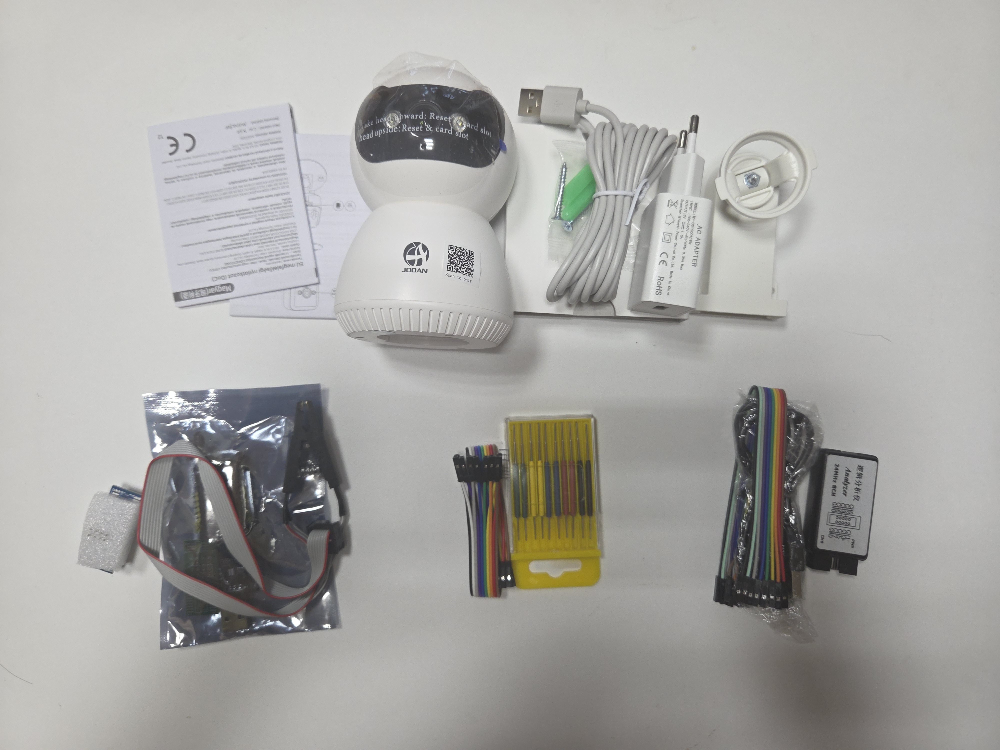
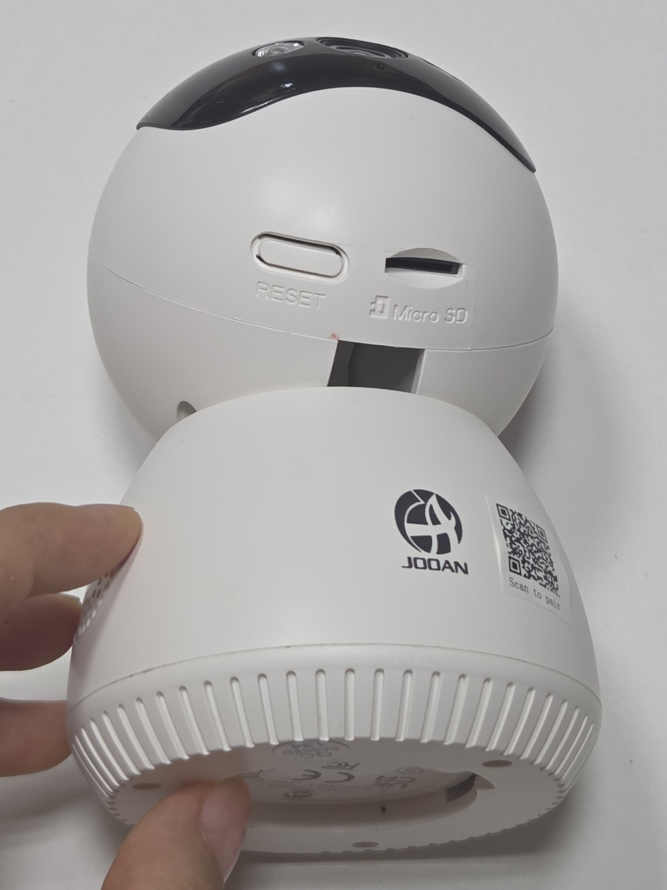
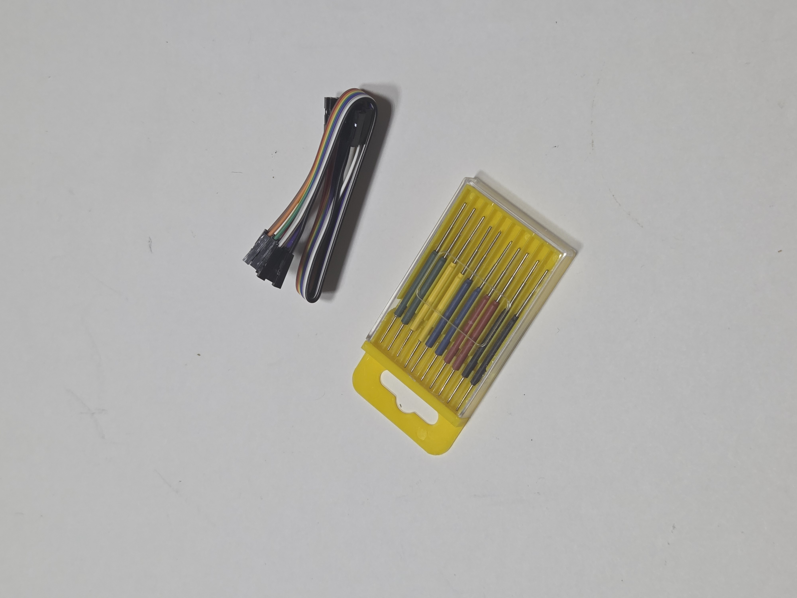
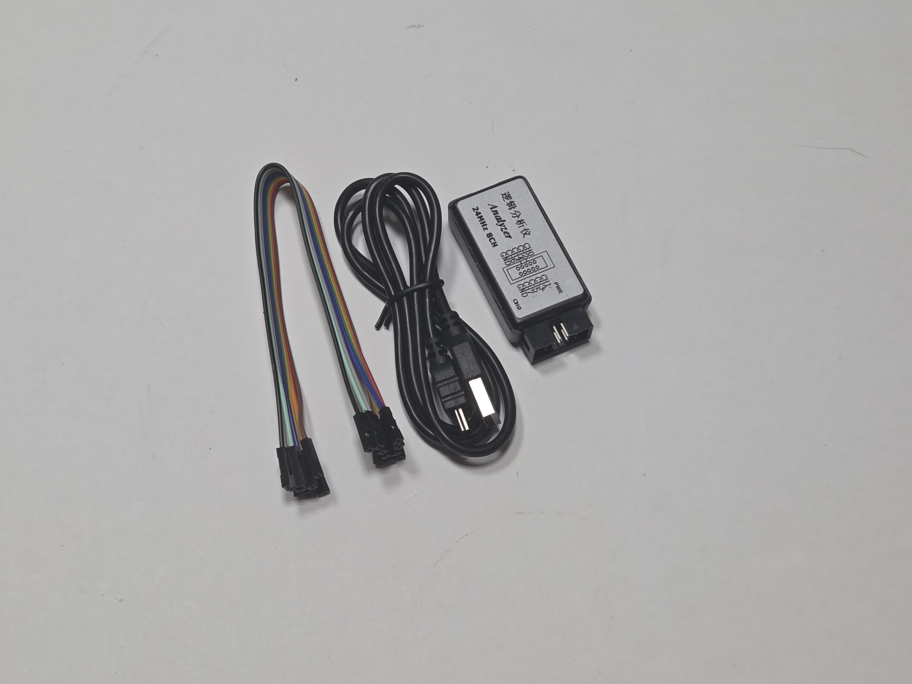
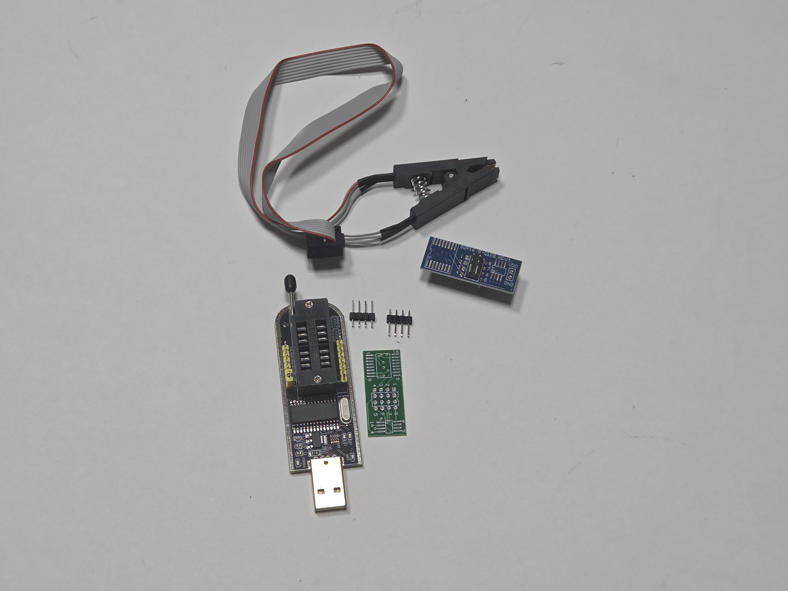

# 펌웨어 추출
프로젝트를 시작하기 위해서 Jooan 홈 카메라에서 펌웨어 추출을 하였습니다.
해당 과정은 총 2가지 도구를 사용해서 진행하였으며, 2장에서는 칩 클램퍼를 이용해 추출한 과정을, 3장에서는 테스트 니들을 이용해서 추출하는 과정을 정리했습니다.

## 1. 사용한 기기 및 도구들 설명

전체 사진 
&nbsp;&nbsp;&nbsp;&nbsp;&nbsp;&nbsp;&nbsp;&nbsp;&nbsp;&nbsp;&nbsp;&nbsp;&nbsp;&nbsp;&nbsp;&nbsp;&nbsp;&nbsp;&nbsp;&nbsp;&nbsp;[홈캠](#jooan) 
[ 칩 클램퍼, ](#5)[ 테스트 니들, ](#3)[ USB 로직 애널라이저 ](#4)
 

  

프로젝트 대상인 Jooan 홈캠  
[홈캠 설명으로 이동](../../대상%20시스템%20및%20분석%20환경/대상%20시스템%20및%20분석%20환경/README.md)
 

  

- 상단 케이블
    - 듀퐁 점퍼 케이블
    - 기판, 센서, 개발보드, 측정 장비 등의 핀 사이를 임시로 연결할 때 사용
- 하단 노란 상자
    - 테스트 니들 / 니들 프로브 세트
    - 일반 커넥터나 케이블을 연결하기 어려운 작은 패드, 핀, 테스트 포인트의 신호나 전압을 측정하거나 외부 장비와 연결할 때 사용
 

  

- 좌측 검은색 장치
    - USB 로직 애널라이저
    - 여러 신호선의 전압 상태 변화를 시간에 따라 측정하여 디지털 통신이나 회로 동작을 분석할 때 사용
- 가운데 검은 케이블
    - USB 케이블
    - 장치에 전원을 공급하거나 장치와 컴퓨터 사이에서 데이터를 전달할 때 사용
- 우측 케이블
    - 듀퐁 점퍼 케이블
    - 위와 동일
  
  
  

- 상단 집게
    - 칩 클램퍼
    - 호환되는 패키지의 IC를 기판에서 분리하지 않고 외부 장비와 연결할 때 사용
- 좌측 USB 기판
    - CH341B USB 프로그래머
    - 지원되는 SPI/I2C 계열 메모리 등의 데이터를 읽거나 기록할 때 사용
- 가운데 상단 금속 핀들
    - 핀 헤더
    - 기판과 다른 기판, 케이블 또는 측정 장비를 전기적으로 연결할 때 사용
- 가운데 하단 초록 기판
    - SOP-DIP 변환용 어댑터 PCB
    - 표면실장 IC를 테스트, 개발 장비에 연결하기 쉽게 변환할 때 사용
- 우측 파란 기판
    - SOP→DIP 변환 어댑터
    - 서로 다른 IC 패키지 형식을 변환하여 프로그래머나 테스트 장비에 연결할 때 사용
   
 
## 2. 칩 클램퍼를 이용하여 펌웨어 추출
## 3. 테스트 니들을 이용하여 펌웨어 추출
## 4. 종합 및 권고
